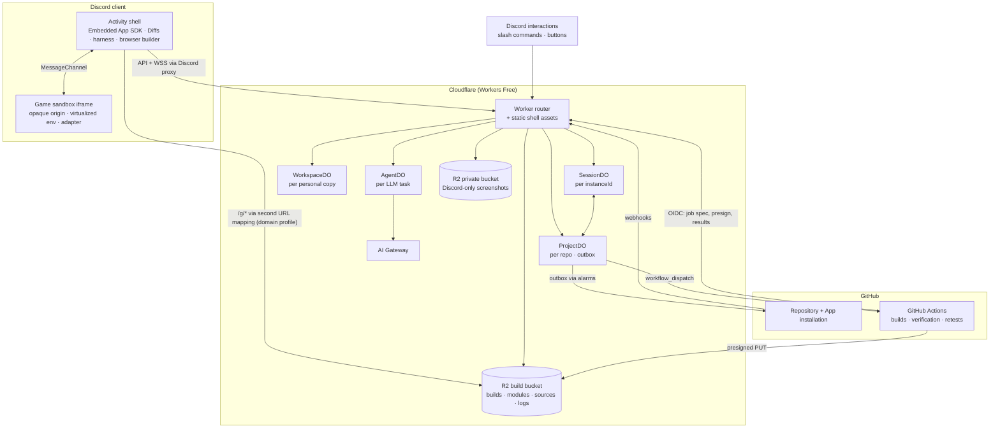
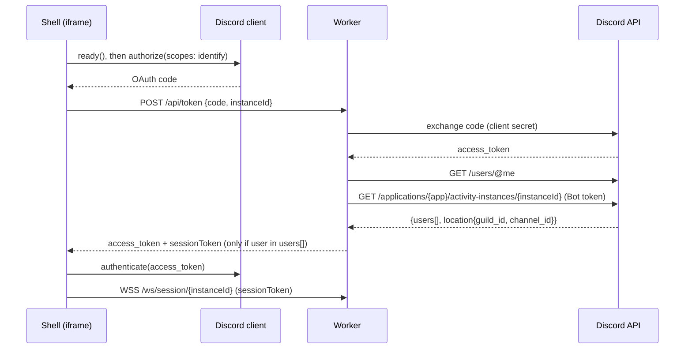
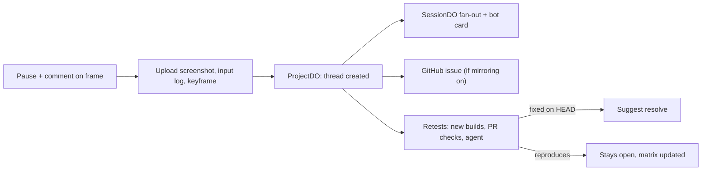
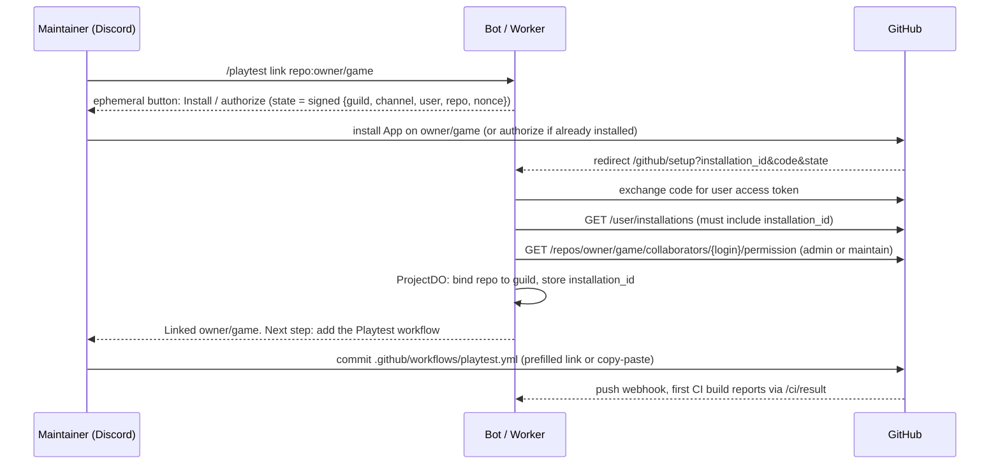
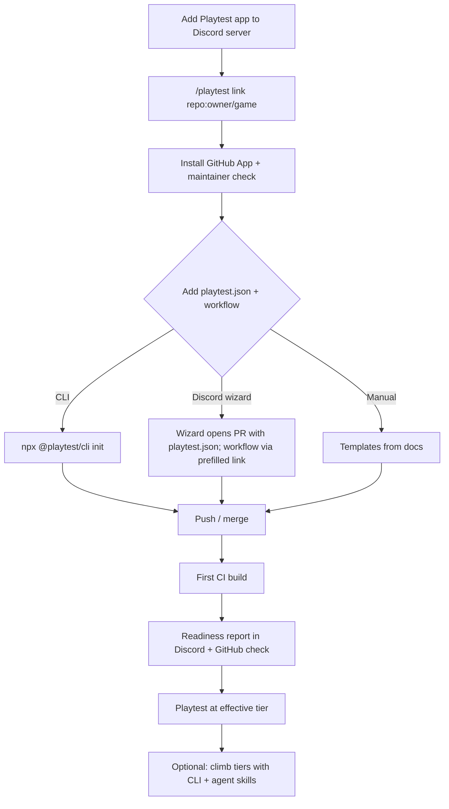

# Playtest: a TestFlight for collective game development on Discord

> **Design document** · Draft v0.5 (Free-plan edition) · 2 November 2026
> "Playtest" is a working name.

> **Platform constraint.** Sections 0–20 use only features available on Cloudflare's **Workers Free** plan. Everything that requires a paid plan, or only works at a useful scale on one, is collected in [§21 Paid-plan upgrades](#21-paid-plan-upgrades). Heavy compute that the Free plan can't host runs in two places:
> - the project's own GitHub Actions, which are free for public repositories on standard runners;
> - the players' browsers.

## Contents

0. [Summary](#0-summary)
1. [Goals, non-goals, requirements](#1-goals-non-goals-requirements)
2. [Glossary](#2-glossary)
3. [Decision summary](#3-decision-summary)
4. [Architecture](#4-architecture) (incl. [4.3 Deployment profiles](#43-deployment-profiles-hostnames-and-routes) and [4.4 Free-plan constraints and budget](#44-free-plan-constraints-and-budget))
5. [Discord integration](#5-discord-integration)
6. [Game runtime and debug API](#6-game-runtime-and-debug-api)
7. [Builds and serving](#7-builds-and-serving)
8. [Workspaces (personal copies)](#8-workspaces-personal-copies)
9. [Feedback model](#9-feedback-model)
10. [Sessions and realtime](#10-sessions-and-realtime)
11. [GitHub integration](#11-github-integration)
12. [LLM integration](#12-llm-integration)
13. [Data model and storage](#13-data-model-and-storage)
14. [Security and privacy](#14-security-and-privacy)
15. [Headless replay infrastructure](#15-headless-replay-infrastructure)
16. [Alternatives considered](#16-alternatives-considered)
17. [Risks and open questions](#17-risks-and-open-questions)
18. [Validation spike](#18-validation-spike)
19. [Phased delivery plan](#19-phased-delivery-plan)
20. [Author onboarding and agent skills](#20-author-onboarding-and-agent-skills)
21. [Paid-plan upgrades](#21-paid-plan-upgrades)
22. [References](#22-references)
- [Appendix A: TypeScript types](#appendix-a-typescript-types)
- [Appendix B: Message templates](#appendix-b-message-templates)

---

## 0. Summary

Playtest is a Discord Activity. Everyone in a channel can:

- play builds of a JS/TS game from a public GitHub repository;
- leave feedback anchored to an exact frame of gameplay or to exact lines of code;
- edit their own copy of the game, optionally with an LLM, and propose the changes upstream as a pull request.

Core ideas:

1. **A frame is an address, not a screenshot.** A `FrameRef` is the tuple (build, seed, input log, frame number). Anyone can reopen that exact frame, and any later build can be retested against it.
2. **The harness owns play, pause, step and rewind.** Games reach the debug API through one of four conformance tiers. The lowest tier works with any framework unmodified, via environment virtualization. The highest tier is a pure deterministic `tick`, which unlocks the full feature set, including headless replay.
3. **Everyone plays their own copy; feedback is shared.** There is no lockstep netcode between players.
4. **Cloudflare Workers Free plan only.** The backend is:
   - one Worker, which also serves the shell as free static assets;
   - four SQLite-backed Durable Object classes;
   - R2 for builds and state. Game files are served by the Worker on a free `workers.dev` hostname (no-domain profile). Once a domain is added, they're served straight from the bucket via a custom domain (domain profile, §4.3).

   Heavy compute never runs on Cloudflare:
   - **The project's GitHub Actions** (free for public repositories) do builds, determinism verification, authoritative replays and PR checks.
   - **Players' browsers** do interactive builds, replays and LLM tool execution.
5. **A GitHub App installed by maintainers is the only writer to GitHub.** It creates playtest branches and PRs, mirrors feedback as issues and review comments, triggers CI jobs, and publishes PR checks that replay open feedback against the new code.
6. **LLM edits happen in stacked overlays ("worktrees").** Each change is validated by replaying the motivating feedback in the requester's browser, then again in CI before it can become a PR.
7. **Paid upgrades are additive.** The upgrades in §21 (server-side builds, isolate replays, browser pools) are extra implementations of the same `Builder` and `ReplayRunner` interfaces, not a different architecture.

---

## 1. Goals, non-goals, requirements

### 1.1 Goals

| # | Goal |
|---|---|
| G1 | Signed-in participants of a Discord activity instance can play any build of a linked project: upstream commits, their own workspace, or someone else's workspace. |
| G2 | A uniform debug API (play, pause, step, rewind, seek) across games and frameworks, implemented by the platform rather than by each game. |
| G3 | Frame feedback that is reproducible: anyone can reopen the exact frame, and later builds can be retested against it. |
| G4 | Code feedback rendered with `@pierre/diffs`: line comments, suggestions, accept/reject. |
| G5 | Personal copies that can be edited in the activity and proposed upstream. |
| G6 | Two-way sync with public GitHub repositories for code and feedback. |
| G7 | Optional LLM assistance that works on isolated worktrees and validates its changes by replay. |
| G8 | Works on Discord desktop, web, Android and iOS. Cross-device reproducibility is best-effort and explicitly reported. |
| G9 | Runs entirely on Cloudflare's Workers Free plan; paid features are optional upgrades (§21). |

### 1.2 Non-goals (v1)

- Private repositories.
- Non-JS engines such as Unity or Godot web exports, beyond the Tier 0 fallback in §6.4.
- Networked multiplayer inside games, and shared lockstep "watch party" sessions. These are deferred; see §16.6.
- Hosting games for end players, or monetization.
- Write-back to git hosts other than GitHub.

### 1.3 Requirements traceability

| Requirement from the brief | Addressed in |
|---|---|
| Runtime: Cloudflare Workers / Durable Objects | §4, §10, §13 |
| Discord multiplayer Activity with Discord-visible endpoints | §5 |
| JS/TS games with a common debug API (play, pause, step, rewind) | §6, §7 |
| Apps and feedback synchronize with public git repos | §7, §11 |
| In-context feedback on code (Diffs) and on game frames (debug interface) | §9 |
| Direct changes to personal copies | §8 |
| Optional LLM, worktree-based, optional sync-back | §12 |
| Compatibility with common frameworks (Phaser, three.js, etc.) | §6.11 |
| Cloudflare Free plan only; paid features isolated | §4.4, §21 |
| Game authors onboard and adapt their games (CLI, wizard, agent skills) | §20 |

---

## 2. Glossary

| Term | Meaning |
|---|---|
| **Activity instance** | One running session of the Activity in a Discord channel, identified by `instanceId`. It ends for good when everyone leaves. |
| **Project** | A GitHub repository linked to one or more Discord servers through the GitHub App. |
| **Build** | Immutable bundled output of a source tree plus toolchain version, identified by `buildHash`. |
| **Workspace** | A user's personal copy of a project: a *base* commit plus an *overlay* of changed files. |
| **Overlay** | A map from file path to new content or a deletion, layered over a base. Overlays can stack. |
| **Revision** | An immutable snapshot of a workspace overlay (autosave or explicit save). |
| **Worktree** | An overlay stacked on a workspace revision, used by the LLM agent so it never edits the user's copy directly. |
| **Run** | One play session of one build: a seed plus an input log. Runs branch when you rewind and play differently. |
| **Input log** | Compact per-tick record of quantized inputs (§6.8). |
| **FrameRef** | `{buildHash, seed, inputLogHash, frame, tier, engineFamily}`: the address of a frame. |
| **Keyframe** | A saved simulation state used for fast seeking (Tiers 2 and 3). |
| **Checkpoint** | A state hash recorded every *K* ticks, used to detect replay divergence. |
| **Thread** | A unit of feedback with one or more anchors, comments, an optional expectation, and retest results. |
| **Anchor** | What a thread points at: a code range, a frame, or both. |
| **Expectation** | An optional machine-checkable predicate over game state that makes retests meaningful. |
| **Retest** | Replaying a thread's run against another build and classifying the outcome. |
| **Tier** | The game's conformance level (0–3) with the harness (§6.4). |
| **Shell** | The trusted Activity UI. It holds the Discord session, the Diffs editor and the harness controller. |
| **Sandbox** | The untrusted, opaque-origin iframe that runs game code. |
| **Adapter** | Framework-specific glue (Phaser, three.js, PixiJS, Babylon) loaded into the sandbox. |
| **CI builder** | The reusable GitHub Actions workflow in the project's repository. It produces canonical builds, verifies determinism and runs authoritative retests. |
| **Browser builder** | The shell's in-browser transformer for interactive workspace edits. Its outputs are labelled *client-built*. |
| **Build bucket** | The R2 bucket `pt-builds`, holding immutable, content-addressed game files served at `/g/`. A custom domain serves it in the domain profile, and the Worker serves it otherwise (§4.3). |
| **Deployment profile** | *No-domain* (everything on `workers.dev`) or *domain* (the build bucket on a custom domain) (§4.3). |
| **Bundled mode** | CI output with one JS bundle per build, a shared runtime and assets shared across builds, minimizing files per load (§7.6). |
| **Outbox** | The ProjectDO table of pending GitHub writes, drained by Durable Object alarms. |
| **Readiness report** | The result of `playtest check` or a CI build: effective tier, determinism status, findings (PT codes) and next steps (§20.5). |
| **Agent skill** | A folder with a `SKILL.md` and resources that teaches coding agents the Playtest contract (§20.8). |

---

## 3. Decision summary

| # | Decision | Choice (Free plan) | Main alternatives | § |
|---|---|---|---|---|
| D1 | Who implements play/pause/step/rewind | Harness, through conformance tiers and environment virtualization | Each game implements the verbs; pure tick contract only | 6, 16.1 |
| D2 | Frame feedback representation | Replayable `FrameRef` plus screenshot | Screenshots/video only | 6, 9, 16.1 |
| D3 | Session model | Everyone plays their own copy, feedback shared live | Driver plus spectators in lockstep; real game netcode | 10, 16.6 |
| D4 | GitHub writer | GitHub App installed by maintainers | Per-user OAuth (fork + PR); patch export only | 11, 16.5 |
| D5 | Source/workspace storage | Overlays in Durable Objects plus content-addressed R2; Git Data API for write-back | Cloudflare Artifacts (paid, §21); isomorphic-git on R2 | 8, 16.4 |
| D6 | Code UI | `@pierre/diffs` (view, edit mode, annotations) plus `@pierre/trees` | CodeMirror 6; Monaco | 8, 9, 16.7 |
| D7 | Build location | The project's GitHub Actions for upstream, PR and verified builds; the author's browser for interactive workspace builds | Dynamic Worker builder or Containers (paid, §21) | 7, 16.8 |
| D8 | Headless replay | Players' browsers (advisory) plus the project's CI (authoritative) | Dynamic Workers, Browser Rendering at scale, Containers (paid, §21) | 15, 16.11 |
| D9 | Feedback source of truth | Platform database, mirrored to GitHub | GitHub issues as source of truth; in-repo files | 9, 11, 16.10 |
| D10 | LLM runtime | AgentDO tool loop; execution tools run in the requester's browser; final validation in CI | Isolate execution (paid, §21); container sandbox (paid) | 12, 16.12 |
| D11 | LLM keys | Per-server key encrypted in ProjectDO, sent through AI Gateway (free core features) | AI Gateway stored keys; platform-paid key | 12.6 |
| D12 | Cloudflare plan | **Workers Free only** | Workers Paid ($5/month minimum), §21 | 4.4, 21 |
| D13 | Serving build files | Two profiles: **no-domain** (the Worker serves bundled builds from R2 on `workers.dev`) and **domain** (R2 bucket on a custom domain via a second Discord URL mapping) | `r2.dev` (development only); GitHub Pages | 4.3, 7.6, 16.14 |
| D14 | Background work | ProjectDO outbox drained by Durable Object alarms | Cloudflare Queues (free: 10k ops/day, 24 h retention) | 11.9, 16.13 |
| D15 | CI authentication | GitHub Actions OIDC tokens verified by the Worker; presigned R2 URLs for uploads | Repository secrets holding Playtest credentials | 7.3, 14 |

---

## 4. Architecture

### 4.1 Component diagram



### 4.2 Responsibilities

| Component | Keyed by | Owns | Notes |
|---|---|---|---|
| **Worker** | n/a | Routing, auth, static shell, webhook and interaction verification, CI authentication, presigning CI uploads, batched client uploads; game files in the no-domain profile | Stateless; must stay within 10 ms CPU per request (§4.4) |
| **SessionDO** | Discord `instanceId` | Presence, live feed fan-out, nudges, run-sharing relay | Ephemeral; WebSocket Hibernation API |
| **ProjectDO** | `github:<owner>/<repo>` | Project config, guild bindings, threads, anchors, comments, retests, runs index, builds index, CI jobs, GitHub mirror map, outbox | Source of truth for feedback |
| **WorkspaceDO** | workspace ID | Overlay, revisions, live viewers | One per personal copy and per worktree |
| **AgentDO** | task ID | LLM conversation, tool loop, worktree reference, progress stream | Agents SDK on Durable Objects; execution tools are forwarded to the requester's browser |
| **R2 build bucket** (`pt-builds`) | content hash | CI builds, vendor chunks, browser-built modules, workspace and upstream sources, input logs, keyframes, screenshots of publicly mirrored threads | Domain profile: public via `builds.<domain>`, CDN-cached, no Worker requests. No-domain profile: served by the Worker. URLs are unguessable content hashes but not secret (§14.3) |
| **R2 private bucket** (`pt-private`) | content hash | Screenshots of Discord-only threads | Served through the Worker |
| **AI Gateway** | n/a | Proxy to LLM providers: caching, analytics, rate limiting | Free core features |
| **GitHub Actions** (the project's CI) | workflow run | Canonical builds, determinism verification, authoritative retests, PR checks, `tsc` | Free for public repositories on standard GitHub-hosted runners |
| **Players' browsers** | n/a | Interactive workspace builds, replays, advisory retests, LLM tool execution, three-way merges, code re-anchoring | Results are labelled with who produced them |

### 4.3 Deployment profiles, hostnames and routes

Playtest runs in one of two **deployment profiles**. They differ only in how game files reach the sandbox; the code is the same, and configuration selects the profile.

| | **No-domain profile** (default to start) | **Domain profile** |
|---|---|---|
| Requires | A Cloudflare account | A domain whose DNS is a zone in the same Cloudflare account (the Free zone plan is fine) |
| Hostnames | One: `playtest.<account>.workers.dev` | Worker on `workers.dev` or a custom hostname, plus `builds.<domain>` for the build bucket |
| Discord URL mappings | `ROOT` only | `ROOT`, plus `/g` → `builds.<domain>` |
| Game files (`/g/*`) | Served by the Worker from the build bucket; each file costs a Worker request | Served by the bucket's custom domain, CDN-cached; no Worker requests |
| CI build output | **Bundled mode** (§7.6): one JS bundle per build, shared runtime, assets shared across builds | Bundled or per-module mode |
| Public screenshots for mirrored GitHub issues | Worker route `/s/<sha256>.png` | `builds.<domain>/shot/<sha256>.png` |
| Rough capacity (§4.4.3) | ~2,000–3,500 play sessions/day | ~4,000 play sessions/day |
| Best for | Development, small communities, first launch | Public launch, busy servers |

**Why only the build bucket needs a domain.** R2 can make a bucket public in only two ways:

- a custom domain, which must be a zone in the same account;
- the managed `r2.dev` URL, which is rate-limited, uncached and intended for development.

Everything else accepts a `workers.dev` URL: the Discord URL-mapping target, the interactions endpoint, GitHub webhooks and the CI endpoints.

**Switching from no-domain to domain** needs no data migration or client change:

1. **Buckets.** Two buckets exist from day one:
   - `pt-builds`, for game files: public access off in the no-domain profile, with the Worker serving it;
   - `pt-private`, for Discord-only screenshots.
2. **Domain setup.** Add the domain as a zone, attach `builds.<domain>` to `pt-builds` as a custom domain, and set its CORS policy (§7.6).
3. **Discord mapping.** Add the URL mapping `/g` → `builds.<domain>`. Clients keep requesting `/g/…`; the more specific mapping should take precedence over `ROOT` (to verify, Q16). The Worker's `/g/*` route stays as a fallback.
4. **Configuration.** Set `PROFILE=domain`, which changes public screenshot URLs and lets CI use per-module mode.
5. **Optional.** Move the Worker to `app.<domain>` for stable URLs. That means updating the Discord `ROOT` mapping, the interactions endpoint and the GitHub App URLs. It isn't required.

**Routes.** The table uses logical hosts:

- `app`: the Worker, reached through the Discord proxy;
- `pub`: the Worker, called directly by Discord and GitHub;
- `builds`: game files.

In the no-domain profile all three are the same `workers.dev` hostname, and `builds` paths are served by the Worker's `/g/*` route. Clients follow Discord's proxy path conventions (`/.proxy/...`); spike S11 verifies this. Every `/g/` response carries `Content-Type`, `Cache-Control: public, max-age=31536000, immutable` and `Access-Control-Allow-Origin: *`, which the opaque-origin sandbox needs. These come from the bucket's CORS policy or from the Worker, depending on the profile.

| Host | Path | Handler | Notes |
|---|---|---|---|
| app | `/`, `/assets/*` | Static shell (Workers static assets) | Free and unlimited |
| app | `POST /api/token` | OAuth code exchange plus instance membership check | §5.2 |
| app | `/api/*` | REST: projects, threads, workspaces, builds, runs | Session token required |
| app | `POST /api/upload` | Batched upload of content-addressed files (≤ 40 files, ≤ 4 MB per request) into the build bucket | Browser builder, screenshots, logs |
| app | `GET /api/private/shot/:sha256` | Discord-only screenshots from the private bucket | Session token required |
| app | `/ws/session/:instanceId` | SessionDO | WebSocket |
| app | `/ws/workspace/:id` | WorkspaceDO | Live edits (optional) |
| app | `/ws/agent/:taskId` | AgentDO | Progress and forwarded tool calls |
| app | `GET /g/*` | Worker reads `pt-builds` | No-domain profile (fallback in the domain profile); no authentication, content-addressed URLs |
| builds | `/b/<buildHash>/…` | CI builds | Immutable |
| builds | `/r/<runtimeVersion>/runtime.js` | Harness runtime and adapters, shared by all builds | Immutable |
| builds | `/a/<sha256>.<ext>` | Assets, shared across builds (bundled mode) | Content-addressed |
| builds | `/v/<lockfileHash>/…` | Vendor chunks (per-module mode only) | Immutable |
| builds | `/m/<sha256>.js` | Browser-built workspace modules | Content-addressed |
| builds | `/ws/<sha256>`, `/src/<gitBlobSha>` | Workspace and upstream source files | Content-addressed |
| builds | `/run/<sha256>.ptil`, `/snap/<sha256>.bin` | Input logs, keyframes | Content-addressed |
| builds | `/shot/<sha256>.png` | Screenshots of publicly mirrored threads | Deleted with the thread |
| pub | `/s/:sha256.png` | Public screenshots for GitHub issues (no-domain profile) | GitHub's image proxy caches them |
| pub | `/discord/interactions` | Slash commands and components | Ed25519 signature check |
| pub | `/github/webhook`, `/github/setup`, `/github/callback` | GitHub App | §11 |
| pub | `GET /ci/job/:id` | Job spec for a CI run (what to build or retest) | OIDC-authenticated (§7.3) |
| pub | `POST /ci/presign` | Presigned `PUT`/`GET` URLs scoped to the job's prefixes | OIDC-authenticated; R2's S3 endpoint needs no custom domain |
| pub | `POST /ci/result` | Build, verification and retest results | OIDC-authenticated |

### 4.4 Free-plan constraints and budget

#### 4.4.1 Limits the design relies on

| Product | Workers Free allowance | How the design uses it |
|---|---|---|
| Workers | 100,000 requests/day (Error 1027 beyond, until 00:00 UTC); **10 ms CPU per request**; 50 external subrequests and 1,000 subrequests to Cloudflare services per invocation; static asset requests free and unlimited | Routing and verification only; shell as static assets; game files bypass the Worker |
| Durable Objects (SQLite backend only) | 100,000 requests/day, including inbound WebSocket messages; 13,000 GB-s/day duration; 5 M rows read and 100 k rows written per day; 5 GB total storage | Hibernating WebSockets; change-only presence; batched writes |
| R2 | 10 GB-month storage; 1 M Class A and 10 M Class B operations per month | Content-addressed build bucket; GC of unreferenced objects. In the no-domain profile, Class B reads are bounded by Worker requests (≤ ~3 M/month) |
| AI Gateway | Core features free; 10 gateways per account; capped log storage | One gateway; per-server caps enforced in ProjectDO |
| Cron Triggers | 5 per account | One daily GC sweep |
| Queues *(not used by default)* | 10,000 operations/day; 24 h retention | Alternative to the outbox (§16.13) |
| Browser Rendering *(not used by default)* | 10 minutes/day; 3 concurrent browsers | Too small to rely on; see §21 |

On the Free plan, exceeding a limit makes further operations fail until 00:00 UTC rather than billing. Two points need confirming (spike S13–S14):

- **Durable Object CPU.** The DO limits page lists 30 s per request, but also says DOs share Workers' per-invocation CPU limits. The design therefore assumes **10 ms**.
- **WebSocket accounting.** It's unclear whether the 20:1 inbound-WebSocket billing ratio also applies to the free daily request quota. The design assumes it **doesn't**.

#### 4.4.2 Design rules

1. **No heavy CPU on Cloudflare.** No archive unpacking, bundling, large diffs, merges or replays in the Worker or in Durable Objects. These run in CI or in browsers.
2. **Keep game-file traffic off the Worker:**
   - **Domain profile:** game files never pass through the Worker; the bucket's custom domain serves `/g/*`.
   - **No-domain profile:** CI emits bundled builds (a handful of files per load). Every file is immutable and content-addressed, so returning players load from their browser cache. Assets are shared across builds, so a new build only costs its changed files.
3. **WebSockets stay quiet:**
   - only the Hibernation API is used;
   - presence is sent on change and at most once every 5 s;
   - there is never per-tick traffic;
   - run sharing is batched every 15 s.
4. **Writes are batched:**
   - workspace revisions are persisted on run, after 60 s idle, or on explicit save (drafts stay in the shell);
   - the GitHub outbox drains up to 40 calls per alarm.
5. **Everything is content-addressed.** Uploads skip objects that already exist, and unchanged modules keep their URLs.
6. **Degrade gracefully.** Each subsystem has a "quota reached" state:
   - Live presence and feeds pause.
   - Playing, rewinding and drafting feedback keep working locally, and queued actions retry after the reset.
   - Usage is watched in Workers analytics, with alerts at 70% of any daily allowance.
7. **Budgets per server.** Daily caps on CI jobs, LLM tasks and uploads protect the shared account from one busy server.

#### 4.4.3 Capacity estimates

These are rough planning numbers, based on the assumptions in the "Cost driver" column; spike S13 replaces them with measurements.

| Resource | Cost driver | Rough daily capacity |
|---|---|---|
| Worker requests (100k/day), domain profile | ~25 per play session: token, API calls, uploads, WebSocket upgrades | ~4,000 play sessions |
| Worker requests (100k/day), no-domain profile | The same ~25 plus game files: ~3 for a returning player (assets cached), ~3 + number of assets on a cold device | ~3,500 sessions if most players return; ~2,000 if every load is cold with ~20 assets |
| DO requests (100k/day) | 1 per WebSocket connect, plus ~30 inbound messages per active player-hour (change-only presence), plus feedback actions | ~2,500–3,000 player-hours (more if the 20:1 ratio applies) |
| DO rows written (100k/day) | ~3 rows per persisted revision; ~20 revisions per editing hour; threads and comments | ~1,500 editor-hours |
| R2 Class A (≈33k/day averaged) | ~5–30 objects per workspace revision; ~50–300 per CI build | ~1,000 revisions plus ~50 CI builds |
| R2 storage (10 GB) | Builds dominate; unreferenced objects are collected after 14 days | Dozens of active projects |

---

## 5. Discord integration

### 5.1 Activity shell and proxy constraints

- **URL mappings:**
  - `ROOT` points at the Worker (`workers.dev`, or `app.<domain>`), and every request uses a relative path.
  - In the domain profile, a second mapping `/g` points at `builds.<domain>` (the build bucket), so game files don't consume Worker requests (§4.3).

  `patchUrlMappings` is not needed if no third-party code calls external hosts.
- **Constraints, from Discord's docs and developer reports:**
  - All traffic goes through Discord's proxy, which runs on Cloudflare Workers.
  - The Content Security Policy (CSP) only allows requests to the app's own proxy origin.
  - WebRTC and WebTransport are not supported; WebSockets work.
  - Developers report that `eval()` and scripts loaded from `blob:` URLs are refused.
- **Consequences:**
  - Vendor every dependency into the bundle, including fonts.
  - Don't use workers created from blob URLs; load workers from proxied URLs instead.
  - The client never turns compiled code into a blob URL; edited modules are uploaded and served by URL (§7.4).
  - Libraries that generate code with `new Function` need CSP-safe modes (PixiJS, §6.11).

### 5.2 Authentication and instance membership



**Session token.** An HMAC-signed object `{userId, instanceId, guildId, channelId, exp}` with a 15-minute TTL, refreshed over the WebSocket. Every REST and WebSocket call needs it.

**Membership re-checks.** SessionDO re-checks membership through the Get Activity Instance API:

- when a user joins;
- when a client reports a participant change. Re-checks are debounced because this API is rate-limited.

**Optional hardening.** Validate Discord's signed proxy headers (`X-Signature-Ed25519`, `X-Signature-Timestamp`, `X-Discord-Proxy-Payload`) on API requests.

**Trust rule.** Identity, participants and channel always come from server-side checks, never from client claims.

**Scopes.** Start with `identify` only. Guild nicknames and avatars, if wanted, need `guilds.members.read`, with the results relayed through the server as Discord recommends.

### 5.3 Slash commands (Discord-visible endpoints)

The interactions endpoint is `pub.<domain>/discord/interactions`.

| Command | Who | Effect |
|---|---|---|
| Activity Entry Point command | anyone | Launches the Activity in the channel |
| `/playtest link repo:<owner/name>` | Manage Server permission, and must be a repo maintainer (§11.2) | Binds the repo to this server and starts App installation if needed |
| `/playtest unlink repo:` | Manage Server | Removes the binding; the project becomes read-only here |
| `/playtest feed channel:` | Manage Server | Sets the channel where the bot posts feedback |
| `/playtest settings` | Manage Server | Public mirroring on/off, AI on/off and key, retest budget |
| `/playtest thread id:` | anyone | Posts a thread card with a deep link |

### 5.4 Deep links

The Activity accepts a `custom_id` when launched from a link. Playtest uses short, typed IDs:

- `t.<threadId>` opens a thread and seeks to its frame;
- `r.<runId>.<frame>` opens a run at a frame;
- `w.<workspaceId>` opens a workspace.

Links are generated by `shareLink` inside the Activity, or by the Custom Links API from the bot. The `custom_id` is untrusted input: parse strictly, authorize access, and keep it short. The length limit still needs confirming (§17.2).

### 5.5 Bot feed messages

The bot posts a card when:

- a thread is created or resolved;
- a retest changes a thread's outcome;
- a PR check finishes.

Each card has a title, author, build, tier badge and screenshot thumbnail, plus these buttons:

- **Open in Activity** (deep link);
- **View on GitHub** (if mirrored);
- **Retest on latest**, which sends an interaction that dispatches a CI retest job, or queues a client retest if the project's CI isn't set up.

### 5.6 Mobile and layout

- **Portrait layout:** the game on top, with threads and the editor in a bottom sheet.
- **Landscape lock:** for landscape games, via `setOrientationLockState`.
- **Touch controls:** generated automatically from the manifest's button and axis schema (§6.8), so every game is playable on phones.

### 5.7 Instance lifecycle

When all users leave, the instance ends and the next launch gets a new `instanceId`. SessionDO therefore holds no durable data; everything persistent lives in ProjectDO and WorkspaceDO, keyed by project rather than by instance.

---

## 6. Game runtime and debug API

### 6.1 Execution model

Two trust domains live inside the Activity iframe:

- **Shell (trusted).** Holds the Discord access token and session token, the Diffs editor, and the *harness controller*. The controller decides when ticks happen, records input, stores keyframes and talks to the backend.
- **Sandbox (untrusted).** A nested `<iframe sandbox="allow-scripts">` with no `allow-same-origin`, which gives it an opaque origin. It loads either `/g/b/<buildHash>/index.html` (CI builds) or a workspace entry under `/g/m/` (browser builds), both under `/g/` (§4.3). The page contains the *harness runtime*, an optional *adapter*, and the game.

The shell and the sandbox talk only through a `MessageChannel` (§6.13).

Properties of the sandbox:

- **Isolation from the shell.** It cannot read the shell's DOM, cookies, tokens or the Discord SDK.
- **CORS on every artifact.** Module scripts loaded from an opaque origin are CORS requests, so every `/g/` response carries `Access-Control-Allow-Origin: *`, from the bucket's CORS policy or from the Worker depending on the profile.
- **No real input.** The shell covers the sandbox with a transparent capture layer (`pointer-events: none` on the iframe), so the sandbox never receives real input. All input flows through the harness, which also removes focus problems with nested iframes.
- **Pointer lock is requested by the shell.** When game code calls `requestPointerLock()`, a shim forwards the request; the shell locks the pointer on its own overlay and forwards movement as axes. The sandbox therefore doesn't need `allow-pointer-lock`, but Discord's own iframe must allow pointer lock (spike item S4).
- **Bootstrap order.** `runtime.js` is a classic script that installs all virtualization shims first and then calls `import('./game.js')`, so no game code runs before the shims are in place.

### 6.2 Environment virtualization

The harness runtime replaces or wraps these browser APIs inside the sandbox:

| API | Virtualized behaviour | Why |
|---|---|---|
| `requestAnimationFrame` / `cancelAnimationFrame` | Callbacks are queued; the harness flushes them once per tick with the virtual timestamp | Puts the harness in control of the loop in every framework |
| `setTimeout` / `setInterval` / `clearTimeout` | Scheduled against virtual time; due timers fire in (due time, insertion order) before the rAF flush | Deterministic timer order; pause really pauses |
| `performance.now`, `Date`, `Date.now`, `new Date()` | Return virtual time. Wall-clock date is fixed per run, at the run's start time | Frameworks derive delta time from these |
| `Math.random` | Seeded PRNG with two streams: **sim** and **cosmetic** (§6.9.1) | Reproducibility; render-side randomness can't desync the simulation |
| `crypto.getRandomValues`, `crypto.randomUUID` | Draw from the sim stream | Some libraries generate IDs this way |
| `document.hidden`, `visibilitychange`, `focus`, `blur`, `pagehide` | Always visible and focused; real events are swallowed | Phaser and others pause or reset delta on blur |
| `localStorage`, `sessionStorage`, `indexedDB` | In-memory implementations whose contents are part of the run's initial state | Opaque origins throw on real storage; saves must be reproducible |
| `fetch`, `XMLHttpRequest`, `Image.src`, `Audio.src`, `FontFace.load` | Allowed only for the build's own assets; completions are delivered in request order, and virtual time freezes while any load is pending | Loading barrier, §6.9.4 |
| `AudioContext.currentTime`, media `ended` events | Allowed; flagged as a non-determinism source if game logic subscribes to them | Audio timing is real time |
| `KeyboardEvent`, `PointerEvent`, `WheelEvent`, `GamepadEvent` | Real events never arrive; synthetic events are dispatched at tick boundaries from the input log | §6.8 |
| `ResizeObserver`, `window.innerWidth/innerHeight`, `devicePixelRatio` | Fixed to the manifest's viewport during a run; visual scaling happens in the shell with CSS | Layout code can't affect simulation |
| `Worker`, `SharedWorker`, `navigator.serviceWorker` | Blocked in Tiers 1–3 (allowed in Tier 0) | Asynchronous parallelism isn't replayable; blob workers are blocked by CSP anyway |
| `requestPointerLock`, `requestFullscreen` | Forwarded to the shell | §6.1 |

### 6.3 Tick definition

For Tiers 1 and 2, one tick runs as follows:

```text
tick(n):
  inputs  <- inputLog[n]               # quantized InputFrame
  dispatchSynthetic(inputs)            # keydown/keyup/pointer events at the tick boundary
  vnow    <- vnow + 1000 / tickRate
  fire timers with due <= vnow, ordered by (due, seq)
  phase   <- SIM;   flush rAF queue once with timestamp vnow
                    # the adapter flips phase to RENDER inside renderer.render(...)
  if checkpoint(n): record hash(adapter.describe() or snapshot) + rngFingerprint
```

For Tier 3, the harness calls `tick(state, input, ctx)` directly, and calls `render` only when a frame is shown.

### 6.4 Conformance tiers

| | **Tier 0: Recorded** | **Tier 1: Hosted** | **Tier 2: Snapshot** | **Tier 3: Pure** |
|---|---|---|---|---|
| What the game provides | Nothing (any web build) | `playtest.json` plus a framework adapter | Tier 1 plus `snapshot()`/`restore()` hooks | `init`/`tick`/`render` module (§6.6) |
| Typical frameworks | Unity/Godot web exports, games that fail verification | Phaser, Babylon, raw canvas, most three.js/PixiJS games | Any framework plus effort, e.g. Rapier snapshots + own model | three.js/PixiJS/canvas with logic separated; ECS games |
| Play / pause / step | Pause only (best effort) | ✅ | ✅ | ✅ |
| Rewind / seek | ❌ (clip scrubbing only) | Re-simulate from frame 0 with rendering skipped, or within a shadow-instance window (§6.10) | Nearest keyframe plus replay | Nearest keyframe plus replay |
| Reproducible `FrameRef` | ❌ (screenshot + approximate input log) | ✅ if verified deterministic | ✅ | ✅ |
| Divergence detection | ❌ | RNG fingerprint, plus `describe()` hash if provided | Snapshot hash | Canonical state hash |
| Headless retest | ❌ | CI (Playwright Chromium) or a player's browser | CI (Playwright Chromium) or a player's browser | CI (Node, no browser needed) or a player's browser |
| LLM validation loop | Static only | Medium (re-simulation in the requester's browser) | Medium-fast (keyframes) | Fast (requester's browser) |
| Edit-and-continue | ❌ | Reload plus re-simulate | Restore keyframe if compatible | Hot-swap `tick`/`render` on live state |

**Verification.** The platform checks a game's tier claim on every build (§6.9.6). A build that fails is downgraded automatically: Tier 3 to Tier 1, and Tier 1 to Tier 0. The UI always shows the effective tier next to frame feedback.

### 6.5 Manifest: `playtest.json`

```json
{
  "$schema": "https://<domain>/schemas/playtest-1.json",
  "name": "Moss Knight",
  "entry": "src/main.ts",
  "tier": 1,
  "adapter": "phaser",
  "tickRate": 60,
  "viewport": [480, 270],
  "orientation": "landscape",
  "input": {
    "buttons": { "left": ["ArrowLeft", "KeyA"], "right": ["ArrowRight", "KeyD"], "jump": ["Space"], "attack": ["KeyJ"] },
    "axes": { "aimX": "pointer.x", "aimY": "pointer.y" },
    "pointer": true
  },
  "determinism": "strict",
  "checkpointEvery": 60,
  "assets": ["public/**"],
  "build": { "tool": "esbuild", "define": { "DEBUG": "false" } }
}
```

| Field | Type | Meaning |
|---|---|---|
| `entry` | path | Game entry module (TS or JS) |
| `tier` | 0–3 | Claimed conformance tier; verified per build |
| `adapter` | `phaser` \| `three` \| `pixi` \| `babylon` \| `none` | Framework glue to load (§6.11) |
| `tickRate` | int | Simulation steps per second; also the virtual rAF rate |
| `viewport` | [w, h] | Fixed logical canvas size during runs |
| `input.buttons` | name → default keys | Up to 32 digital buttons (bitmask) |
| `input.axes` | name → source | Up to 8 analog axes, quantized to int16 |
| `input.pointer` | bool | Enables a pointer position plus primary/secondary buttons |
| `determinism` | `strict` \| `local` \| `off` | `strict` = cross-device goal (lint bans transcendental `Math.*`); `local` = same JS engine; `off` = Tier 0 |
| `checkpointEvery` | int | Ticks between divergence checkpoints |
| `assets` | globs | Files copied into the build and allowed through the fetch shim |

### 6.6 Tier 3 API (pure)

```ts
export interface PlaytestGame<S, I extends InputFrame = InputFrame> {
  init(ctx: InitContext): S | Promise<S>;             // may await assets; runs before frame 0
  tick(state: S, input: I, ctx: TickContext): S;       // may mutate in place and return the same object
  render(state: S, view: RenderView): void;            // must not mutate state
  snapshot?(state: S): Snapshot;                       // default: structuredClone(state)
  restore?(snap: Snapshot): S;                         // default: structuredClone(snap)
  describe?(state: S): JsonValue;                      // JSON view for inspector, expectations, LLM
  migrate?(old: Snapshot, oldSchema: string): S;       // optional, for edit-and-continue
}
export interface InitContext { seed: number; rng: Rng; assets: AssetMap; viewport: [number, number] }
export interface TickContext { tick: number; dt: number; rng: Rng }        // dt = 1 / tickRate, constant
export interface RenderView { canvas: HTMLCanvasElement; alpha: number; tick: number }
```

Rules for Tier 3, enforced by lint and runtime checks:

- `tick` must not touch the DOM, timers, network or storage. It may use `ctx.rng` or `Math.random`, which is the sim stream in this phase.
- `render` must not mutate state. Debug builds hash the state before and after `render` every N frames and flag violations.
- State must be `structuredClone`-able unless `snapshot`/`restore` are provided. Typed arrays (bitECS-style stores) are fine.
- Because `tick` doesn't touch the DOM, the same module runs headless in Node in the project's CI (§15), and in isolates on a paid plan (§21.2).

### 6.7 Tier 2 hooks (hosted games)

```ts
export const playtest: PlaytestHooks = {
  snapshot: () => ({ model: level.toJSON(), physics: world.takeSnapshot() }),
  restore:  (s) => { level.rebuild(s.model); world = RAPIER.World.restoreSnapshot(s.physics); },
  ready:    () => new Promise((r) => scene.events.once("create", r)),   // optional explicit barrier
  describe: () => ({ player: { x: hero.x, y: hero.y, hp: hero.hp }, level: level.id }),
};
```

- The adapter adds its own state to every snapshot: both RNG streams, virtual clock and timers, framework clocks, and Phaser's `RND.state()`.
- `describe()` is optional in Tiers 1 and 2. Providing it enables state-based checkpoints, expectations and much better LLM context.
- Writing `restore()` for a scene-graph framework is real work, which is why Tier 2 is opt-in.

### 6.8 Input model and encoding

- **Capture.** The shell captures keyboard, pointer, touch and gamepad input. It maps them to manifest buttons and axes and quantizes them once per tick:
  - buttons become a `u32` bitmask;
  - axes become `int16[]`;
  - pointer position is normalized to the viewport and quantized to 1/4096.
- **Log format.** The input log is a binary run-length encoding of changes:

  ```text
  header: magic "PTIL", version, tickRate, buttonCount, axisCount, seed, startTimeMs
  records: varint(ticksSinceLast), u32 buttons, [int16 axes...] (axes only if changed, via a mask byte)
  footer: tickCount, checkpoints[(tick, u64 hash)], engineFamily
  ```

  A five-minute session is typically a few kilobytes.
- **Replay for Tiers 1–2.** Each button transition becomes a synthetic `keydown`/`keyup` for the button's first default key. Pointer state becomes `pointermove`/`pointerdown`/`pointerup` on the canvas, with coordinates computed from the viewport. Gamepad axes are exposed through a virtual `navigator.getGamepads()`.
- **Replay for Tier 3.** The `InputFrame` is passed directly to `tick`.
- **Portability.** The declared schema keeps logs replayable across builds, provided the manifest's input section is unchanged. The schema is hashed into each log. It also lets the LLM and test tooling synthesize input.

### 6.9 Determinism

#### 6.9.1 Randomness

- The harness PRNG is small and fast (for example `sfc32` or `xoshiro128**`), and its state is part of every keyframe.
- There are two streams:
  - **sim**, used during ticks, timers and loading;
  - **cosmetic**, used inside render calls, where the adapter flips the phase.

  Without the split, a particle effect calling `Math.random` in a render path would consume the simulation's numbers, and fast seeking (which skips rendering) would diverge.
- Framework generators are seeded from the harness: Phaser's `Phaser.Math.RND` takes its seed from the game config, and the adapter supplies it.
- Note for three.js: `MathUtils.generateUUID` uses `Math.random`, so creating any `Object3D`, material or geometry consumes random numbers. This is harmless thanks to phase separation, but it is a classic source of "it diverges only when I seek".

#### 6.9.2 Floating point across devices

- Basic arithmetic and `Math.sqrt` are IEEE-754 exact and identical across engines.
- ECMAScript leaves `sin`, `cos`, `tan`, `atan2`, `exp`, `log`, `pow` and friends *implementation-approximated*. Discord desktop (V8) and Discord on iOS (JavaScriptCore) can therefore disagree in the last bits, and simulations amplify the difference.
- `@playtest/kit/math` provides deterministic implementations built only from `+ - * /` and `sqrt`. With `determinism: "strict"`, lint flags direct use of `Math.sin` and friends in simulation code.
- WebAssembly float math is deterministic across engines, apart from NaN payloads. This is why Rapier's `-deterministic` builds are recommended (§6.12).
- Third-party JS physics (Phaser Arcade, Matter.js, cannon-es) uses `Math` trigonometry, so games using it are deterministic within one engine family only (`determinism: "local"`).

#### 6.9.3 Other hazards that lint flags

- `Array.prototype.sort` with inconsistent comparators;
- `for…in` over objects whose shape depends on timing;
- `WeakRef` / `FinalizationRegistry`;
- `Atomics` / `SharedArrayBuffer`;
- reading `navigator.*` or the user agent in simulation code;
- `Date` constructed from a string.

#### 6.9.4 Loading barrier

- Virtual time doesn't advance while any intercepted load is pending.
- Completions are delivered in request order, even if the network finishes them out of order.
- Frame 0 is the first tick after the barrier clears and the optional `ready()` hook resolves.

This makes Phaser `preload`, three.js loaders, PixiJS `Assets` and Babylon `SceneLoader` deterministic without code changes.

#### 6.9.5 Checkpoints and divergence

- Every `checkpointEvery` ticks, the runtime records a 64-bit hash:
  - Tier 3: canonical state serialization;
  - Tier 2: snapshot bytes;
  - Tier 1: `describe()` output if provided, otherwise the RNG fingerprint (draw count plus state).
- Each run records its JS **engine family** (V8 / JavaScriptCore / SpiderMonkey).
- Replays compare checkpoints. The first mismatch gives `diverged@tick`.
- Divergence across engine families on `local` games is reported as "reproduces on V8 only", not as a failure.
- An optional Playwright WebKit runner in CI can replay runs recorded on JavaScriptCore (§15).

#### 6.9.6 Build-time verification

Each build gets a determinism status of `verified`, `unverified` or `failed`, from three checks:

1. **Lint:** an AST scan of simulation code for §6.9.2–6.9.3 hazards; this only produces warnings.
2. **Double run:** run N ticks (default 600) twice from the same seed with a synthetic input log; checkpoints must match.
3. **Golden replays:** replay up to K stored runs from the previous build of the same workspace or upstream branch. Divergence after a code change is expected, so only the double-run check gates the tier.

Where they run: in the project's CI, in Node for Tier 3 and in Playwright Chromium for Tiers 1–2. For client-built workspace builds, the author's browser runs the double-run check (advisory) until a CI build exists.

### 6.10 Verb semantics

| Verb | Behaviour |
|---|---|
| `play()` | Ticks at `tickRate` against real time, catching up at most 4 ticks per animation frame, and renders once per animation frame |
| `pause()` | Stops ticking; the last frame stays on screen |
| `step(n = 1)` | Runs n ticks and renders the last one |
| `seek(frame)` | Restores the nearest earlier keyframe and replays inputs with rendering skipped, then renders. Tier 1 without a keyframe restarts the sandbox and replays from frame 0 |
| `rewind(n)` | `seek(current − n)` |
| Branching | Supplying new input after a rewind forks the run: a new `runId` with `parentRunId` and `forkTick`. Runs form a tree, and feedback anchors to a specific branch |

**Keyframe policy (Tiers 2–3).** A keyframe is taken every 120 ticks, kept in a ring buffer capped by memory (default 64 MB desktop, 16 MB mobile). Older history is thinned exponentially: dense recently, sparse further back. Keyframes attached to threads are uploaded to R2 so other users can seek instantly.

**Shadow instance (Tier 1 optimization).** A second, hidden sandbox replays the same run with rendering skipped, lagging the live game by a window W (default 10 s). A rewind within W promotes the shadow to live (instant) and starts a new shadow. The cost is about 2× simulation CPU, so it's off by default on mobile.

### 6.11 Framework adapters

| | **Phaser 4 (and 3.60+)** | **three.js** | **PixiJS v8** | **Babylon.js** | **none** |
|---|---|---|---|---|---|
| Loop control | Virtualized rAF; config overrides `fps.smoothStep: false`, `fps.target = tickRate`, `seed` | Virtualized rAF (`setAnimationLoop`, `Clock`/`Timer`) | Virtualized rAF (`Ticker`) | Virtualized rAF; `deterministicLockstep: true`, `timeStep = 1/tickRate` | Virtualized rAF |
| Render-phase hook | Wrap the game's renderer render step | Wrap `WebGLRenderer.prototype.render` (and the WebGPU renderer) | Wrap `Renderer.render` | Wrap `Scene.render`; ticks map to `onBeforeStepObservable` | ❌ no phase info, so seeking renders every frame |
| Built-in RNG | `Phaser.Math.RND`: seeded and state captured by adapter | None (UUIDs use `Math.random`) | None | None | — |
| Snapshot | Game-authored (Tier 2) | Game-authored, or Tier 3 with separated state | Game-authored, or Tier 3 | Game-authored | — |
| Headless retest (CI) | Playwright Chromium; `headlessStep` with the HEADLESS renderer can skip rendering there | Node if logic avoids the renderer and loaders; else Playwright Chromium | Node if Tier 3; else Playwright Chromium | `NullEngine` in Node (to verify); else Playwright Chromium | Playwright Chromium |
| Gotchas | Pauses and resets delta on blur/visibility (virtualized). Keep Arcade's fixed-step mode on (to verify). Arcade/Matter use `Math` trig, so `local` determinism | Pointer-lock controls go through the shell; screenshot capture happens inside the render hook, so no `preserveDrawingBuffer` is needed | **Must** `import "pixi.js/unsafe-eval"` before init under Discord's CSP; avoid worker-based asset loading (to verify) | Havok physics is wasm (determinism unverified); NullEngine can't do `attachControl` or `DynamicTexture` | — |
| Natural tier | 1 (2 with effort) | 3 with discipline, else 1 | 3 with discipline, else 1 | 1–2 | 1 |

Other frameworks (Excalibur, KAPLAY, LittleJS, PlayCanvas, raw WebGL/canvas) are expected to work at Tier 1 through virtualization alone. Dedicated adapters add the render-phase hook and framework-specific settings.

### 6.12 Physics guidance

| Engine | Determinism | Snapshot | Recommendation |
|---|---|---|---|
| **Rapier** (`@dimforge/rapier2d/3d-deterministic`) | Cross-platform guaranteed for the `-deterministic` builds. The main build is only same-machine deterministic. Older docs claim all JS builds are cross-platform; the package README is more careful, so trust it | `world.takeSnapshot()` / `World.restoreSnapshot()` | **Default recommendation.** Use the `-compat` variant if bundling wasm is awkward. Initial values must not come from `Math.sin` and friends |
| Phaser Arcade | Same engine only (JS `Math` trig) | Via game model | Fine for `local` |
| Matter.js | Same engine only; internal RNG is seeded | No official serializer | Fine for `local`; Tier 2 needs custom serialization |
| cannon-es | Same engine only | Manual | Fine for `local` |
| Havok (Babylon) | Wasm; cross-engine behaviour unverified | Unverified | Verify in the spike before recommending |

Multithreaded wasm (SharedArrayBuffer) requires cross-origin isolation, which is unrealistic inside Discord's iframe. Use single-threaded builds.

### 6.13 Harness ↔ sandbox protocol

The protocol runs over a `MessageChannel`, with structured-clone messages and transferables for bitmaps and buffers. See Appendix A for the complete union.

| Direction | Message | Purpose |
|---|---|---|
| shell → sandbox | `boot {manifest, buildHash, seed, tier, storage, startTimeMs}` | Initialize the runtime, shims and adapter |
| sandbox → shell | `loading {pending}` / `ready {schemaHash}` | Loading-barrier progress and readiness |
| shell → sandbox | `ticks {from, frames: InputFrame[], render: "last" \| "none" \| "each"}` | Advance the simulation |
| sandbox → shell | `ticked {to, checkpoints[], rng}` | Ack, with checkpoints |
| shell → sandbox | `snapshot {}` → `snapshotted {bytes}` | Keyframes (Tiers 2–3) |
| shell → sandbox | `restore {bytes}` → `restored {tick}` | Seek |
| shell → sandbox | `capture {region?}` → `captured {bitmap}` | Screenshot (`ImageBitmap`, transferred) |
| shell → sandbox | `describe {paths?}` → `described {json}` | Inspector, expectations, LLM context |
| shell → sandbox | `eval-expectation {expr}` → `expectation {pass, value}` | Runs the expectation DSL (§9.4); no `eval` |
| sandbox → shell | `log`, `error {stack, sourcemapped?}`, `nondeterminism {api}` | Diagnostics; errors can become code-anchored threads |
| sandbox → shell | `request {pointerLock \| fullscreen}` | Forwarded browser features |

### 6.14 Frame capture

- **Screenshots.** Taken inside the render hook, immediately after the render call and in the same task. This avoids WebGL's cleared-buffer problem without `preserveDrawingBuffer`. The adapter calls `createImageBitmap(canvas)`, transfers the bitmap to the shell, which encodes a PNG (OffscreenCanvas) and uploads it by SHA-256. It goes to the private bucket for Discord-only threads, and is copied to the build bucket only if the thread is mirrored publicly.
- **Clips.** Tier 0 games, and optionally others, can capture short clips with `MediaRecorder` on `canvas.captureStream()`. Whether this works inside the sandbox on all clients is spike item S10.

---

## 7. Builds and serving

### 7.1 Two builders

Builds are produced by implementations of one interface:

```ts
interface Builder {
  build(src: SourceRef, opts: { verify: boolean }): Promise<BuildResult>;   // returns buildHash, tier, determinism status
}
```

| Builder | Runs in | Used for | Trust |
|---|---|---|---|
| **CI builder** | The project's GitHub Actions | Upstream commits, PR heads, "verified" workspace builds, any build whose dependencies changed | Canonical: produces the build that checks and proposals rely on |
| **Browser builder** | The author's shell | Interactive workspace edits (instant feedback) | Labelled **client-built** until a CI build of the same source exists |

The paid alternative is a server-side builder in Dynamic Workers (§21.2).

### 7.2 Build identity

```text
buildHash = sha256(sourceDigest, manifest, lockfileHash, toolchainVersion, runtimeVersion, adapterVersion, builderKind)
sourceDigest = git tree SHA                                      (upstream builds)
             | sha256(baseTreeSha, sorted overlay entries)       (workspace builds)
```

`builderKind` is part of the hash, so client-built and CI-built outputs never collide.

### 7.3 CI builder (GitHub Actions)

**Workflow file.** Maintainers add a small workflow that calls a reusable workflow published by Playtest. Onboarding is in §11.2.

```yaml
# .github/workflows/playtest.yml  (in the game repository)
name: Playtest
on:
  push: { branches: [main] }
  pull_request:
  workflow_dispatch:
    inputs:
      job: { description: "Playtest job id", required: false }
permissions:
  contents: read
  id-token: write          # OIDC token used to authenticate to Playtest; no secrets needed
jobs:
  playtest:
    uses: <playtest-org>/actions/.github/workflows/playtest.yml@v1
    with:
      job: ${{ inputs.job }}
```

**What the reusable workflow does:**

1. **Fetch the job spec.** It requests an OIDC token for audience `playtest` and calls `GET /ci/job/:id`. `push` and `pull_request` events get an implicit job created on the fly.
2. **Check out the source.** For workspace jobs, it checks out the base commit and applies the overlay listed in the job spec, downloading files from the build bucket. Overlay paths under `.github/` are rejected.
3. **Install dependencies** with `npm ci --ignore-scripts`. Install scripts never run.
4. **Prebundle dependencies** into vendor chunks keyed by `lockfileHash` (per-module mode only). This is skipped if `/g/v/<lockfileHash>/` already exists.
5. **Transform sources:**
   - type-strip and rewrite imports to absolute URLs;
   - emit `index.html` (no inline scripts) referencing the shared `/g/r/<runtimeVersion>/runtime.js`;
   - **bundled mode** (always in the no-domain profile): emit one ESM bundle including vendor code, plus an asset map. Upload assets content-addressed to `/g/a/<sha256>.<ext>` (§7.6);
   - **per-module mode:** emit one file per module plus vendor chunks;
   - in both modes, emit source maps;
   - also upload the source files to `/src/<gitBlobSha>` for the code view.
6. **Verify:**
   - lint (§6.9.3);
   - the double-run determinism check (§6.9.6): Node for Tier 3, Playwright Chromium for Tiers 1–2;
   - `tsc --noEmit`, if the project has a `tsconfig.json`.
7. **Run retests** listed in the job spec (§15), if any.
8. **Upload.** Request presigned `PUT` URLs from `POST /ci/presign` (one batch of up to 100 per call, scoped to `b/<buildHash>/` and `a/`, valid for 15 minutes), then upload directly to R2's S3 endpoint. This works in both profiles, because the S3 endpoint needs no custom domain. Assets that already exist are skipped.
9. **Report.** `POST /ci/result` sends the build hash, effective tier, determinism status, lint/`tsc` summary, retest results and run URL.

**Authentication.** The Worker verifies the OIDC JWT, which is cheap: it's an RS256 check via WebCrypto against GitHub's cached JWKS. It requires:

- issuer `https://token.actions.githubusercontent.com`;
- audience `playtest`;
- `repository` equal to the linked project;
- `job_workflow_ref` pointing at the published reusable workflow at an allowed version;
- an unexpired token.

No credentials are stored in the repository.

**Fork pull requests.** Workflows triggered by PRs from forks run with reduced permissions and should be assumed unable to obtain OIDC tokens (spike S8). For those, the build job uploads its output as a workflow artifact. A follow-up `workflow_run` job then publishes it with OIDC. Because that job runs in the base repository's context, it never executes the fork's code. Playtest's own PRs come from `playtest/*` branches in the base repository, so they aren't affected.

**Cost and limits.** Standard GitHub-hosted runners are free for public repositories. Concurrency is limited per GitHub account (20 concurrent jobs on GitHub Free); jobs beyond that queue. A typical job takes tens of seconds, plus runner start-up.

### 7.4 Browser builder (interactive edits)

The browser builder runs in the author's shell, in pure JavaScript, so it's safe under Discord's CSP.

1. **Transform changed files.** Type-strip them (e.g. a `sucrase` / `ts-blank-space`-style stripper) and rewrite imports:
   - bare imports become the vendor chunks of the base build's lockfile (`/g/v/<lockfileHash>/…`);
   - relative imports become content-addressed module URLs (`/g/m/<sha256>.js`).
2. **Form a Merkle graph.** Each module's URL is the hash of its rewritten text. Changing one file re-hashes only that file and its importers, up to the entry.
3. **Upload only new hashes** through `POST /api/upload` (≤ 40 files per request). A typical edit uploads a handful of small files.
4. **Fall back to CI when needed.** If `package.json` or the lockfile changed, dependencies can't be resolved in the browser, because npm isn't reachable through Discord's proxy. The UI then offers **"Build in CI"**, which dispatches a workspace job.

**Trust model.** A client-built output might not match its source. Viewers are protected anyway, because all game code runs in the sandbox. The UI shows a **client-built** badge. PR checks and "Propose upstream" always use a CI build of the same `sourceDigest`.

### 7.5 Source acquisition

- **CI uploads source files.** Upstream source files are uploaded by CI to `/g/src/<gitBlobSha>`, so the code view and Diffs never call the GitHub API from the browser. In the domain profile they also cost no Worker requests.
- **ProjectDO stores tree listings.** It keeps the listing for each built commit: paths and blob SHAs, reported in `/ci/result`.
- **Before any CI build exists,** for example right after linking, the code view falls back to GitHub's public web URLs, opened outside the Activity.

### 7.6 Serving, build output modes and hot reload

**Delivery.** All game files live under `/g/`, in both profiles:

- in the domain profile, the bucket's custom domain serves them, CDN-cached;
- in the no-domain profile, the Worker serves them.

Every URL is content-addressed or scoped by build hash, so files never change. Every response is marked immutable, so returning players load unchanged files from their browser cache.

**Output modes:**

| | **Bundled mode** | **Per-module mode** |
|---|---|---|
| Files per game load | `index.html`, the shared `runtime.js`, one `game.<hash>.js` bundle (vendor code included), plus assets | `index.html`, `runtime.js`, one file per module and vendor chunk, plus assets |
| Typical Worker requests per load (no-domain) | ~3 when assets are cached; ~3 + number of assets on a cold device | Dozens |
| Deduplication across builds | Runtime and assets; the bundle changes per build | Unchanged modules keep their URLs |
| Used by | CI in the no-domain profile (required); CI in the domain profile (optional) | Browser builder (workspace edits); CI in the domain profile |

**Assets shared across builds.**

- CI uploads each asset to `/g/a/<sha256>.<ext>` and writes an asset map (logical path → hash) into the bundle.
- The runtime's loading shim, which already intercepts `fetch`/`Image`/`Audio` loads for the loading barrier (§6.9.4), rewrites logical paths such as `assets/hero.png` to their content-addressed URLs.
- A new build therefore only costs requests for assets that actually changed.

**Optional asset packs.** A single pack file for all small assets would cut cold loads to about four files. However, it requires loading images from `blob:` or `data:` URLs inside the sandbox, which Discord's CSP may forbid. It's used only if spike S19 shows that it works.

**Loading:**

- **Upstream builds** are loaded from `/g/b/<buildHash>/index.html`.
- **Workspace revisions** get a new entry module URL each time, so module instances never go stale. No blob URLs are used, because CSP blocks them.
  - In the no-domain profile, browser-built modules are served by the Worker. The author's device has them cached, but other viewers pay one request per module on first load.
  - **Share** on a workspace therefore offers a CI bundled build when the project has CI.

**Hot reload:**

- Tier 3: the runtime imports the new module graph and swaps `tick`/`render` on the live state.
- Tiers 1–2: the sandbox reloads, then either restores a compatible keyframe (Tier 2) or re-simulates the current run (Tier 1).

### 7.7 Edit-and-continue and schema changes

- **Tier 3:** the runtime computes a structural *schema hash* of the state (sorted keys and value types, sampled). If it is unchanged after an edit, the new `tick` continues from the current state. If it changed, it calls `migrate()` if provided. Otherwise it offers **"replay this run on the new code"**, which re-simulates from frame 0 with the same inputs: often the most useful option.
- **Tier 2:** restore a keyframe only if `ready()` reports the same schema hash; otherwise re-simulate.

### 7.8 Source maps and errors

- Errors from the sandbox are mapped through source maps to `(path, line)` in the workspace or commit.
- The UI offers **"Create thread from error"**, which produces a thread anchored to both the frame and the code location.

### 7.9 Type checking

Type stripping does not type-check. There are two layers:

- **Editor diagnostics:** the TypeScript language service in a client-side worker. It must be loaded from a proxied URL, not a blob.
- **In CI:** `tsc --noEmit` on every CI build (§7.3, step 6). Its result is attached to PR checks and to "Propose upstream".

---

## 8. Workspaces (personal copies)

### 8.1 Model

```ts
interface Workspace {
  id: string;                         // ULID
  projectId: string;
  ownerDiscordId: string;
  title: string;
  base: { commitSha: string } | { workspaceId: string; rev: number };   // stacking supported
  rev: number;                        // latest revision
  visibility: "server" | "private";   // "server" = readable by people in linked servers
  createdAt: string; updatedAt: string;
  upstream?: { branch: string; prNumber?: number; lastPushedRev?: number };
}
interface OverlayEntry { path: string; sha256: string | null; mode: "100644" | "100755" }  // null = deleted
```

### 8.2 Lifecycle

- **Create** from upstream HEAD, from any build, or via **"Fork here"** on a thread. Forking from a thread creates a workspace at that thread's build and opens its frame.
- **Edit** in the activity:
  - Drafts autosave locally in the shell.
  - A revision, with a browser build, is persisted to WorkspaceDO when the user runs the game, after 60 s of idle editing, or on explicit save.
  - This keeps Durable Object row writes within the Free plan's daily allowance (§4.4).
- **Name a revision** to make it easy to share or reference later.
- **Archive or delete** when done. Deleting removes overlay content after a grace period.

### 8.3 Storage

- Overlay entries and the revision log live in WorkspaceDO SQLite.
- File contents are uploaded by the shell to the build bucket and served at `/g/ws/<sha256>`. They're content-addressed, so URLs are unguessable but not secret (§14.3). Files under 16 KB are also kept inline in SQLite.
- Each revision stores its overlay digest and `buildHash`.

### 8.4 Editor and review UI

- **`@pierre/trees`** provides the file tree, with changed files highlighted.
- **`@pierre/diffs`** provides the rest:
  - **Edit mode:** `File`/`FileDiff` wrapped in `EditProvider`, which includes selection management, auto-indent, undo history, find-in-file and lint markers.
  - **Review:** a `FileDiff` against the base, in split or stacked layout.
  - **Annotations** render threads inline, and **line selection** starts a new thread (§9).
  - **Accept/reject UI** handles suggested changes and LLM output (§12).
  - **Merge-conflict UI** handles rebases (§8.6).
- Lint and type diagnostics from §7.7 show as lint markers.
- On mobile the editor defaults to read-only review with a single-file edit mode.

### 8.5 Collaboration model

- **Single writer per workspace.** v1 deliberately avoids multi-writer real-time editing (no CRDT).
- **Others can:**
  - play any revision of a server-visible workspace;
  - comment on its diff or frames;
  - fork it, which creates a stacked workspace;
  - watch the owner edit live (optional, via `/ws/workspace/:id`).
- Alternative: Yjs-based co-editing later; see §16.7.

### 8.6 Rebasing onto a new upstream

When upstream moves, **"Update base"** runs a per-file three-way merge (old base, overlay, new upstream) in the author's browser, which keeps merge CPU off Cloudflare. The result is saved as a new revision.

- Clean merges apply automatically.
- Conflicts open in the Diffs merge-conflict UI (accept current, incoming or both) and block "Propose upstream" until resolved.
- Code anchors on the workspace are re-anchored (§9.3).

### 8.7 Limits (defaults, configurable per server)

| Limit | Default |
|---|---|
| Changed files per workspace | 500 |
| Text file size | 2 MB |
| Binary asset size | 10 MB |
| Workspaces per user per project | 20 active |
| Revisions kept | All named revisions plus the last 200 persisted revisions |
| Persisted revisions per workspace per day | 200 |

---

## 9. Feedback model

### 9.1 Threads

A thread has:

- one or more **anchors** (code, frame, error);
- comments, a status (`open`, `resolved`, `wontfix`, `duplicate`) and labels;
- an optional **expectation**;
- **retest** results;
- **mirror** references (GitHub issue or review comment);
- an author and the server it was created in.

The full type is in Appendix A.

### 9.2 Anchors

| Anchor | Fields | Created from |
|---|---|---|
| **Code** | `target` (commit SHA or workspace@rev), `path`, `side` (old/new), `startLine`, `endLine`, `contentHash` of the selected lines, context hashes (3 lines before and after) | Diffs line selection |
| **Frame** | `FrameRef`, `region` (normalized point or rect), `screenshotSha`, optional `statePath` and `stateExcerpt` (from `describe()`), optional `keyframeRef` for instant open | Paused game, "Comment on frame" |
| **Error** | `FrameRef` of the failing tick, source-mapped stack, top in-project frame as a code anchor | Sandbox error, "Create thread from error" |

A single thread can hold a frame anchor and a code anchor together. This is how "the jitter at frame 1240 comes from `physics.ts:40`" is expressed.

### 9.3 Re-anchoring code

When a code anchor's target is superseded (new upstream commit, new workspace revision, or a rebase), the platform:

1. maps the line range through the diff between the old and new target;
2. moves the anchor if the selected lines' content hash is unchanged;
3. otherwise marks it **outdated** and keeps the original snippet, as GitHub does for outdated review comments.

The line mapping is computed in the browser of the first client that views the anchor against the new target. ProjectDO only checks the content hash and stores the result; it never diffs files itself.

### 9.4 Expectations

Retests are only as good as their definition of "still broken". An expectation is a small predicate over `describe()` output (Tiers 1–2) or over the state (Tier 3), evaluated by the harness. It is parsed by a hand-written parser, never with `eval`, so it stays CSP-safe.

```text
expectation  := clause (";" clause)*
clause       := "at" TICK ":" cond
              | "during" TICK ".." TICK ":" cond
              | "by" TICK ":" cond                      # eventually true at or before TICK
              | "never" ":" cond
              | "no-error"
cond         := PATH OP LITERAL | cond "&&" cond | cond "||" cond | "!" cond
PATH         := identifier ("." identifier | "[" int "]")*       # into describe() / state
OP           := "==" | "!=" | "<" | "<=" | ">" | ">=" | "in"
```

Example: `during 1200..1300: !player.stuck; at 1300: player.y < 400`.

**Semantics.** An expectation states the *correct* behaviour. When it is attached, the platform checks that it **fails** on the original build; this confirms the bug is captured. A retest then reports `fixed` when it passes and `reproduces` when it fails.

The LLM can draft an expectation from the comment text and `describe()` output; the author confirms it before it is saved.

### 9.5 Retests

| Outcome | Meaning |
|---|---|
| `reproduces` | Expectation fails, or, with no expectation, checkpoints match the original up to the anchored frame |
| `fixed` | Expectation passes |
| `diverged@tick` | No expectation and checkpoints differ. Ambiguous: the UI shows the original and new runs side by side at the anchored frame |
| `crashed@tick` | Uncaught error during replay (with stack) |
| `inconclusive` | Input schema changed, build failed, timeout, or engine-family mismatch on a `local` game |

**Triggers:**

- the "Retest" button in the Activity or on a bot card;
- a new upstream build: the CI workflow retests open threads in the same run;
- PR checks (§11.8);
- the LLM agent (§12).

**Where they run:** players' browsers (advisory) or the project's CI (authoritative); see §15. Each result records where it ran and the engine family. Threads show a *retest matrix* of builds against outcomes. A `fixed` result on upstream HEAD suggests resolving the thread.

### 9.6 User flows

**Frame feedback.**

1. Pause (or press the hotkey), click **Comment on frame**, and select a point or region.
2. Write the comment. Optionally add an expectation, and optionally link code by picking lines or an error stack frame.
3. Post. The shell uploads the screenshot, the input log up to this tick, and a keyframe (Tiers 2–3).
4. ProjectDO creates the thread. SessionDO fans it out, the bot posts a card, and the GitHub mirror is updated if enabled.

**Code feedback.** Select lines in Diffs and comment. Or choose **Suggest change**: edit inline to produce a suggestion that renders with accept/reject actions for the workspace owner.

**Stretch: runtime-aware code view.** Hovering an identifier in Diffs (token hover callbacks) shows its value at the current frame, when it maps to a `describe()` or state path.

### 9.7 Lifecycle of a frame thread



---

## 10. Sessions and realtime

### 10.1 SessionDO

SessionDO is keyed by `instanceId` and holds:

- **Participants:** Discord user, display name, avatar, and status (playing, editing or idle).
- **For each participant:** what they're playing (`buildHash` or workspace@rev), `runId`, current tick and paused state.
- **The bound project,** chosen at launch from the deep link, the channel's last project, or a picker.

It uses the WebSocket Hibernation API. Each socket attachment stores `{userId, sessionExp}`, which must stay within the 2,048-byte limit. Periodic work uses DO alarms instead of `setInterval`, so the object can hibernate.

### 10.2 Fan-out

ProjectDO keeps a set of subscribed SessionDOs and pushes events to them over DO RPC. SessionDO subscribes on its first join and unsubscribes when empty.

Events:

- `thread.created`, `thread.updated`, `thread.commented`, `thread.retested`;
- `build.ready`;
- `workspace.updated`;
- `pr.check.completed`.

### 10.3 Presence

- Clients send presence only when it changes (start/stop playing, pause, open a thread), at most once every 5 seconds. Inbound WebSocket messages count against the Durable Objects daily request allowance (§4.4).
- SessionDO broadcasts only the changes.
- Every client shows small avatars on the thread list and on the shared timeline of who is where.

### 10.4 "Watch someone's run" (not lockstep)

1. A player opts in to **Share my run**. Their shell then sends input-log chunks every 15 s over its existing WebSocket, and SessionDO relays them to viewers without storing them.
2. Viewers replay that run in their own sandbox as a deterministic ghost, roughly 15 s behind live.

This gives spectating at near-zero bandwidth, with no lockstep or driver.

### 10.5 Protocol

The full message union is in Appendix A. Messages are JSON with a `type` discriminator; binary payloads go to R2 and are referenced by hash.

---

## 11. GitHub integration

### 11.1 App registration

| Setting | Value |
|---|---|
| Repository permissions | **Contents:** read & write. **Pull requests:** read & write. **Issues:** read & write. **Checks:** read & write. **Actions:** read & write (to dispatch CI jobs via `workflow_dispatch`). **Metadata:** read |
| Deliberately not requested | **Workflows.** The App never edits `.github/workflows/`, and overlays touching `.github/` are rejected |
| Account permissions | None |
| Webhook events | `push`, `pull_request`, `pull_request_review`, `pull_request_review_comment`, `issues`, `issue_comment`, `check_run`, `installation`, `installation_repositories` |
| Setup URL | `https://pub.<domain>/github/setup` |
| Callback URL | `https://pub.<domain>/github/callback` |
| Request user authorization (OAuth) during installation | **On.** Needed to verify installations (§11.2) |
| Webhook secret | Required; every delivery is verified with `X-Hub-Signature-256` |
| Private key | Worker secret. Installation tokens are cached in ProjectDO until shortly before they expire |

### 11.2 Onboarding and verification

GitHub warns that the `installation_id` on the setup redirect can be spoofed. Bindings are therefore only created after verifying a user access token.



- **`state` handling.** The `state` value is single-use (a nonce stored in ProjectDO with a 10-minute TTL) and is bound to the Discord user who ran the command. Whether the installation URL passes `state` through to the setup URL needs confirming during implementation. If it doesn't, use an intermediate `/github/start` page that sets a short-lived cookie on `pub.<domain>`.
- **User token.** It's discarded after verification, unless the maintainer also links their GitHub account for attribution (§11.5).
- **Adding the workflow.** The Activity shows two options:
  - a link that opens GitHub's new-file editor with the path and contents of §7.3 prefilled (to verify, Q12);
  - a copy-paste snippet;
  - `npx @playtest/cli init`, which writes both files locally (§20.3).
- **Until the workflow exists,** the project is in **CI pending** mode. Games without npm dependencies can still be played via the browser builder; other games show a setup prompt.

### 11.3 Branch policy

- The App only writes refs named `playtest/<discordUserId>/<workspace-slug>`.
- It never writes default or protected branches. Maintainers can enforce this with a repository ruleset that limits the App to `playtest/**`.
- Force-pushes happen only on playtest branches, and only after a workspace rebase (§8.6).

### 11.4 Write-back ("Propose upstream")

1. **Require a CI build.** A CI build of the workspace revision must exist and pass. If none exists, a workspace job is dispatched first.
2. **Write via the Git Data API.** Calls are enqueued in the ProjectDO outbox (§11.9) and executed in order:
   1. `POST /git/blobs` for binary files. Text files go inline as `content` in tree entries, and deletions use `sha: null`.
   2. `POST /git/trees` with `base_tree` set to the base commit's tree.
   3. `POST /git/commits` with `{message, tree, parents: [branchHead ?? baseCommit]}`. The message references threads and carries `Co-authored-by:` trailers (§11.5).
   4. `POST /git/refs` to create the branch, or `PATCH /git/refs/heads/<branch>` to update it (forced only after a rebase).
   5. Open or update the PR, using the template in Appendix B and the `playtest` label.
3. **Large changes.** Changes touching many binary files are split across several alarm invocations, because of the 50-external-subrequest cap per invocation.

**Idempotency.** `lastPushedRev` is stored on the workspace; pushes are skipped when nothing changed.

**Base drift.** If upstream moved since the workspace base, the commit still goes on top of the original base. The PR shows conflicts, and the UI suggests "Update base" first.

### 11.5 Attribution

- Commits are authored by `<app>[bot]`.
- Users who link a GitHub account (an opt-in OAuth step) are credited with `Co-authored-by: Name <id+login@users.noreply.github.com>`.
- Users without a linked account are credited by Discord display name in the PR body, and only if they've opted in. The default is anonymous ("a playtester"); see §14.3.

### 11.6 Feedback mirroring

Mirroring is per server and **off by default**. Each thread can also be marked "Keep in Discord".

| Platform object | GitHub object |
|---|---|
| Frame or error thread on an upstream build | Issue labelled `playtest`, `playtest:frame`. The body holds the screenshot (a public URL: `builds.<domain>` or the Worker's `/s/` route, depending on the profile), `FrameRef`, build, tier, expectation, deep link, and a retest-matrix section between HTML-comment markers that the App rewrites |
| Code thread on a workspace that has an open PR | PR review comment using `line`/`side`/`start_line`. Lines outside the diff become file-level comments (`subject_type: file`) |
| Code thread on an upstream commit, no PR | Issue with a SHA-pinned permalink (`/blob/<sha>/<path>#L10-L14`) |
| Thread on a workspace without a PR | Not mirrored; backfilled as review comments when a PR is opened |
| Comment | Issue comment or review reply (`in_reply_to`) |
| Status `resolved` / `wontfix` | Issue closed as completed / not planned |

### 11.7 Inbound sync

- **Verification and dedup:** every webhook is verified with HMAC and de-duplicated by `X-GitHub-Delivery`.
- **ID mapping:** ProjectDO maps GitHub IDs (issue, comment, review comment) to thread and comment IDs.
- **What flows in:** replies, edits and deletes from GitHub users appear in the thread with their GitHub identity. Closing or reopening an issue updates the thread status.
- **Echo suppression:** ignore events whose `sender` is the App's bot account, or whose external ID is in the pending-writes table.
- **Conflict policy:** comments are append-mostly. Edits are last-write-wins per comment, compared by `updated_at`.
- **Webhook handlers stay cheap:** verify, extract the few fields needed, and hand off to ProjectDO, to stay within 10 ms of CPU.

### 11.8 PR checks: "Playtest replays"

PR checks run inside the project's own CI workflow (§7.3), not on Cloudflare.

1. On `pull_request` (opened, synchronize, reopened), the workflow builds the PR head.
2. It fetches the retest list from `GET /ci/job/:id`, which ProjectDO creates when it sees the webhook. The list is the open frame and error threads, capped per run (default 25): those with expectations first, then recent ones, then ones with the most reactions.
3. It downloads each thread's input log and keyframe from the build bucket via presigned `GET` URLs and runs the retests: Node for Tier 3, Playwright Chromium for Tiers 1–2.
4. It posts results to `/ci/result`.
5. ProjectDO publishes a Check Run through the App, with:
   - a summary table (fixed / reproduces / diverged / crashed / inconclusive);
   - annotations on files for error threads that have code anchors;
   - `details_url` pointing at a deep link.
6. `check_run.rerequested` dispatches the workflow again.

For fork PRs, results are published by the follow-up `workflow_run` job (§7.3).

### 11.9 Outbox, rate limiting and reliability

- **Outbox.** All GitHub writes go into an `outbox` table in ProjectDO, drained by Durable Object alarms. Each alarm invocation makes at most 40 GitHub calls, under the Free plan's 50 external subrequests per invocation, then reschedules itself.
- **Retries.** On `403`/`429` and secondary rate limits, retry with exponential backoff and jitter, honouring `retry-after`.
- **Coalescing.** A retest-matrix change edits the issue body at most once per minute.
- **No bursts.** GitHub explicitly rate-limits rapid content creation.
- **CI dispatch.** `POST /repos/{o}/{r}/actions/workflows/playtest.yml/dispatches` with the job ID. A per-server daily job budget bounds runner usage.

### 11.10 Uninstall and suspension

When the App is uninstalled or suspended, affected projects become read-only in the Activity, mirroring pauses and no CI jobs are dispatched. Data is kept according to the retention policy (§13.4) and the project resumes on reinstall.

---

## 12. LLM integration

### 12.1 Entry points

| Entry point | Scope |
|---|---|
| **Fix with AI** (on a thread) | Edits a worktree to resolve one or more threads |
| **Ask AI** (in a workspace) | Free-form change request |
| **Draft expectation** | Proposes an expectation from the comment and `describe()` output (§9.4) |
| **Explain this frame** | Read-only: explains what's happening using state and code |

### 12.2 AgentDO lifecycle

1. The task is created with `{userId, workspaceId@rev, threadIds[], prompt, model}`.
2. AgentDO creates a **worktree**: a new overlay stacked on the workspace revision. The user's workspace is never edited directly.
3. It runs the tool loop (§12.4) and streams progress to the requester's shell over `/ws/agent/:taskId`.
   - **Execution tools are forwarded** over that same socket. The shell runs them in a hidden sandbox and returns bounded results.
   - **If the requester disconnects,** the task pauses and resumes when they return.
4. It finishes with a **proposal** (diff plus validation report) or a failure report. Idle tasks expire after 24 h.

Implemented with the Cloudflare Agents SDK, which is built on Durable Objects and available on the Free plan. AgentDO only orchestrates; parsing, file I/O and tool execution are kept small or delegated, so each message stays within a conservative CPU budget (§4.4.1).

### 12.3 Context assembly

- **Thread content:** comments, the expectation, code anchors with context, and source-mapped error stacks.
- **Frame content:**
  - the screenshot (as image input);
  - `describe()` or state excerpts at the anchored tick and a few ticks before it;
  - an input-log summary, e.g. "jump held ticks 1180–1199".
- **Project content:** manifest, file tree, files referenced by stacks and imports (bounded), and short docs for the kit and adapter.
- **Trust:** all repository and thread text is treated as untrusted data (§14.2).

### 12.4 Tools

| Tool | Runs in | Notes |
|---|---|---|
| `list_files(glob)`, `read_file(path, range?)`, `search(query)` | AgentDO (reads overlay index; file contents from the build bucket) | Read the worktree |
| `write_file(path, content)`, `apply_patch(unifiedDiff)` | AgentDO | Write the worktree only; content uploaded content-addressed |
| `build()` | Requester's browser (browser builder) | Transform/lint errors, determinism double-run |
| `replay(runRef, untilTick, expectation?)` | Requester's browser (hidden sandbox) | Outcome, checkpoint comparison, errors |
| `state_at(runRef, tick, paths[])` | Requester's browser | `describe()`/state excerpts |
| `screenshot_at(runRef, tick)` | Requester's browser | Bitmap downscaled before being sent to the model |
| `ci_verify()` | Project CI (dispatched job) | Optional final check; slow (tens of seconds or more) |
| `propose(summary)` | AgentDO | Ends the loop |

The agent has no network, GitHub or Discord tools.

**Speed by tier.** Tier 3 replays in the browser are fast (milliseconds to seconds), so tight iterate-and-verify loops work well. Tier 1 replays re-simulate from frame 0 with rendering skipped, so they're slower. Each task has a budget (default 20 browser replays, 1 CI verification). The paid alternative is isolate execution in Dynamic Workers (§21.2).

### 12.5 Validation and output

A proposal is presented as **validated (client)** only if all of these hold:

1. The browser build succeeds.
2. Target threads' expectations pass (`fixed`). Without an expectation, the original crash or divergence no longer occurs.
3. A sample of other open threads shows no new `crashed` outcomes.
4. The determinism check still passes (no tier downgrade).

The output is shown as a Diffs `FileDiff` with per-hunk accept/reject. Accepted hunks become a new workspace revision. The validation report is posted as a thread comment.

**Propose upstream** requires a CI build of that revision. The CI re-runs the same retests, and the result upgrades the label to **validated (CI)**. The agent never holds GitHub credentials.

### 12.6 Models, keys and cost

- **Bring-your-own-key per server.**
  - The provider key is stored AES-GCM-encrypted in ProjectDO; the key-encryption key is a Worker secret.
  - Requests go through **AI Gateway**, whose core features (caching, analytics, rate limiting) are free.
  - The Free plan allows 10 gateways per account, so servers share one gateway and are distinguished by request metadata. Per-server caps (tasks per day, tokens per task, replays per task) are enforced in ProjectDO.
- **Alternative:** AI Gateway's stored provider keys, which are kept in Secrets Store, if that is available on the account.
- **Optional:** Workers AI's free daily allowance for small helper tasks, such as drafting expectations. Some models require Workers Paid.
- **Logging:** AI Gateway logging is configurable per server; the default stores metadata only, which keeps within the Free plan's log-storage cap.

### 12.7 Safety

- **Prompt injection** via repository or thread content is expected. The agent has no exfiltration channels and writes only to its worktree. A human reviews every hunk before it enters the workspace, and a maintainer reviews every PR.
- **Generated code** only ever runs in sandboxes: the opaque-origin iframe in the requester's browser, or the project's CI.

---

## 13. Data model and storage

### 13.1 ProjectDO (SQLite)

```sql
CREATE TABLE project (id TEXT PRIMARY KEY, owner TEXT, repo TEXT, installation_id INTEGER,
  default_branch TEXT, ci_status TEXT, settings_json TEXT);
CREATE TABLE guild_binding (guild_id TEXT PRIMARY KEY, feed_channel_id TEXT, mirror_public INTEGER DEFAULT 0,
  ai_enabled INTEGER DEFAULT 0, ai_key_enc BLOB, daily_budgets_json TEXT);
CREATE TABLE build (build_hash TEXT PRIMARY KEY, builder TEXT, source_kind TEXT, commit_sha TEXT, workspace_id TEXT,
  rev INTEGER, tier_claimed INTEGER, tier_effective INTEGER, determinism TEXT, schema_hash TEXT, created_at TEXT);
CREATE TABLE tree (commit_sha TEXT PRIMARY KEY, listing_json TEXT);       -- paths + blob SHAs reported by CI
CREATE TABLE run (run_id TEXT PRIMARY KEY, build_hash TEXT, user_id TEXT, seed INTEGER, input_log_sha TEXT,
  ticks INTEGER, engine_family TEXT, parent_run_id TEXT, fork_tick INTEGER, shared INTEGER DEFAULT 0, created_at TEXT);
CREATE TABLE thread (thread_id TEXT PRIMARY KEY, guild_id TEXT, author_id TEXT, title TEXT, status TEXT,
  expectation TEXT, labels_json TEXT, keep_private INTEGER DEFAULT 0, created_at TEXT, updated_at TEXT);
CREATE TABLE anchor (anchor_id TEXT PRIMARY KEY, thread_id TEXT, kind TEXT, data_json TEXT, outdated INTEGER DEFAULT 0);
CREATE TABLE comment (comment_id TEXT PRIMARY KEY, thread_id TEXT, author_kind TEXT, author_id TEXT, body TEXT,
  created_at TEXT, updated_at TEXT, deleted INTEGER DEFAULT 0);
CREATE TABLE retest (retest_id TEXT PRIMARY KEY, thread_id TEXT, build_hash TEXT, outcome TEXT, tick INTEGER,
  where_ran TEXT, engine_family TEXT, details_json TEXT, created_at TEXT);
CREATE TABLE ci_job (job_id TEXT PRIMARY KEY, kind TEXT, spec_json TEXT, status TEXT, run_url TEXT,
  result_json TEXT, created_at TEXT, finished_at TEXT);
CREATE TABLE outbox (id INTEGER PRIMARY KEY AUTOINCREMENT, kind TEXT, payload_json TEXT, attempts INTEGER DEFAULT 0,
  next_at TEXT, last_error TEXT);
CREATE TABLE mirror (local_kind TEXT, local_id TEXT, gh_kind TEXT, gh_id INTEGER, gh_url TEXT,
  PRIMARY KEY (local_kind, local_id));
CREATE TABLE pending_write (key TEXT PRIMARY KEY, created_at TEXT);
CREATE TABLE workspace_index (workspace_id TEXT PRIMARY KEY, owner_id TEXT, title TEXT, visibility TEXT,
  rev INTEGER, updated_at TEXT);
CREATE TABLE session_sub (session_do_id TEXT PRIMARY KEY, guild_id TEXT, subscribed_at TEXT);
CREATE TABLE usage (day TEXT, guild_id TEXT, kind TEXT, count INTEGER, PRIMARY KEY (day, guild_id, kind));
CREATE INDEX thread_status ON thread(status, updated_at);
CREATE INDEX anchor_thread ON anchor(thread_id);
CREATE INDEX retest_thread ON retest(thread_id, created_at);
CREATE INDEX outbox_due ON outbox(next_at);
```

**Visibility.** Threads are scoped to the server where they were created (`guild_id`). Public mirrors are visible to everyone on GitHub regardless. Sharing threads across servers is open question Q1.

**Budgets.** The `usage` table enforces the per-server daily budgets from §4.4.2.

### 13.2 WorkspaceDO (SQLite)

```sql
CREATE TABLE workspace (id TEXT PRIMARY KEY, project_id TEXT, owner_id TEXT, title TEXT, base_json TEXT,
  rev INTEGER, visibility TEXT, upstream_json TEXT, created_at TEXT, updated_at TEXT);
CREATE TABLE revision (rev INTEGER PRIMARY KEY, overlay_digest TEXT, build_hash TEXT, builder TEXT, name TEXT,
  created_at TEXT);
CREATE TABLE overlay (rev INTEGER, path TEXT, sha256 TEXT, mode TEXT, inline BLOB, PRIMARY KEY (rev, path));
-- overlay rows are copy-on-write: a revision stores only the paths changed since the previous revision
```

### 13.3 R2 layout

**Build bucket** (`pt-builds`). It is served at `/g/*`: by `builds.<domain>` in the domain profile, by the Worker otherwise.

| Prefix | Content | Written by |
|---|---|---|
| `b/<buildHash>/…` | CI builds | CI (presigned) |
| `r/<runtimeVersion>/…` | Harness runtime and adapters | Platform release |
| `a/<sha256>.<ext>` | Assets shared across builds | CI (presigned) |
| `v/<lockfileHash>/…` | Vendor chunks | CI (presigned) |
| `m/<sha256>.js` | Browser-built workspace modules | Shell via `/api/upload` |
| `ws/<sha256>` | Workspace source files | Shell via `/api/upload` |
| `src/<gitBlobSha>` | Upstream source files | CI (presigned) |
| `run/<sha256>.ptil` | Input logs | Shell via `/api/upload` |
| `snap/<sha256>.bin` | Keyframes / snapshots | Shell via `/api/upload` |
| `shot/<sha256>.png` | Screenshots of publicly mirrored threads (served at `/s/` in the no-domain profile) | Worker (copied when mirroring is enabled) |

**Private bucket** (`pt-private`):

| Prefix | Content |
|---|---|
| `shot/<sha256>.png` | Screenshots of Discord-only threads, served through the Worker |

All objects are immutable, and keys are content hashes.

### 13.4 Retention and garbage collection (defaults for 10 GB)

| Data | Kept for |
|---|---|
| Builds and vendor chunks not referenced by any thread, run, named revision or recent upstream commit | 14 days |
| Browser-built modules not referenced by any revision | 14 days |
| Runs without threads | 7 days |
| Workspaces with no activity | Archived after 60 days, deleted after 120 |
| Screenshots, logs and keyframes of deleted threads | Deleted immediately |

**GC process.** A daily Cron Trigger sweeps one ProjectDO at a time, with alarm-chained batches. Each project keeps reference sets, and R2 list and delete calls happen in batches; list calls are Class A operations and deletes are free.

### 13.5 Identifiers and scale

- **Identifiers:** ULIDs for platform IDs, SHA-256 for content hashes, git SHAs as given.
- **Scale:** one ProjectDO per repository is a single-threaded hotspot only for very popular projects. The Free plan's per-object storage limit (1 GB per the DO FAQ) and 5 GB account total make sharding more likely than on Paid. Threads can be sharded into `ThreadShardDO`s by thread-ID hash, with ProjectDO keeping only the index.

---

## 14. Security and privacy

### 14.1 Threat model

| Threat | Mitigations |
|---|---|
| Malicious game code (token theft, shell XSS, phishing UI, crypto-mining) | Opaque-origin sandbox with no tokens; Discord CSP limits egress to our proxy; no `allow-popups`/`allow-top-navigation`/`allow-same-origin`; input only through the shell overlay; builds by other users are labelled with their author; report/block; games run only when a user opens them |
| Forged Discord identity or membership | Server-side code exchange, Get Activity Instance check, short-lived signed session tokens |
| Forged interactions or webhooks | Ed25519 (Discord) and HMAC-SHA256 (GitHub) verification with timestamp windows; dedup by delivery ID |
| Spoofed GitHub installation | Setup-URL `installation_id` never trusted; user-token verification plus repo permission check; single-use signed `state` |
| Prompt injection into the LLM | No exfiltration tools; worktree-only writes; human review of hunks and PRs (§12.7) |
| Supply chain in builds (malicious npm packages) | Builds run in the project's CI with `npm ci --ignore-scripts`; the workflow has only `contents: read` and `id-token: write` and no secrets; `pull_request_target` is never used |
| Forged CI results or uploads | OIDC verification (issuer, audience, repository, reusable-workflow ref); presigned URLs scoped to the job's prefix with a 15-minute TTL |
| Client-built outputs that don't match their source | Sandbox limits the impact; *client-built* badge; CI rebuild before PR checks and proposals |
| Resource abuse (huge repos/assets, retest/LLM floods) | Limits (§8.7), per-server budgets, queueing |
| Data exposure through public mirroring | Off by default; explicit enablement with a notice; per-thread "Keep in Discord"; no Discord IDs in public content |

### 14.2 Handling untrusted content

The following are all untrusted:

- repository files;
- thread and comment text;
- GitHub webhook payloads;
- `custom_id` values;
- `describe()` output;
- anything coming from the sandbox.

Handling rules:

- Render Markdown with a sanitizer.
- Never interpolate untrusted text into system prompts without delimiting it and labelling it as data.
- Strictly parse every protocol message.

### 14.3 Privacy

- **Data stored about Discord users:** ID, display name and avatar hash.
- **Public GitHub content:** contains a user's display name only if they opted in. Otherwise they are credited as "a playtester".
- **Screenshots:** contain only game content, because the sandbox never sees Discord data.
- **Build bucket:** `/g/*` is served without authentication in both profiles. The sandbox has an opaque origin and carries no credentials. Builds, workspace sources, input logs and keyframes are therefore readable by anyone holding the URL. URLs are content hashes (unguessable) but not secret. Screenshots of Discord-only threads live in the private bucket and are served through the Worker.

### 14.4 User rights

`/playtest forget-me`:

- deletes the user's workspaces;
- anonymizes their comments ("deleted user");
- edits App-authored GitHub mirrors to remove their attribution.

### 14.5 Secrets inventory

| Service | Secrets |
|---|---|
| Discord | Client secret, bot token, public key |
| GitHub App | Private key, webhook secret, client secret |
| Platform | Session HMAC key, R2 S3 API token (for presigning CI uploads), AI-key encryption key |
| AI Gateway | Gateway token |

All are stored as Worker secrets (available on the Free plan), with a documented rotation procedure.

---

## 15. Headless replay infrastructure

Replays run through one interface:

```ts
interface ReplayRunner {
  retest(job: { buildHash: string; runs: RunRef[]; expectations?: string[]; untilTick?: number }): Promise<RetestResult[]>;
}
```

### 15.1 Runners on the Free plan

| Runner | Where | Tiers | Trust | Typical latency | Used for |
|---|---|---|---|---|---|
| **Player's browser** (hidden sandbox) | Discord client | 1–3 | Advisory: tagged with reporter, build and engine family | Seconds | Opening threads, the "Retest" button, LLM tool calls, first-load verification of client-built builds |
| **CI: Node** | The project's GitHub Actions | 3 | Authoritative | Tens of seconds plus runner start | Build verification, retests on new upstream builds, PR checks |
| **CI: Playwright Chromium** | The project's GitHub Actions | 1–3 | Authoritative | Same | Same, for DOM-bound games |
| **CI: Playwright WebKit** (optional) | The project's GitHub Actions | 1–3 | Authoritative for the JavaScriptCore family; parity with iOS to verify | Same | Replaying runs recorded on iOS |

### 15.2 Dispatch

1. ProjectDO creates a `ci_job` describing the builds and runs to retest.
2. It calls `workflow_dispatch` with the job ID.
3. The workflow fetches the spec (`GET /ci/job/:id`, with OIDC), downloads logs and keyframes from the build bucket (presigned `GET`), runs the replays, and posts results (`/ci/result`).

**Batching.** One job retests many threads. New upstream builds and PR checks reuse the build job, with no extra dispatch.

**Client retests.** These are queued in SessionDO and offered to idle participants who have the matching build cached. Results are advisory, and PR checks never count them.

**Rendering.** Runners skip rendering and capture at most one screenshot at the end.

**Engine family.** Results from Chromium and Node are V8. Retests of runs recorded on iOS (JavaScriptCore) for `local`-determinism games report `inconclusive` instead of `diverged`, unless the optional WebKit runner is used.

**Budgets.** Each server has a daily CI job budget, and GitHub's per-account concurrency limits apply. Long replays are chunked at keyframes.

Paid alternatives (Dynamic Workers, Browser Rendering at scale, Containers) are described in §21.

---

## 16. Alternatives considered

Options marked **(paid)** require a Cloudflare paid plan and are detailed in §21.

### 16.1 Who implements the debug verbs

| Option | Pros | Cons | Verdict |
|---|---|---|---|
| Each game implements play/pause/step/rewind | No harness complexity; any framework | Inconsistent semantics; no reproducible frames; no retests or LLM validation | Rejected |
| Pure tick contract only (this design's v0.1) | Simplest harness; everything headless | Excludes idiomatic Phaser/Babylon games; high adoption cost | Kept as Tier 3 |
| **Tiers plus environment virtualization** | Works for unmodified games; upgrade path to full features | More harness code (shims, adapters) | **Chosen** |
| Recording only (screenshots/video) | Universal, including Unity/Godot | No retests, no rewind, weak LLM context | Kept as Tier 0 fallback |

### 16.2 Rewind for Tier 1 games

| Option | Verdict |
|---|---|
| **Re-simulate from frame 0 with rendering skipped** | Chosen; correct, cost grows with run length |
| Shadow instance lagging the live game | Optional optimization (§6.10) |
| Heap snapshot / realm cloning | Not available to page JavaScript |
| Scrub recorded video | Gives pictures, not live state; Tier 0 only |

### 16.3 Determinism strategy

| Option | Pros | Cons | Verdict |
|---|---|---|---|
| **Virtualization + lint + build verification** | Works with unmodified code; measurable | Cross-engine float drift remains for `Math` trig | **Chosen** |
| SES / Hardened JS (`lockdown()`, Compartments) | Principled taming of `Date`/`Math.random`; strong isolation | Compartment evaluation relies on `eval`/`Function`, which Discord's CSP blocks in the client | Rejected for the client; possible in CI |
| QuickJS-in-wasm interpreter for Tier 3 logic | Bit-identical across V8/JSC because one interpreter runs everywhere, in the browser and in CI | Much slower than JIT; harder debugging; no DOM | Revisit as an opt-in "strict-portable" mode if iOS drift is common |
| Fixed-point math everywhere | Fully portable | Intrusive for authors | Optional via `@playtest/kit` |

### 16.4 Source and workspace storage

| Option | Pros | Cons | Verdict |
|---|---|---|---|
| **Overlays in DOs + content-addressed R2 + GitHub Git Data API** | Simple, cheap, no git server; write-back without git clients | No real git history per workspace (revisions instead) | **Chosen** |
| Cloudflare Artifacts **(paid)** | Real git per workspace and per agent; standard git remotes | Requires Workers Paid; beta; one more system to keep in sync with GitHub | §21.5 |
| isomorphic-git objects on R2 | Real git semantics | Pack/protocol work exceeds the Free plan's CPU budget per request | Rejected |
| GitHub branches as storage (autosave = commit) | Conceptually simple | Rate limits, commit noise, drafts public immediately | Rejected |

### 16.5 GitHub writer

| Option | Pros | Cons | Verdict |
|---|---|---|---|
| **GitHub App installed by maintainers** | Maintainer opt-in; testers need no GitHub account; checks, CI dispatch and mirroring possible | Maintainer setup steps (App + workflow) | **Chosen** |
| Per-user OAuth (fork + PR) | Native attribution; no maintainer setup | Every tester needs GitHub; fork management; per-user tokens | Rejected |
| Patch export only | No permissions | Manual; no mirroring or checks | Rejected (available as an "export patch" button anyway) |

### 16.6 Session model

| Option | Verdict |
|---|---|
| **Own copies + shared live feedback** | Chosen |
| Driver + spectators in lockstep ("watch party") | Deferred; per-tick relay traffic would also strain the Free plan's DO request allowance. §10.4 covers much of the need with replay ghosts |
| Real-time netcode for games | Out of scope |

### 16.7 Code editor and review

| Option | Pros | Cons | Verdict |
|---|---|---|---|
| **`@pierre/diffs` (edit mode, annotations, accept/reject, merge UI) + `@pierre/trees`** | One component for editing and review; built for review workflows; virtualized for large diffs | Edit mode is newer than CodeMirror/Monaco | **Chosen** |
| CodeMirror 6 (+ `@codemirror/merge`) | Mature, mobile-friendly | Separate review UI to build | Fallback |
| Monaco | Familiar VS Code UX | Heavy; language features rely on web workers (must load from proxied URLs, not blobs); weak on mobile | Rejected |
| Yjs multi-writer co-editing | Real-time pair editing | CRDT complexity; chatty WebSocket traffic | Future |

### 16.8 Build location

| Option | Verdict |
|---|---|
| **Project CI (GitHub Actions) + browser builder** | Chosen. Free for public repositories; CI handles npm dependencies and verification; the browser gives an instant edit loop |
| Server-side builder in Dynamic Workers **(paid)** | §21.2 |
| Builder in Containers **(paid)** | §21.4 |
| Browser-only | Rejected: npm can't be reached through Discord's proxy, and there would be no trusted builds |
| Builds in the Worker or Durable Objects | Rejected: 10 ms CPU per request on Free |

### 16.9 Realtime transport

| Option | Verdict |
|---|---|
| **Durable Object WebSockets with hibernation** | Chosen |
| PartyServer-style libraries on top of DOs | Acceptable alternative (same primitives, nicer ergonomics) |
| WebRTC / WebTransport | Not supported in Activities |

### 16.10 Feedback source of truth

| Option | Pros | Cons | Verdict |
|---|---|---|---|
| **Platform DB, mirrored to GitHub** | Rich frame metadata; Discord-only users; private threads | Two-way sync complexity | **Chosen** |
| GitHub issues as source of truth | Simple, familiar | Requires GitHub (or bot-authored proxies); brittle metadata in issue bodies; no private feedback on public repos | Rejected |
| In-repo files (`.playtest/threads/*.json`) | Versioned with code | Commit noise; merge conflicts; every comment is a write | Rejected |

### 16.11 Headless replay

| Option | Verdict |
|---|---|
| **Players' browsers (advisory) + project CI (authoritative)** | Chosen |
| Dynamic Workers for Tier 3 **(paid)** | §21.2 |
| Browser Rendering | Free allowance (10 min/day) too small to rely on; useful at scale only on Paid, §21.3 |
| Containers with headless Chrome **(paid)** | §21.4 |
| Self-hosted GitHub runners | Possible for maintainers who want faster CI; outside Cloudflare, optional |

### 16.12 LLM runtime

| Option | Verdict |
|---|---|
| **AgentDO + execution tools in the requester's browser; final validation in CI** | Chosen |
| Execution in Dynamic Workers **(paid)** | §21.2 |
| Container sandbox with git, Node and `tsc` **(paid)** | §21.4 |
| Client-side agent in the shell | Rejected: keys in the client, CSP limits |
| Agent entirely inside CI | Possible for long unattended tasks; feedback too slow for interactive use |

### 16.13 Background work

| Option | Verdict |
|---|---|
| **ProjectDO outbox drained by alarms** | Chosen: no extra product. Each alarm costs one DO request plus row writes |
| Cloudflare Queues | Free (10,000 operations/day, 24 h retention); viable alternative if fan-out grows |
| Cron Triggers | Free (5 per account); used only for the daily GC sweep |

### 16.14 Serving build files

| Option | Verdict |
|---|---|
| **R2 bucket on a custom domain via a second Discord URL mapping** | Chosen for the **domain profile**: no Worker requests, CDN-cached |
| **Worker reading from R2, with bundled builds and immutable caching** | Chosen for the **no-domain profile**: costs Worker requests, kept low by bundling, shared assets and browser caching |
| `r2.dev` public URL | Development only: rate-limited, no caching |
| Workers static assets | Rejected: assets are deployed with each Worker version, not uploaded per build |
| GitHub Pages deployed by CI | Possible, but couples Playtest to each repository's Pages settings |

---

## 17. Risks and open questions

### 17.1 Risks

| # | Risk | L | I | Mitigation |
|---|---|---|---|---|
| R1 | WebAssembly blocked in the nested sandbox on some clients | M | H | Spike S2; fall back to JS physics; keep Tier 3 pure-JS path |
| R2 | Mobile webviews differ (JSC float drift, performance) | H | M | `strict` mode with kit math; engine-family labelling; recommend Rapier `-deterministic`; optional WebKit CI runner |
| R3 | Tier 1 seek cost on long runs | M | M | Shadow instance; promote Tier 2/3; auto-split runs longer than 15 minutes |
| R4 | **Free-plan quotas exhausted** (requests, DO requests, rows written) cause hard failures until 00:00 UTC | M | H | Design rules in §4.4.2; per-server budgets; presence back-off; local queuing of feedback; alerts at 70%; upgrade path §21 |
| R5 | **Durable Object CPU on Free may be 10 ms per request** | M | M | No heavy work in DOs; batch via alarms; measure in spike S14 |
| R6 | Discord proxy/CSP behaviour changes, including the second URL mapping to R2 | L | H | Canary server; CSP violation reporting; SDK version pinning |
| R7 | GitHub rate limits and Actions queueing on busy projects | M | M | Outbox, coalescing, per-server CI budgets; client retests for interactivity |
| R8 | Privacy: public mirroring, and public-bucket objects readable by anyone holding the URL | L | H | Mirroring off by default; Discord-only screenshots in the private bucket; content-hash URLs; documentation (§14.3) |
| R9 | Maintainer adoption friction (App install + workflow file) | M | M | One-click flows; browser-only mode for dependency-free games |
| R10 | Abuse via workspace builds (phishing UI, mining) | M | M | Sandbox; author labels; client-built badges; report/block; per-server moderation |
| R11 | Client-built outputs that don't match their source | L | M | Badges; CI rebuild before PR checks or upstream proposals |
| R12 | CI latency makes authoritative retests feel slow | M | L | Client retests for interactive use; CI for checks and proposals |
| R13 | OIDC unavailable for fork PRs | H | L | `workflow_run` follow-up publisher (§7.3) |
| R14 | No-domain capacity depends on Discord clients caching immutable `/g/*` responses | M | M | Spike S19; bundled mode; switch to the domain profile (§4.3) |

### 17.2 Open questions

| # | Question | Current proposal |
|---|---|---|
| Q1 | Share threads across Discord servers linked to the same repo? | Server-scoped by default; GitHub mirrors are the shared surface |
| Q2 | Allow read-only playtesting of any public repo before the App and workflow are installed? | Only for dependency-free games via the browser builder; licensing and abuse need a decision |
| Q3 | Funding for LLM usage? | BYOK per server; Workers AI free allowance for small helper tasks |
| Q4 | Moderation: who can delete or hide others' threads? | Server moderators (Discord permissions) + repo maintainers (GitHub permission) |
| Q5 | `custom_id` length limit and launch behaviour from links outside voice channels? | Verify against current Discord docs |
| Q6 | Do Phaser Arcade fixed-step and PixiJS asset loading behave as assumed under virtualization? | Spike S3/S5 |
| Q7 | Should Tier 0 integrate Unity/Godot pause hooks? | Post-v1 |
| Q8 | Licensing: building and serving modified versions of public repos | App installation by a maintainer counts as consent; document this in the onboarding notice |
| Q9 | (Domain profile) Does Discord's proxy forward the `/g` mapping to an R2 custom domain with correct `Content-Type` and CORS for an opaque (`null`) origin? | Spike S15 |
| Q10 | Does the 20:1 inbound-WebSocket ratio apply to the Free plan's daily DO request quota? | Spike S13; plan assumes no |
| Q11 | What is the CPU limit per Durable Object request on Free? | Spike S14; plan assumes 10 ms |
| Q12 | Can GitHub's new-file page be prefilled (path and contents) for one-click workflow setup? | Verify; copy-paste fallback |
| Q13 | Could R2 temporary, prefix-scoped credentials replace per-file presigning for CI uploads? | Verify availability on Free |
| Q14 | Where to publish agent skills beyond `playtest skills install`? | Claude Code plugin plus individual `.skill` packages; other agents via the generic `skills/` folder layout |
| Q15 | How strictly should `playtest check` gate CI (fail the build versus annotate)? | Annotate by default; maintainers can opt into failing on errors |
| Q16 | Does Discord's proxy give a more specific mapping (`/g`) precedence over `ROOT`? | Spike S15. If not, use a distinct prefix (e.g. `/gb`) in the domain profile and make the client path configurable |

---

## 18. Validation spike

Run this before committing to P1. Each item has a pass criterion; failures feed back into §17.

| # | Test | Pass criterion |
|---|---|---|
| S1 | Nested opaque-origin sandbox loads ES modules from `/g/` through the proxy on Discord desktop, web, Android and iOS | Sample game boots on all four |
| S2 | WebAssembly in the sandbox: Rapier `-deterministic` (and `-compat`) | World steps; no CSP violations |
| S3 | PixiJS v8 with `pixi.js/unsafe-eval` under Discord's CSP; Pixi `Assets` under the loading barrier | Renders; deterministic load order |
| S4 | Pointer lock requested by the shell overlay inside Discord's iframe | Locks on desktop and web, or documented as unsupported |
| S5 | Drift: a 10-minute Phaser Arcade replay and a three.js + Rapier (`-deterministic`) replay, compared across V8 desktop, Android and iOS (JSC) | Rapier sample matches across all; Arcade drift tick recorded |
| S6 | Virtualization overhead (rAF, timers, event dispatch) on a mid-range phone | Under 10% frame-time overhead at 60 Hz |
| S7 | Tier 1 seek throughput with rendering skipped (Phaser sample) in a client and in CI (Playwright Chromium) | Ticks/second measured; sets the run-length cap in R3 |
| S8 | CI end to end:<br>• reusable workflow with OIDC verified by the Worker<br>• presigned uploads<br>• build served through `/g`<br>• fork-PR path via `workflow_run` | A push produces a playable build without repository secrets |
| S9 | Tier 3 replay throughput in Node on a standard runner; job start latency | Ticks/second and p50/p95 start latency measured |
| S10 | Screenshot capture in the render hook; `MediaRecorder` clip inside the sandbox | Both work, or clip capture is dropped |
| S11 | Auth flow: proxy path conventions, Get Activity Instance latency and rate limits, session refresh | End-to-end works; limits documented |
| S12 | Deep links: `custom_id` round trip from a bot card into an existing or new instance; length limit | Thread opens at the anchored frame |
| S13 | Free-plan accounting under a load test:<br>• Worker requests and DO requests per player-hour<br>• whether the 20:1 WebSocket ratio applies to the free quota<br>• error codes at the limits | §4.4.3 numbers replaced by measurements |
| S14 | CPU per request on Free:<br>• Worker: presigning 100 URLs, OIDC verification, webhook verification<br>• DO: outbox batch, thread queries | All under the effective limit with margin |
| S15 | Domain profile: R2 custom domain through the Discord proxy, checking `Content-Type`, CORS for `Origin: null`, CDN caching and mapping precedence over `ROOT` | Modules load in the sandbox without errors |
| S16 | Browser builder: transforming 200 files on a mid-range phone; upload size per typical edit | Edit-to-play under 2 s for a typical change |
| S17 | `playtest init` detection on ~20 open-source games per framework (Phaser, three.js, PixiJS, Babylon) | Correct adapter and entry in ≥ 90%; viewport/inputs need at most one correction |
| S18 | Agent skills baseline: run each skill's evals with and without the skill | Measurable improvement in `playtest check` outcomes with the skill |
| S19 | No-domain profile:<br>• Worker requests per session, cold versus warm<br>• whether Discord desktop, iOS and Android clients cache immutable `/g/*` responses<br>• whether `blob:`/`data:` images work in the sandbox (asset packs) | §4.4.3 no-domain capacity confirmed; asset-pack decision made |

---

## 19. Phased delivery plan

All phases target the Workers Free plan; §21 upgrades are optional and independent. Start on the no-domain profile, and switch to the domain profile (§4.3) before a public launch or when Worker requests regularly exceed 70% of the daily allowance.

| Phase | Scope | Exit criterion |
|---|---|---|
| **P0 Spike** | §18 | All items pass or have a documented fallback |
| **P1 Playtest MVP** | Shell and auth; `/playtest link` (App + workflow); CI builder in bundled mode on the no-domain profile; harness Tiers 1 and 3; three.js and Phaser adapters; frame threads; bot feed; client retests; quota guards and budgets; `@playtest/cli` `init`/`check`; readiness report; `playtest` and `playtest-onboard` skills | A server playtests a public Phaser game and a three.js game, leaves frame feedback, and reopens exact frames, within Free-plan limits |
| **P2 Personal copies** | WorkspaceDO; Diffs editor and trees; browser builder; code threads; hot reload; Propose upstream (outbox writes); opt-in mirroring; PixiJS and Babylon adapters; `playtest dev`, `create`, `replay`; remaining skills with evals | A tester's change lands as a PR with mirrored feedback |
| **P3 Authoritative retests** | CI retest jobs; expectations DSL; retest matrix; PR checks | PR shows "Playtest replays" with correct outcomes |
| **P4 LLM** | AgentDO; browser-executed tools; CI verification; BYOK via AI Gateway | "Fix with AI" produces validated, reviewable diffs |
| **P5 Extensions** | Tier 2 kits (Rapier/Phaser snapshot helpers); shadow instance; replay-ghost spectating polish; optional WebKit CI runner; strict-portable QuickJS mode if justified | Driven by usage |
| **P6 (optional) Paid upgrades** | Any items from §21, when Free-plan limits are consistently reached | Measured need |

---

## 20. Author onboarding and agent skills

This section covers the game author's path: from linking a repository to a game that reaches its target tier. Everything here runs on the author's machine, in GitHub Actions, or on the Workers Free plan.

### 20.1 Prerequisites

| Requirement | Why |
|---|---|
| Public GitHub repository where the author has **admin** or **maintain** rights | The GitHub App's maintainer check (§11.2). Non-maintainers onboard a fork instead |
| A JS/TS game that builds to a web page | The harness loads ES modules in a sandboxed iframe (§6.1) |
| A Discord server where the author, or an admin, can add apps (Manage Server) | Installs slash commands and the Activity |

### 20.2 Onboarding flow



1. **Add the Playtest app** to the Discord server. This registers `/playtest` and the Activity in the App Launcher.
2. **Link the repository** with `/playtest link repo:owner/game`. Install the GitHub App and pass the maintainer check (§11.2). Then choose a feed channel; public mirroring stays off.
3. **Add two files**, `playtest.json` (§6.5) and `.github/workflows/playtest.yml` (§7.3), using one of the three paths in §20.3–§20.4.
4. **Push or merge.** The first CI build produces a **readiness report** (§20.5).
5. **Configure the server and invite playtesters:**
   - roles allowed to create workspaces;
   - mirroring;
   - optional LLM key;
   - daily budgets.
6. **Climb tiers later if useful** (§20.7). Agent skills (§20.8) automate most of the code work.

**Shortcut for games without npm dependencies.** These can be played right after step 2, before any files are added. The browser builder builds them, and they start as Tier 1 with an inferred manifest; the inferred manifest can be committed later.

### 20.3 `@playtest/cli`

An npm package with a `playtest` binary. It runs locally and in CI, needs no Discord account, and talks to Playtest's servers only for explicitly remote operations, such as fetching a mirrored thread's run.

| Command | Purpose |
|---|---|
| `playtest create <dir> --template <phaser\|three\|pixi\|babylon\|canvas>` | Scaffold a new game that is Playtest-ready. Templates target Tier 3, except Phaser (Tier 2) |
| `playtest init [--yes] [--framework …] [--tier n]` | Detect the framework and write `playtest.json` and the workflow file into an existing repository |
| `playtest check [--json] [--tier n] [--engine node\|chromium\|webkit] [--fix]` | Run what CI runs: build, lint, manifest validation, the double-run determinism check, and `tsc`. Prints the readiness report (§20.5). `--fix` applies safe autofixes |
| `playtest dev [--proxy <url>] [--engine …]` | Local harness (§20.6) |
| `playtest replay <log.ptil \| issue-url \| thread-url> [--build <local\|hash>] [--until n] [--compare <build>] [--bisect]` | Replay a run locally. `--compare` diffs checkpoints between two builds; `--bisect` finds the first diverging tick and the state paths that differ |
| `playtest skills install [--target claude\|agents\|<dir>]` | Copy the agent skills (§20.8) into the repository, e.g. `.claude/skills/` |
| `playtest doctor` | Environment checks: Node version, Playwright browsers, manifest schema version |

**How `init` detects the setup** (each value is shown to the author for confirmation):

| Signal | Inference |
|---|---|
| `phaser` in dependencies | `adapter: "phaser"`; entry is the file containing `new Phaser.Game(`; viewport from the game config's `width`/`height`; `tickRate` from `fps.target` (default 60); buttons from `addKey(…)`, `createCursorKeys()` and `KeyCodes.*` usages |
| `three` | `adapter: "three"`; entry from `index.html` / bundler input; viewport from `renderer.setSize(…)` (default 960×540); buttons from `KeyboardEvent.code`/`key` string literals |
| `pixi.js` (v8) | `adapter: "pixi"`; viewport from `app.init({ width, height })` |
| `@babylonjs/core` or `babylonjs` | `adapter: "babylon"`; notes whether `deterministicLockstep` is already set |
| None of the above | `adapter: "none"` |
| `@dimforge/rapier*-deterministic` | Suggest `determinism: "strict"` |
| Other Rapier builds, `matter-js`, `cannon-es`, Arcade physics | Suggest `determinism: "local"`; for Rapier, mention the `-deterministic` build |
| `vite.config.*`, `webpack.config.*`, `index.html` module script | Entry detection, in that order |
| `tsconfig.json` | Enable `tsc` in CI |
| Pointer usage (`pointerdown`, `mousemove`, raycasting) | `input.pointer: true` |

### 20.4 Discord setup wizard

The wizard is the no-terminal path. It runs in the Activity right after `/playtest link`.

1. **Read the repository.** It reads `package.json` and the entry candidates through the App's read access and runs the same detection as `init`.
2. **Ask a few questions:**
   - confirm the framework and entry;
   - map controls to buttons, with a live key-capture field;
   - viewport and orientation;
   - determinism goal (same device type only, or across devices);
   - who can create personal copies.
3. **Open a PR** "Add Playtest manifest" containing `playtest.json`, on a `playtest/setup` branch.
4. **Hand over the workflow file.** Because the App doesn't request the Workflows permission, the wizard shows a prefilled new-file link (to verify, Q12) or a copy button.
5. **Wait for the first CI run,** then show the readiness report in the Activity.

### 20.5 Readiness report

CI and `playtest check` both produce the same report, and it appears in four places:

- as JSON (`--json`, and the `/ci/result` payload);
- as a GitHub Check Run summary;
- as a Discord card in the feed channel;
- as a panel in `playtest dev` and in the Activity.

The type is in Appendix A.

| Field | Content |
|---|---|
| Effective tier | Claimed versus achieved, with the reason for any downgrade |
| Determinism | `verified` / `unverified` / `failed`, the first diverging tick, and differing state paths when `describe()` exists |
| Findings | Code, severity, file:line, the tiers it blocks, the fix, whether `--fix` can apply it, and a docs link |
| Next steps | The single most valuable next change (e.g. "Add `describe()`: enables expectations"), and the agent skill that performs it |

**Finding codes** (initial set):

| Code | Severity | Finding | Blocks | Fix |
|---|---|---|---|---|
| PT001 | error | Request to an external origin (script, import, image, font, fetch) | All | Vendor the asset into the repository; Discord's CSP allows only the app's own proxy |
| PT002 | error | `eval`, `new Function`, string `setTimeout` | All | Remove; for PixiJS the adapter injects `pixi.js/unsafe-eval` automatically (PT016) |
| PT003 | error | Script or worker from a `blob:`/`data:` URL | All | Load from a build-relative URL |
| PT004 | warn | `Worker`, `SharedArrayBuffer`, `Atomics` | 1–3 | Run on the main thread; single-threaded wasm builds |
| PT005 | warn | Network access beyond build assets (API calls, WebSocket) | All | Mock or offline mode; the sandbox has no network |
| PT006 | warn | Wall-clock time in simulation code (`Date.now`, `performance.now`, `new Date()`) | 3 | Use `ctx.tick`/`ctx.dt`; virtualized automatically in Tiers 1–2 |
| PT007 | warn | Transcendental `Math.*` in simulation code with `determinism: "strict"` | strict | `@playtest/kit/math` |
| PT008 | warn | Game logic driven by audio timing (`ended`, `currentTime`) | 1–3 | Drive timing from game state |
| PT009 | warn | Inconsistent or random `sort` comparator | 1–3 | Total, deterministic comparator |
| PT010 | warn | `WeakRef` / `FinalizationRegistry` in simulation | 1–3 | Explicit lifetimes |
| PT011 | error | `render` mutates state (hash changed across render) | 3 | Move mutation into `tick` |
| PT012 | error | `tick` touches DOM, timers, network or storage | 3 | Move to `init`/`render` or input |
| PT013 | error | Double-run divergence at tick *N* | 1–3 | `playtest replay --bisect`; see the `playtest-determinism-debug` skill |
| PT014 | info | Framework settings overridden by the adapter (e.g. Phaser `fps.smoothStep`) | — | None; informational |
| PT015 | info | No `describe()` | — | Add one for checkpoints, expectations and LLM context |
| PT016 | info | PixiJS CSP polyfill injected | — | None |
| PT017 | warn | Pointer lock or fullscreen requested | — | Routed through the shell; support on all Discord clients is unverified |
| PT018 | warn | Build size above budget (default 30 MB total, 10 MB per file) | — | Compress or split assets |
| PT019 | warn | Keys used in source but not declared in `input.buttons` | — | Add them to the manifest; undeclared keys never reach the game |
| PT020 | error | Manifest invalid or entry not found | All | Fix `playtest.json` (`playtest init` can regenerate it) |
| PT021 | warn | Multithreaded wasm build detected | 1–3 | Single-threaded build, or accept Tier 0 |
| PT022 | info | Physics engine is only locally deterministic under `strict` | strict | Rapier `-deterministic`, or `determinism: "local"` |

### 20.6 Local harness: `playtest dev`

This gives authors a Discord-free loop with production parity where it matters.

- **Same pipeline as CI.** It builds with the CI transform in watch mode and serves locally with Discord-equivalent CSP: own origin only, no `eval`, no `blob:` scripts.
- **Same sandbox.** It loads the game in an opaque-origin sandboxed iframe with the same runtime and adapter as production.
- **Harness UI:**
  - play, pause, step, rewind and seek on a timeline;
  - input recorder and touch-control preview generated from the manifest;
  - live findings (runtime `nondeterminism` events);
  - an on-demand double-run check;
  - a "compare with CI build" button.
- **Proxy mode.** `--proxy http://localhost:5173` runs the author's own dev server (e.g. Vite with HMR) inside the sandbox, with a relaxed CSP for the HMR socket. Results in this mode are labelled "not production-equivalent".
- **Other engines.** `--engine webkit` or `firefox` drives Playwright browsers for local engine-family checks.
- **Limits.** It's not a Discord client, so proxy and URL-mapping behaviour is covered only by the spike (§18).

### 20.7 Tier ladder for authors

| From → to | Typical work | Unlocks | Skill |
|---|---|---|---|
| — → 1 | Manifest + workflow (no game code changes) | Play/pause/step, reproducible frames, CI retests | `playtest-onboard` |
| 1 → 1+ | Export `describe()` | State checkpoints, expectations, better LLM context, inspector | `playtest-tier-up` |
| 1 → 2 | Export `snapshot()`/`restore()` (e.g. game model + `world.takeSnapshot()`) | Instant rewind and seek | `playtest-tier-up` |
| 1/2 → 3 | Separate state from rendering into `init`/`tick`/`render` | Node replays in CI, fast LLM loop, edit-and-continue | `playtest-tier-up` |
| `local` → `strict` | Kit math, Rapier `-deterministic`, no engine-dependent APIs | Cross-device reproducibility (desktop ↔ iOS) | `playtest-determinism-debug` |

### 20.8 Agent skills

Many authors work with coding agents. Playtest publishes a set of [Agent Skills](https://github.com/anthropics/skills): folders with a `SKILL.md` and supporting files. They encode the harness contract, so agents produce compatible code and verify it with the CLI instead of guessing.

**Distribution:**

- `playtest skills install` copies them into the repository (e.g. `.claude/skills/`).
- They're also published as a Claude Code plugin and as individual `.skill` packages.
- Skills are versioned with the runtime and manifest schema. Each skill's `compatibility` field names the CLI version it targets.

| Skill | Purpose | Triggers on | Key resources |
|---|---|---|---|
| `playtest` (core) | The contract: runtime rules, manifest, tiers, CSP, determinism, finding codes, framework specifics | Any mention of Playtest, `playtest.json`, play/pause/step/rewind harness compatibility, deterministic replay in a JS game | `references/` per framework (Phaser, three.js, PixiJS, Babylon, canvas and others), physics, tiers, manifest, findings |
| `playtest-onboard` | Add Playtest to an existing game | "Add this game to Playtest", missing `playtest.json`, readiness report errors | `assets/playtest.yml`; uses `playtest init` and `playtest check --json` |
| `playtest-new-game` | Start a new game that is Playtest-ready from day one | "New game", "prototype", "game jam" in a repository without a game, with Playtest mentioned | `playtest create` templates; Tier 3 skeleton |
| `playtest-tier-up` | Move a game up one tier, verifying each step | "Make rewind faster", "add describe", "Tier 2/3", PT015 findings | Patterns for `describe`, snapshots and pure-tick refactors per framework |
| `playtest-determinism-debug` | Find and fix divergence | PT006–PT013 findings, "replay diverges", "works on desktop not iOS" | `playtest replay --bisect` workflow; fix catalogue |

**How the skills share a contract.** Every skill:

1. reads the manifest and the latest readiness report (`playtest check --json`) before editing;
2. makes the smallest change that resolves a finding or reaches the next tier;
3. re-runs `playtest check` and stops only when it passes or the remaining findings are explained to the user.

Skills never edit `.github/workflows/` except to add the Playtest workflow during onboarding with the user's approval. They never weaken the CSP or add network access.

**Evals.** Each skill gets test cases in the standard `evals/` layout, for example: "make this Phaser platformer Tier 2", "fix PT013 in this three.js + Rapier game", "onboard this Vite + PixiJS repository". The grading assertions are the resulting `playtest check` JSON and the absence of new findings.

Stubs for all five skills ship alongside this document in `playtest-skills/`.

---

## 21. Paid-plan upgrades

Nothing in §0–§20 depends on this section. Each upgrade either raises a limit or adds an implementation of an existing interface:

- `Builder` (§7.1)
- `ReplayRunner` (§15)
- agent execution tools (§12.4)
- `RepoStore` (§8)

The Free-plan paths stay in place as the cheapest option and as fallbacks. Prices below were taken from Cloudflare's docs in November 2026; check the current pricing pages before enabling anything.

### 21.1 Workers Paid plan (raises limits)

| | Workers Free (this design) | Workers Paid |
|---|---|---|
| Subscription | $0 | $5/month minimum |
| Worker requests | 100,000/day, hard stop | 10 M/month included, then pay-as-you-go |
| CPU per request | 10 ms | 30 s default, configurable up to 5 min |
| Subrequests per invocation | 50 external / 1,000 to Cloudflare services | 10,000 (configurable) |
| DO requests / duration | 100k/day / 13,000 GB-s/day | 1 M requests and 400k GB-s per month included, then $0.15/M requests and $12.50/M GB-s |
| DO SQLite rows written | 100k/day | 50 M/month included, then $1.00/M |
| DO storage | 5 GB total | 5 GB-month included, then $0.20/GB-month |
| Queues retention | 24 h | Up to 14 days |
| AI Gateway | Capped log storage | Higher log storage; Logpush |

**What changes:**

- Rules 3–4 of §4.4.2 can be relaxed: presence twice per second, autosave every few seconds, larger outbox batches.
- The "quota reached" states become cost alerts.
- The no-domain profile scales without a domain, because Worker requests are no longer capped per day (they're billed instead).
- Workspace merges and code re-anchoring could move into Durable Objects.
- Lockstep "watch party" sessions (§16.6) become affordable.

### 21.2 Dynamic Workers (Worker Loader)

*Requires Workers Paid. Open beta.* Pricing has three dimensions: unique Dynamic Workers created per day, requests, and CPU time including isolate start-up. Check the current per-Worker fee.

**Server-side builder** (`Builder` implementation):

- **Stage 1, dependency prebundle (per lockfile).** It runs in a Dynamic Worker whose `globalOutbound` is a gateway `WorkerEntrypoint` that only allows the npm registry. Tarballs are cached in R2 by integrity hash. If esbuild-wasm can't be loaded in an isolate, stage 1 runs in a Container (§21.4).
- **Stage 2, per-file transform.** Type-strip and rewrite imports in an isolate with `globalOutbound: null`. Sources arrive via an RPC binding backed by R2 and the overlay.
- **Benefits:**
  - No dependency on the project's CI for builds.
  - Builds take seconds instead of a CI round trip.
  - Workspace dependency changes don't need CI.

**Isolate replays** (`ReplayRunner` implementation, Tier 3):

- `env.LOADER.get(buildHash, …)` loads the headless runtime plus the game modules with `globalOutbound: null`. Inputs and logs pass in over RPC.
- Isolates are cached by ID, so repeated retests of one build reuse a warm isolate.
- Replays take milliseconds to seconds.

**Agent execution tools:** `build`, `replay`, `state_at` and `determinism_check` can run in isolates instead of the requester's browser. Tasks then no longer pause when the requester disconnects, and validated proposals are possible without a CI round trip.

**Babylon `NullEngine`:** if a Babylon game's simulation runs on `NullEngine`, it can be routed to isolates too (to verify).

### 21.3 Browser Rendering (Browser Run) at scale

*Available on Free with 10 minutes/day and 3 concurrent browsers. That's too small to rely on, so the main design doesn't use it.* On Workers Paid, 10 browser hours/month and 10 concurrent browsers are included, then $0.09/hour and $2.00 per additional concurrent browser.

- **`ReplayRunner` for Tiers 1–2:** Puppeteer opens a headless harness page hosting the sandbox, rendering is skipped, and keyframes come from R2.
- **What this enables:**
  - authoritative retests and PR checks for projects that haven't installed the CI workflow;
  - the bot's "Retest on latest" without a CI round trip;
  - server-generated screenshots for bot cards.
- **Caveat:** WebGL in headless Chrome is software-rendered and slow, so runners skip rendering except for a final screenshot.

### 21.4 Containers

*Paid.*

- **`Builder`:** run stage 1 prebundling, `tsc --noEmit` and other full toolchains server-side.
- **`ReplayRunner`:** run warm headless-Chrome pools with custom flags.
- **LLM sandbox:** a container with git, Node and `tsc` for agents that need a full toolchain (optionally backed by §21.5).

### 21.5 Cloudflare Artifacts

*Requires Workers Paid. Beta; billing started 14 Oct 2026.* `RepoStore` implementation:

- each workspace and each agent worktree becomes a real Git repository (import from GitHub, fork);
- standard git remotes for agents running in Containers;
- branching workspace history.

The Free-plan overlay model remains the default.

### 21.6 Other paid-only items

| Item | Benefit |
|---|---|
| AI Gateway Logpush / higher log storage | Long-term LLM audit trails |
| Workers AI models restricted to Workers Paid | Larger models for helper tasks without BYOK |
| Workers Logpush | Export platform logs to external storage |

### 21.7 Enabling upgrades

- **Configuration.** A `PLAYTEST_PROFILE=free|paid` setting plus per-capability flags (`builder.server`, `replay.isolate`, `replay.browser`, `repo.artifacts`) select the implementations.
- **Runner priority.** On Paid, the default order is isolate, then browser rendering, then CI, then client.
- **Rollout.** Upgrades can be enabled per project to keep costs predictable.

---

## 22. References

### Discord

- [Activities: networking and the Discord proxy](https://docs.discord.com/developers/activities/development-guides/networking): URL mappings, `patchUrlMappings`, CSP, unsupported transports
- [Activities: multiplayer experience](https://docs.discord.com/developers/activities/development-guides/multiplayer-experience): `instanceId` semantics, participants, Get Activity Instance, proxy request signatures
- [Activities: growth and referrals](https://docs.discord.com/developers/activities/development-guides/growth-and-referrals): custom links, `custom_id`, `shareLink`
- [Embedded App SDK reference](https://docs.discord.com/developers/developer-tools/embedded-app-sdk)
- [Activity instance object](https://discord.com/developers/docs/resources/application#get-application-activity-instance-activity-instance-object)
- [Interactions overview](https://discord.com/developers/docs/interactions/overview)
- [Developer write-up on Activity CSP (eval and blob: scripts blocked)](https://chipsoffury.com/posts/discord-activity/)

### Cloudflare: Free-plan limits and pricing

- [Workers limits](https://developers.cloudflare.com/workers/platform/limits/) and [Workers pricing](https://developers.cloudflare.com/workers/platform/pricing/)
- [Durable Objects pricing](https://developers.cloudflare.com/durable-objects/platform/pricing/) and [limits](https://developers.cloudflare.com/durable-objects/platform/limits/)
- [Queues now available on Workers Free (changelog)](https://developers.cloudflare.com/changelog/post/2026-02-04-queues-free-plan/)
- [AI Gateway pricing](https://developers.cloudflare.com/ai-gateway/reference/pricing/) and [limits](https://developers.cloudflare.com/ai-gateway/reference/limits/)

### Cloudflare: products used on Free

- [Durable Objects](https://developers.cloudflare.com/durable-objects/) and [WebSockets / Hibernation API](https://developers.cloudflare.com/durable-objects/best-practices/websockets/)
- [Agents SDK](https://developers.cloudflare.com/agents/)
- [R2](https://developers.cloudflare.com/r2/): [public buckets and custom domains](https://developers.cloudflare.com/r2/buckets/public-buckets/), [CORS](https://developers.cloudflare.com/r2/buckets/cors/), [presigned URLs](https://developers.cloudflare.com/r2/api/s3/presigned-urls/)
- [Workers static assets](https://developers.cloudflare.com/workers/static-assets/) and [`workers.dev` subdomains](https://developers.cloudflare.com/workers/configuration/routing/workers-dev/)
- [R2 limits (including `r2.dev` rate limiting)](https://developers.cloudflare.com/r2/platform/limits/)
- [AI Gateway BYOK (stored keys)](https://developers.cloudflare.com/ai-gateway/configuration/bring-your-own-keys/)

### Cloudflare: paid-plan upgrades (§21)

- [Dynamic Workers: pricing](https://developers.cloudflare.com/dynamic-workers/pricing), [API reference](https://developers.cloudflare.com/dynamic-workers/api-reference), [egress control](https://developers.cloudflare.com/dynamic-workers/usage/egress-control), [Worker Loader binding](https://developers.cloudflare.com/workers/runtime-apis/bindings/worker-loader)
- [Browser Rendering](https://developers.cloudflare.com/browser-rendering/) and [Browser Run limits](https://developers.cloudflare.com/browser-run/limits/)
- [Containers](https://developers.cloudflare.com/containers/)
- [Artifacts docs](https://developers.cloudflare.com/artifacts/), [launch post](https://blog.cloudflare.com/artifacts-git-for-agents-beta/), [limits](https://developers.cloudflare.com/artifacts/platform/limits/)

### GitHub

- [GitHub Apps](https://docs.github.com/en/apps) and [About the setup URL](https://docs.github.com/en/apps/creating-github-apps/registering-a-github-app/about-the-setup-url) (the spoofable `installation_id` warning)
- [Permissions required for GitHub Apps](https://docs.github.com/en/rest/authentication/permissions-required-for-github-apps) (Actions write for workflow dispatch; Workflows permission for workflow files)
- Git Data API: [blobs](https://docs.github.com/en/rest/git/blobs), [trees](https://docs.github.com/en/rest/git/trees), [commits](https://docs.github.com/en/rest/git/commits), [refs](https://docs.github.com/en/rest/git/refs)
- [Pull request review comments](https://docs.github.com/en/rest/pulls/comments), [Issues](https://docs.github.com/en/rest/issues/issues), [Check runs](https://docs.github.com/en/rest/checks/runs), [Workflow dispatch](https://docs.github.com/en/rest/actions/workflows#create-a-workflow-dispatch-event)
- [Validating webhook deliveries](https://docs.github.com/en/webhooks/using-webhooks/validating-webhook-deliveries)
- GitHub Actions: [billing (standard runners free for public repositories)](https://docs.github.com/billing/managing-billing-for-your-products/managing-billing-for-github-actions), [usage limits](https://docs.github.com/en/actions/reference/usage-limits-billing-and-administration), [OpenID Connect concepts](https://docs.github.com/en/actions/concepts/security/openid-connect), [OIDC reference (claims)](https://docs.github.com/en/actions/reference/security/oidc)

### Code review UI

- [Diffs (`@pierre/diffs`)](https://diffs.com/): annotations, line selection, accept/reject, merge-conflict UI, edit mode
- [Pierre monorepo (diffs, trees)](https://github.com/pierrecomputer/pierre), [DiffsHub](https://diffshub.com/)

### Frameworks, physics and testing

- Phaser: [TimeStep](https://docs.phaser.io/api-documentation/class/core-timestep) (smoothStep, visibility pause), [Game](https://docs.phaser.io/api-documentation/class/game) (`headlessStep`), [RandomDataGenerator](https://docs.phaser.io/api-documentation/class/math-randomdatagenerator) (seed, `state()`)
- three.js: [MathUtils](https://threejs.org/docs/#api/en/math/MathUtils) (`generateUUID`)
- PixiJS: [pixijs-skills (environments, CSP / `pixi.js/unsafe-eval`)](https://github.com/pixijs/pixijs-skills)
- Babylon.js: [EngineOptions](https://doc.babylonjs.com/typedoc/interfaces/_babylonjs_core.EngineOptions) (`deterministicLockstep`, `timeStep`), [Running on a server (NullEngine)](https://doc.babylonjs.com/setup/support/serverSide), [Babylon Lite headless null engine (experimental)](https://doc.babylonjs.com/lite/05-headless-null-engine/)
- Rapier: [Determinism (JS)](https://rapier.rs/docs/user_guides/javascript/determinism), [Serialization / snapshots](https://rapier.rs/docs/user_guides/templates_injected/serialization), [rapier.js packages (`-deterministic`, `-compat`)](https://github.com/dimforge/rapier.js)
- [Playwright](https://playwright.dev/) (Chromium and WebKit runners in CI)

### Authoring tools

- [Agent Skills (format and examples)](https://github.com/anthropics/skills)
- [Playwright](https://playwright.dev/) (used by `playtest check --engine` and `playtest dev --engine`)

### Web platform

- [ECMAScript `Math.sin` (implementation-approximated)](https://tc39.es/ecma262/#sec-math.sin)
- [MDN: `<iframe>` and the `sandbox` attribute](https://developer.mozilla.org/en-US/docs/Web/HTML/Element/iframe)
- [MDN: Content Security Policy](https://developer.mozilla.org/en-US/docs/Web/HTTP/CSP)

---

## Appendix A: TypeScript types

```ts
// ---------- Common ----------
type JsonValue = null | boolean | number | string | JsonValue[] | { [k: string]: JsonValue };
type EngineFamily = "v8" | "jsc" | "spidermonkey";
type Tier = 0 | 1 | 2 | 3;

// ---------- Runs and frames ----------
interface InputFrame {
  buttons: number;                                   // u32 bitmask, manifest order
  axes?: Int16Array;                                 // manifest order
  pointer?: { x: number; y: number; buttons: number };  // x, y in [0, 4095]
}
interface FrameRef {
  buildHash: string; runId: string; seed: number; inputLogSha: string;
  frame: number; tier: Tier; engineFamily: EngineFamily; checkpointHash?: string;
}

// ---------- Threads ----------
type ThreadStatus = "open" | "resolved" | "wontfix" | "duplicate";
interface CodeAnchor {
  kind: "code";
  target: { commitSha: string } | { workspaceId: string; rev: number };
  path: string; side: "old" | "new"; startLine: number; endLine: number;
  contentHash: string; contextHashes: [before: string, after: string];
  outdated?: boolean;
}
interface FrameAnchor {
  kind: "frame";
  frame: FrameRef;
  region?: { x: number; y: number; w?: number; h?: number };   // normalized 0..1
  screenshotSha: string;
  statePath?: string; stateExcerpt?: JsonValue; keyframeSha?: string;
}
interface ErrorAnchor {
  kind: "error";
  frame: FrameRef;
  stack: { path: string; line: number; column: number; fn?: string }[];
  code?: CodeAnchor;
}
type Anchor = CodeAnchor | FrameAnchor | ErrorAnchor;

interface Comment {
  id: string; author: { kind: "discord" | "github" | "agent"; id: string; name: string };
  body: string; createdAt: string; updatedAt?: string; deleted?: boolean;
}
type RetestOutcome = "reproduces" | "fixed" | "diverged" | "crashed" | "inconclusive";
interface RetestResult {
  id: string; buildHash: string; outcome: RetestOutcome; tick?: number;
  where: "client" | "ci-node" | "ci-chromium" | "ci-webkit" | "isolate" | "browser-rendering";   // last two: paid (§21)
  engineFamily: EngineFamily;
  details?: JsonValue; createdAt: string;
}
interface Thread {
  id: string; projectId: string; guildId: string; authorId: string;
  title: string; status: ThreadStatus; labels: string[];
  anchors: Anchor[]; expectation?: string;
  comments: Comment[]; retests: RetestResult[];
  mirror?: { kind: "issue" | "review-comment"; ghId: number; url: string };
  keepPrivate: boolean; createdAt: string; updatedAt: string;
}

// ---------- Session WebSocket ----------
interface Participant {
  userId: string; name: string; avatar?: string;
  status: "playing" | "editing" | "idle";
  playing?: { buildHash: string; workspaceId?: string; rev?: number };
  runId?: string; tick?: number; paused?: boolean; sharingRun?: boolean;
}
type ProjectEvent =
  | { kind: "thread.created" | "thread.updated" | "thread.commented" | "thread.retested"; threadId: string }
  | { kind: "build.ready"; buildHash: string; effectiveTier: Tier }
  | { kind: "workspace.updated"; workspaceId: string; rev: number }
  | { kind: "pr.check.completed"; prNumber: number; summary: Record<RetestOutcome, number> };

type ClientToSession =
  | { type: "hello"; sessionToken: string; projectId?: string }
  | { type: "presence"; p: Omit<Participant, "userId" | "name" | "avatar"> }
  | { type: "share-run"; runId: string; on: boolean }
  | { type: "run-chunk"; runId: string; fromTick: number; chunk: string }   // base64 PTIL records, relayed not stored
  | { type: "nudge"; toUserId: string; threadId: string }
  | { type: "refresh-token" };

type SessionToClient =
  | { type: "welcome"; you: Participant; participants: Participant[]; projectId: string }
  | { type: "presence-diff"; upserts: Participant[]; removed: string[] }
  | { type: "event"; event: ProjectEvent }
  | { type: "run-chunk"; userId: string; runId: string; fromTick: number; chunk: string }
  | { type: "nudge"; from: string; threadId: string }
  | { type: "token"; sessionToken: string; exp: number }
  | { type: "error"; code: string; message: string };

// ---------- Harness <-> sandbox (MessageChannel) ----------
type HostToSandbox =
  | { t: "boot"; manifest: JsonValue; buildHash: string; seed: number; tier: Tier; storage: Record<string, string>; startTimeMs: number }
  | { t: "ticks"; from: number; frames: InputFrame[]; render: "last" | "none" | "each" }
  | { t: "snapshot" }
  | { t: "restore"; bytes: ArrayBuffer }
  | { t: "capture"; region?: { x: number; y: number; w: number; h: number } }
  | { t: "describe"; paths?: string[] }
  | { t: "eval-expectation"; expr: string; tick: number }
  | { t: "pointer-lock"; locked: boolean };

type SandboxToHost =
  | { t: "loading"; pending: number }
  | { t: "ready"; schemaHash: string }
  | { t: "ticked"; to: number; checkpoints: [tick: number, hash: string][]; rng: { draws: number } }
  | { t: "snapshotted"; bytes: ArrayBuffer }
  | { t: "restored"; tick: number }
  | { t: "captured"; bitmap: ImageBitmap }
  | { t: "described"; json: JsonValue }
  | { t: "expectation"; pass: boolean; value?: JsonValue }
  | { t: "log"; level: "debug" | "info" | "warn" | "error"; args: JsonValue[] }
  | { t: "error"; message: string; stack: string; tick: number }
  | { t: "nondeterminism"; api: string; tick: number }
  | { t: "request"; feature: "pointerLock" | "fullscreen" };

// ---------- Agent ----------
interface AgentTask {
  id: string; userId: string; workspaceId: string; rev: number;
  threadIds: string[]; prompt?: string; model: string; worktreeId: string;
}
type AgentEvent =
  | { type: "status"; text: string }
  | { type: "tool"; name: string; summary: string }
  | { type: "diff-ready"; worktreeRev: number }
  | { type: "validation"; build: boolean; fixed: string[]; stillFailing: string[]; newCrashes: string[]; determinism: "verified" | "failed" }
  | { type: "done"; summary: string }
  | { type: "failed"; reason: string };

// ---------- Agent <-> shell (forwarded execution tools, §12.4) ----------
type AgentToShell = { type: "exec"; callId: string; tool: "build" | "replay" | "state_at" | "screenshot_at"; args: JsonValue };
type ShellToAgent = { type: "exec-result"; callId: string; ok: boolean; result?: JsonValue; error?: string };

// ---------- CI (§7.3, §15) ----------
interface CiJobSpec {
  jobId: string; kind: "build" | "workspace-build" | "retest" | "pr-check";
  repository: string; commitSha?: string;
  workspace?: { id: string; rev: number; overlay: { path: string; sha256: string | null }[] };
  retests?: { threadId: string; runId: string; inputLogSha: string; keyframeSha?: string; untilTick: number; expectation?: string }[];
}
interface CiResult {
  jobId: string; runUrl: string; buildHash?: string; tierEffective?: Tier;
  determinism?: "verified" | "unverified" | "failed"; tsc?: { errors: number };
  tree?: { path: string; blobSha: string }[]; retests?: RetestResult[];
  readiness?: ReadinessReport;
}

// ---------- Readiness report (§20.5) ----------
interface Finding {
  code: string;                        // "PT001".."PT022"
  severity: "error" | "warn" | "info";
  title: string; file?: string; line?: number;
  blocks: (Tier | "strict" | "all")[];  // what the finding prevents
  fix: string; autofix: boolean; docs: string;
}
interface ReadinessReport {
  version: 1; buildHash: string; builder: "ci" | "local" | "browser";
  claimedTier: Tier; effectiveTier: Tier; downgradeReason?: string;
  determinism: { status: "verified" | "unverified" | "failed"; firstDivergence?: { tick: number; paths?: string[] } };
  checks: { manifest: "pass" | "fail"; lint: "pass" | "warn" | "fail"; tsc?: { errors: number } };
  findings: Finding[];
  nextSteps: { target: string; summary: string; skill?: string }[];
}
```

---

## Appendix B: Message templates

### B.1 Mirrored issue (frame thread)

```markdown
### Playtest feedback: Knight clips through ledge after double jump


**Build** `a1b2c3d` (commit 9f8e7d6) · **Tier** 3 · **Frame** 1240 · **Engine** V8
**Expectation** `during 1200..1300: !player.inWall`

> Happens every time I double-jump at the right edge of the second ledge.

[Open this frame in Discord](https://discord.com/activities/<app_id>?custom_id=t.01JC...)

<!-- playtest:retests:start -->
| Build | Outcome | Where | When |
|---|---|---|---|
| `a1b2c3d` | reproduces | isolate | 2026-11-02 |
<!-- playtest:retests:end -->

<sub>Mirrored by Playtest. Replies here and in Discord stay in sync.</sub>
```

### B.2 Pull request ("Propose upstream")

```markdown
## Playtest proposal: smoother ledge collision

Proposed from Discord via Playtest by a playtester (workspace `ledge-fix`, rev 14).

**Addresses** #12, #15
**Validation (CI)** build passed · expectations fixed 2/2 · regression sample: 0 new crashes · determinism verified (Tier 3)
**AI-assisted** yes (reviewed hunk-by-hunk by the author)

### Summary
- Clamp vertical velocity before resolving ledge collisions
- Add a one-frame coyote buffer for double jumps

<sub>Commits are authored by playtest[bot]; contributors who linked GitHub are credited as co-authors.</sub>
```

### B.3 Bot feed card (Discord embed)

| Field | Example |
|---|---|
| Title | "Knight clips through ledge after double jump" |
| Author | Display name and avatar |
| Fields | Build `a1b2c3d` · Tier 3 · Frame 1240 · Status: open |
| Image | Screenshot thumbnail |
| Buttons | Open in Activity (link) · View on GitHub (link) · Retest on latest (interaction) |