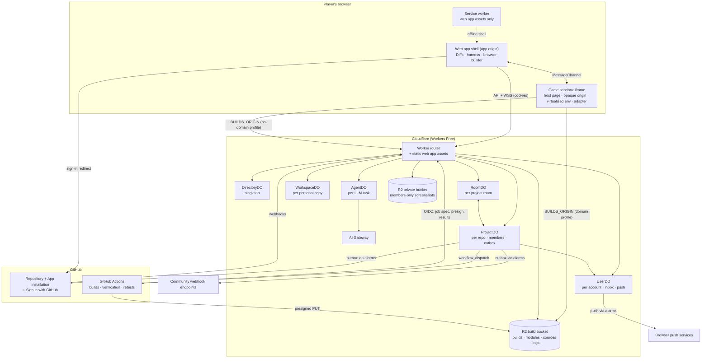
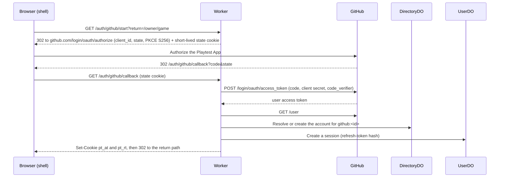
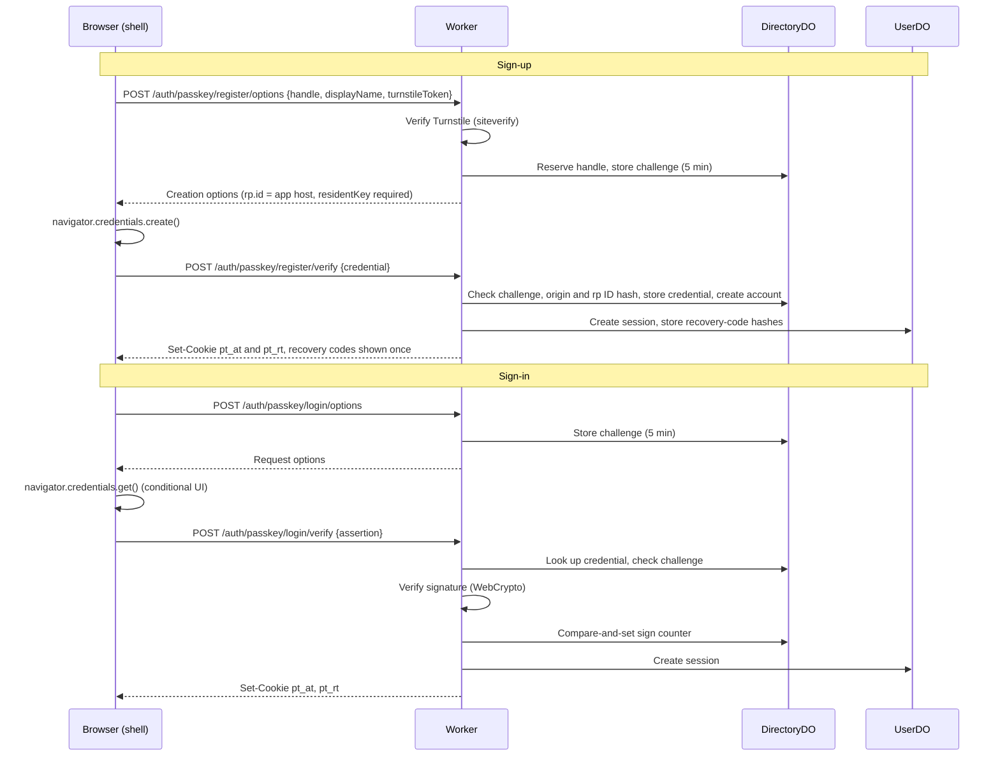
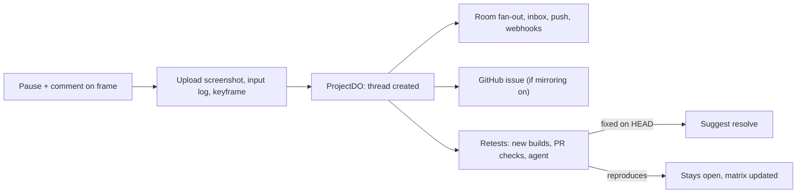
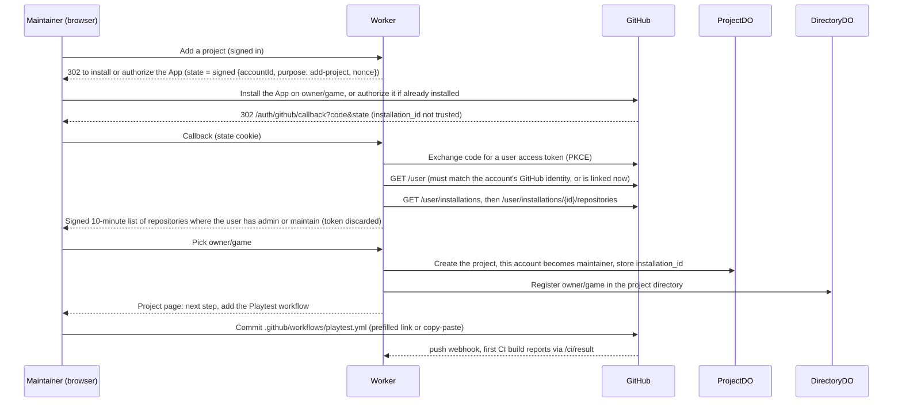
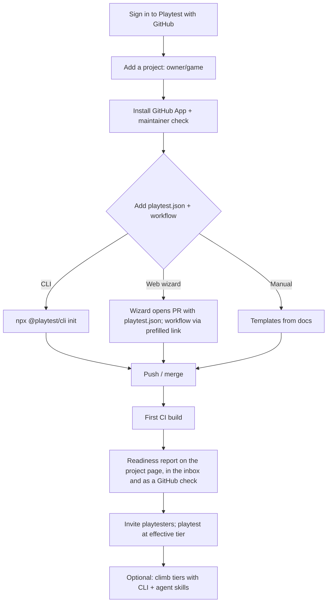

# Playtest: a TestFlight for collective game development on the web

> **Design document** · Draft v0.1 (standalone web edition, Free plan) · 2 November 2026
> "Playtest" is a working name.

> **Status.** This is an alternative to [`playtest-design.md`](playtest-design.md) (v0.5), which designs Playtest as a Discord Activity. In this edition Playtest is a standalone web app with its own accounts, communities, links and notifications. The game runtime, determinism model, builds, workspaces, feedback model, GitHub integration and LLM integration carry over almost unchanged. `playtest-design.md` stays the authoritative design unless this document is adopted. [Appendix C](#appendix-c-differences-from-the-original-design) lists every difference.

> **Platform constraint.** Sections 0–20 use only features available on Cloudflare's **Workers Free** plan. Everything that requires a paid plan, or only works at a useful scale on one, is collected in [§21 Paid-plan upgrades](#21-paid-plan-upgrades). Heavy compute that the Free plan can't host runs in two places:
> - the project's own GitHub Actions, which are free for public repositories on standard runners;
> - the players' browsers.

## Contents

0. [Summary](#0-summary)
1. [Goals, non-goals, requirements](#1-goals-non-goals-requirements)
2. [Glossary](#2-glossary)
3. [Decision summary](#3-decision-summary)
4. [Architecture](#4-architecture) (incl. [4.3 Deployment profiles](#43-deployment-profiles-hostnames-and-routes) and [4.4 Free-plan constraints and budget](#44-free-plan-constraints-and-budget))
5. [Web app, identity and communities](#5-web-app-identity-and-communities)
6. [Game runtime and debug API](#6-game-runtime-and-debug-api)
7. [Builds and serving](#7-builds-and-serving)
8. [Workspaces (personal copies)](#8-workspaces-personal-copies)
9. [Feedback model](#9-feedback-model)
10. [Rooms and realtime](#10-rooms-and-realtime)
11. [GitHub integration](#11-github-integration)
12. [LLM integration](#12-llm-integration)
13. [Data model and storage](#13-data-model-and-storage)
14. [Security and privacy](#14-security-and-privacy)
15. [Headless replay infrastructure](#15-headless-replay-infrastructure)
16. [Alternatives considered](#16-alternatives-considered)
17. [Risks and open questions](#17-risks-and-open-questions)
18. [Validation spike](#18-validation-spike)
19. [Phased delivery plan](#19-phased-delivery-plan)
20. [Author onboarding and agent skills](#20-author-onboarding-and-agent-skills)
21. [Paid-plan upgrades](#21-paid-plan-upgrades)
22. [References](#22-references)
- [Appendix A: TypeScript types](#appendix-a-typescript-types)
- [Appendix B: Message templates](#appendix-b-message-templates)
- [Appendix C: Differences from the original design](#appendix-c-differences-from-the-original-design)

---

## 0. Summary

Playtest is a web app. Anyone can open the page of a project, which is a public GitHub repository linked to Playtest, and:

- play builds of its JS/TS game in the browser, without an account;
- after signing in (with GitHub or a passkey) and joining the project, leave feedback anchored to an exact frame of gameplay or to exact lines of code;
- edit their own copy of the game, optionally with an LLM, and propose the changes upstream as a pull request.

Core ideas:

1. **A frame is an address, not a screenshot.** A `FrameRef` is the tuple (build, seed, input log, frame number). Anyone can reopen that exact frame, and any later build can be retested against it.
2. **The harness owns play, pause, step and rewind.** Games reach the debug API through one of four conformance tiers. The lowest tier works with any framework unmodified, via environment virtualization. The highest tier is a pure deterministic `tick`, which unlocks the full feature set, including headless replay.
3. **Everyone plays their own copy; feedback is shared.** There is no lockstep netcode between players.
4. **Links are the integration surface.** Every project, build, run frame, thread and workspace has a stable URL. Links preview in chat tools and social sites, notifications open them, and GitHub mirrors point back to them. Playtest doesn't host chat or voice; communities keep the tools they already use.
5. **The project is the community.** There is one community per linked repository. Maintainers are whoever GitHub says they are. Everyone else joins with a GitHub account or a passkey, through open sign-up or an invite link.
6. **Cloudflare Workers Free plan only.** The backend is:
   - one Worker, which also serves the web app as free static assets;
   - six SQLite-backed Durable Object classes;
   - R2 for builds and state. Game files are served by the Worker on a free `workers.dev` hostname (no-domain profile). Once a domain is added, they're served straight from the bucket via a custom domain (domain profile, §4.3).

   Heavy compute never runs on Cloudflare:
   - **The project's GitHub Actions** (free for public repositories) do builds, determinism verification, authoritative replays and PR checks.
   - **Players' browsers** do interactive builds, replays and LLM tool execution.
7. **Playtest owns the sandbox fence.** Game code runs in an opaque-origin iframe whose document is always a platform-owned host page with a strict Content Security Policy. Builds supply only modules, assets and sanitized markup, never a document of their own (§6.1).
8. **A GitHub App installed by maintainers is the only writer to GitHub.** It creates playtest branches and PRs, mirrors feedback as issues and review comments, triggers CI jobs, and publishes PR checks that replay open feedback against the new code. The same App provides "Sign in with GitHub".
9. **LLM edits happen in stacked overlays ("worktrees").** Each change is validated by replaying the motivating feedback in the requester's browser, then again in CI before it can become a PR.
10. **Paid upgrades are additive.** The upgrades in §21 (server-side builds, isolate replays, browser pools, email) are extra implementations of the same interfaces, not a different architecture.

---

## 1. Goals, non-goals, requirements

### 1.1 Goals

| # | Goal |
|---|---|
| G1 | Anyone can play any build of a linked project in a browser, with nothing to install: upstream commits, their own workspace, or a workspace someone shared. Public projects need no account to play. |
| G2 | A uniform debug API (play, pause, step, rewind, seek) across games and frameworks, implemented by the platform rather than by each game. |
| G3 | Frame feedback that is reproducible: anyone can reopen the exact frame, and later builds can be retested against it. |
| G4 | Code feedback rendered with `@pierre/diffs`: line comments, suggestions, accept/reject. |
| G5 | Personal copies that can be edited in the browser and proposed upstream. |
| G6 | Two-way sync with public GitHub repositories for code and feedback. |
| G7 | Optional LLM assistance that works on isolated worktrees and validates its changes by replay. |
| G8 | Works in current desktop browsers (Chrome, Edge, Safari, Firefox) and mobile browsers (Safari on iOS, Chrome on Android), and installs as a Progressive Web App. Cross-device reproducibility is best-effort and explicitly reported. |
| G9 | Runs entirely on Cloudflare's Workers Free plan; paid features are optional upgrades (§21). |
| G10 | Every project, build, run frame, thread and workspace has a stable, shareable URL with a link preview. |
| G11 | Testers can take part without a GitHub account. |

### 1.2 Non-goals (v1)

- Private repositories.
- Non-JS engines such as Unity or Godot web exports, beyond the Tier 0 fallback in §6.4.
- Networked multiplayer inside games, and shared lockstep "watch party" sessions. These are deferred; see §16.6.
- Hosting games for end players, or monetization.
- Write-back to git hosts other than GitHub.
- Built-in voice, video or text chat beyond feedback threads. Communities keep their own tools; Playtest gives them links, previews and webhooks (§5.4, §5.5).
- Identity providers other than GitHub and passkeys, and email of any kind. Workers Free has no general-purpose email sending (§21.6).

### 1.3 Requirements traceability

| Requirement from the brief | Addressed in |
|---|---|
| Runtime: Cloudflare Workers / Durable Objects | §4, §10, §13 |
| Multiplayer chat-platform Activity with visible endpoints | **Replaced by design choice:** a standalone web app with rooms, shareable links and notifications (§5, §10). See Appendix C |
| JS/TS games with a common debug API (play, pause, step, rewind) | §6, §7 |
| Apps and feedback synchronize with public git repos | §7, §11 |
| In-context feedback on code (Diffs) and on game frames (debug interface) | §9 |
| Direct changes to personal copies | §8 |
| Optional LLM, worktree-based, optional sync-back | §12 |
| Compatibility with common frameworks (Phaser, three.js, etc.) | §6.11 |
| Cloudflare Free plan only; paid features isolated | §4.4, §21 |
| Game authors onboard and adapt their games (CLI, wizard, agent skills) | §20 |
| *(This edition)* Testers without GitHub accounts; shareable links | §5.2, §5.4 |

---

## 2. Glossary

| Term | Meaning |
|---|---|
| **Account** | A Playtest user, identified by an `accountId` (ULID). It has a handle, a display name and one or more identities. |
| **Identity** | A way to sign in to an account: a GitHub user (through the GitHub App's user authorization) or a passkey (a WebAuthn credential). |
| **Project** | A public GitHub repository linked through the GitHub App, and the community around it. |
| **Member** | An account that has joined a project. Its role is `member`, `moderator` or `maintainer`. |
| **Maintainer** | A member whose linked GitHub user has admin or maintain permission on the repository. The role is derived from GitHub and can't be granted in Playtest. |
| **Visitor** | Anyone viewing a project without being a member, signed in or not. Visitors can play builds of listed projects but can't post. |
| **Join policy** | How accounts become members of a project: `open`, `invite` or `collaborators` (§5.3). |
| **Room** | A live presence space inside a project, held by a RoomDO. Every project has a `lobby`; ad-hoc rooms are created for focused sessions and end when idle. |
| **Share link** | The canonical app URL of a project, build, run frame, thread or workspace. It renders a link preview (§5.4). |
| **Build** | Immutable bundled output of a source tree plus toolchain version, identified by `buildHash`. |
| **Workspace** | An account's personal copy of a project: a *base* commit plus an *overlay* of changed files. |
| **Overlay** | A map from file path to new content or a deletion, layered over a base. Overlays can stack. |
| **Revision** | An immutable snapshot of a workspace overlay (autosave or explicit save). |
| **Worktree** | An overlay stacked on a workspace revision, used by the LLM agent so it never edits the user's copy directly. |
| **Run** | One play session of one build: a seed plus an input log. Runs branch when you rewind and play differently. |
| **Input log** | Compact per-tick record of quantized inputs (§6.8). |
| **FrameRef** | `{buildHash, seed, inputLogHash, frame, tier, engineFamily}`: the address of a frame. |
| **Keyframe** | A saved simulation state used for fast seeking (Tiers 2 and 3). |
| **Checkpoint** | A state hash recorded every *K* ticks, used to detect replay divergence. |
| **Thread** | A unit of feedback with one or more anchors, comments, an optional expectation, and retest results. |
| **Anchor** | What a thread points at: a code range, a frame, or both. |
| **Expectation** | An optional machine-checkable predicate over game state that makes retests meaningful. |
| **Retest** | Replaying a thread's run against another build and classifying the outcome. |
| **Tier** | The game's conformance level (0–3) with the harness (§6.4). |
| **Shell** | The trusted web app on the app origin. It holds the UI, the Diffs editor and the harness controller. |
| **Host page** | The platform-owned document (`host.html`) that every sandbox loads. It carries the sandbox's Content Security Policy and boots the runtime, then the build (§6.1). |
| **Sandbox** | The untrusted, opaque-origin iframe, showing the host page, that runs game code. |
| **Adapter** | Framework-specific glue (Phaser, three.js, PixiJS, Babylon) loaded into the sandbox. |
| **CI builder** | The reusable GitHub Actions workflow in the project's repository. It produces canonical builds, verifies determinism and runs authoritative retests. |
| **Browser builder** | The shell's in-browser transformer for interactive workspace edits. In *full mode* it also resolves npm dependencies (§7.4). Its outputs are labelled *client-built*. |
| **`BUILDS_ORIGIN`** | The absolute base URL of build files: `https://playtest.<account>.workers.dev/g` in the no-domain profile, `https://builds.<domain>` in the domain profile (§4.3). |
| **Build bucket** | The R2 bucket `pt-builds`, holding immutable, content-addressed game files served at `BUILDS_ORIGIN`. A custom domain serves it in the domain profile, and the Worker serves it otherwise (§4.3). |
| **Deployment profile** | *No-domain* (everything on `workers.dev`) or *domain* (the build bucket on a custom domain) (§4.3). |
| **Bundled mode** | CI output with one JS bundle per build, a shared runtime and assets shared across builds, minimizing files per load (§7.6). |
| **Asset pack** | One file holding a build's small assets, unpacked in the sandbox into `blob:` URLs (§7.6). |
| **Outbox** | A Durable Object table of pending external calls (GitHub writes, outbound webhooks, push sends), drained by alarms. |
| **Inbox** | An account's notification list, held in its UserDO (§5.5). |
| **Readiness report** | The result of `playtest check` or a CI build: effective tier, determinism status, findings (PT codes) and next steps (§20.5). |
| **Agent skill** | A folder with a `SKILL.md` and resources that teaches coding agents the Playtest contract (§20.8). |

---

## 3. Decision summary

| # | Decision | Choice (Free plan) | Main alternatives | § |
|---|---|---|---|---|
| D1 | Who implements play/pause/step/rewind | Harness, through conformance tiers and environment virtualization | Each game implements the verbs; pure tick contract only | 6, 16.1 |
| D2 | Frame feedback representation | Replayable `FrameRef` plus screenshot | Screenshots/video only | 6, 9, 16.1 |
| D3 | Session model | Everyone plays their own copy; feedback and presence shared live through rooms | Driver plus spectators in lockstep; real game netcode | 10, 16.6 |
| D4 | GitHub writer | GitHub App installed by maintainers | Per-user OAuth (fork + PR); patch export only | 11, 16.5 |
| D5 | Source/workspace storage | Overlays in Durable Objects plus content-addressed R2; Git Data API for write-back | Cloudflare Artifacts (paid, §21); isomorphic-git on R2 | 8, 16.4 |
| D6 | Code UI | `@pierre/diffs` (view, edit mode, annotations) plus `@pierre/trees` | CodeMirror 6; Monaco | 8, 9, 16.7 |
| D7 | Build location | The project's GitHub Actions for upstream, PR and verified builds; the author's browser for interactive workspace builds, including npm dependencies on desktop (full mode) | Dynamic Worker builder or Containers (paid, §21) | 7, 16.8 |
| D8 | Headless replay | Players' browsers (advisory) plus the project's CI (authoritative) | Dynamic Workers, Browser Rendering at scale, Containers (paid, §21) | 15, 16.11 |
| D9 | Feedback source of truth | Platform database, mirrored to GitHub | GitHub issues as source of truth; in-repo files | 9, 11, 16.10 |
| D10 | LLM runtime | AgentDO tool loop; execution tools run in the requester's browser; final validation in CI | Isolate execution (paid, §21); container sandbox (paid) | 12, 16.12 |
| D11 | LLM keys | Per-project key encrypted in ProjectDO, sent through AI Gateway (free core features) | AI Gateway stored keys; platform-paid key | 12.6 |
| D12 | Cloudflare plan | **Workers Free only** | Workers Paid ($5/month minimum), §21 | 4.4, 21 |
| D13 | Serving build files | Two profiles: **no-domain** (the Worker serves bundled builds and asset packs from R2 on `workers.dev`) and **domain** (the R2 bucket on a custom domain) | `r2.dev` (development only); GitHub Pages | 4.3, 7.6, 16.14 |
| D14 | Background work | ProjectDO and UserDO outboxes drained by Durable Object alarms | Cloudflare Queues (free: 10k ops/day, 24 h retention) | 11.9, 16.13 |
| D15 | CI authentication | GitHub Actions OIDC tokens verified by the Worker; presigned R2 URLs for uploads | Repository secrets holding Playtest credentials | 7.3, 14 |
| D16 | Identity | "Sign in with GitHub" through the GitHub App's user authorization, plus passkeys (WebAuthn); one account can hold both | GitHub only; email magic links; hosted auth service | 5.2, 16.15 |
| D17 | Community model | The project is the community; roles derived from GitHub plus open, invite or collaborator joins | Spaces that group several repositories | 5.3, 16.16 |
| D18 | Global state | A DirectoryDO singleton (accounts, identities, project directory) plus one UserDO per account | D1; Workers KV | 4.2, 13, 16.17 |
| D19 | Notifications | In-app inbox, Web Push, optional outbound project webhooks | Email (needs a provider, §21.6); chat-bot integrations; polling only | 5.5, 16.18 |
| D20 | Sandbox document | Platform-owned host page with a meta CSP; builds supply only modules, assets and sanitized markup | Per-build `index.html` with a header-enforced CSP | 6.1, 16.20 |
| D21 | Abuse controls | Turnstile on sign-up and first posts, per-IP rate limits, join policies, moderation roles | Invite-only everywhere; third-party moderation service | 5.3, 14.1 |

---

## 4. Architecture

### 4.1 Component diagram



### 4.2 Responsibilities

| Component | Keyed by | Owns | Notes |
|---|---|---|---|
| **Worker** | n/a | Routing; authentication (GitHub sign-in, passkeys, session cookies); static web app; link previews; webhook verification; CI authentication; presigning CI uploads; batched client uploads; rate limits; game files in the no-domain profile | Stateless; must stay within 10 ms CPU per request (§4.4) |
| **DirectoryDO** | singleton | Accounts, handles, identities (GitHub user IDs, passkey credential IDs and public keys), project directory (`owner/repo` → project, listing) | Touched on sign-up, sign-in, handle changes, project creation and directory pages; never on the play path. The Free plan's daily request cap keeps it far below a single object's throughput |
| **UserDO** | `accountId` | Sessions (refresh tokens), push subscriptions, inbox, notification preferences, membership index, recovery-code hashes, push outbox | One per account |
| **RoomDO** | `projectId:roomSlug` | Presence, live feed fan-out, nudges, run-sharing relay, client-retest queue | Ephemeral; WebSocket Hibernation API |
| **ProjectDO** | `github:<owner>/<repo>` | Project config, members and roles, invites, threads, anchors, comments, retests, runs index, builds index, CI jobs, GitHub mirror map, outbound webhooks, outbox | Source of truth for feedback and membership |
| **WorkspaceDO** | workspace ID | Overlay, revisions, live viewers | One per personal copy and per worktree |
| **AgentDO** | task ID | LLM conversation, tool loop, worktree reference, progress stream | Agents SDK on Durable Objects; execution tools are forwarded to the requester's browser |
| **R2 build bucket** (`pt-builds`) | content hash | Host pages and runtime, CI builds, vendor chunks, asset packs, browser-built modules, workspace and upstream sources, input logs, keyframes, screenshots of publicly visible threads | Domain profile: public via `builds.<domain>`, CDN-cached, no Worker requests. No-domain profile: served by the Worker. URLs are unguessable content hashes but not secret (§14.3) |
| **R2 private bucket** (`pt-private`) | content hash | Screenshots of members-only threads | Served through the Worker to members |
| **AI Gateway** | n/a | Proxy to LLM providers: caching, analytics, rate limiting | Free core features |
| **GitHub Actions** (the project's CI) | workflow run | Canonical builds, determinism verification, authoritative retests, PR checks, `tsc` | Free for public repositories on standard GitHub-hosted runners |
| **Players' browsers** | n/a | Interactive workspace builds, replays, advisory retests, LLM tool execution, three-way merges, code re-anchoring | Results are labelled with who produced them |

### 4.3 Deployment profiles, hostnames and routes

Playtest runs in one of two **deployment profiles**. They differ only in how game files reach the sandbox; the code is the same, and configuration selects the profile.

| | **No-domain profile** (default to start) | **Domain profile** |
|---|---|---|
| Requires | A Cloudflare account | A domain whose DNS is a zone in the same Cloudflare account (the Free zone plan is fine) |
| Hostnames | One: `playtest.<account>.workers.dev` | The app on `workers.dev` or `app.<domain>` (fixed before public sign-up, see below), plus `builds.<domain>` for the build bucket |
| `BUILDS_ORIGIN` | `https://playtest.<account>.workers.dev/g` | `https://builds.<domain>` |
| Game files | Served by the Worker from the build bucket; each file costs a Worker request | Served by the bucket's custom domain, CDN-cached; no Worker requests |
| CI build output | **Bundled mode with asset packs** (§7.6) | Bundled or per-module mode |
| Sandbox CSP response header (defense in depth, §6.1) | Set by the Worker | Set by one response-header Transform Rule on the zone |
| Public screenshots (GitHub issues, link previews) | Worker route `/s/<sha256>.png` | `builds.<domain>/shot/<sha256>.png` |
| Link previews (§5.4) | Rendered by the Worker on every open; the Cache API doesn't work on `workers.dev` | Rendered by the Worker; cached with the Cache API when the app runs on `app.<domain>` |
| Rough capacity (§4.4.3) | ~3,300–3,500 play sessions/day | ~4,000 play sessions/day |
| Best for | Development, small communities, first launch | Public launch, busy projects |

**Why only the build bucket needs a domain.** R2 can make a bucket public in only two ways:

- a custom domain, which must be a zone in the same account;
- the managed `r2.dev` URL, which is rate-limited, uncached and intended for development.

Everything else accepts a `workers.dev` URL: the web app, the GitHub App's callback, setup and webhook URLs, and the CI endpoints.

**The app hostname is part of every account.** Passkeys are bound to a relying-party ID, which is the app's hostname or a parent domain of it, and session cookies are bound to the host. If the app moves from `workers.dev` to `app.<domain>` after people have registered passkeys, those passkeys stop working on the new host. The options, in order of preference:

1. Choose the final app hostname before sign-up opens to the public.
2. Keep the old relying-party ID and publish a WebAuthn *Related Origin Requests* list at `https://<old-host>/.well-known/webauthn` naming the new origin. Chromium and Safari support this; Firefox doesn't yet (to verify, Q12).
3. Have affected users sign in with a linked GitHub identity or a recovery code and register a new passkey.

The build hostname can change at any time: records store content hashes, never URLs, and clients build every game-file URL from `BUILDS_ORIGIN`.

**Switching from no-domain to domain** needs no data migration:

1. **Buckets.** Two buckets exist from day one:
   - `pt-builds`, for game files: public access off in the no-domain profile, with the Worker serving it;
   - `pt-private`, for members-only screenshots.
2. **Domain setup.** Add the domain as a zone, attach `builds.<domain>` to `pt-builds` as a custom domain, set its CORS policy (§7.6), and add a Transform Rule that sets the sandbox CSP header on every response.
3. **Configuration.** Set `PROFILE=domain` and `BUILDS_ORIGIN=https://builds.<domain>`. This changes public screenshot URLs and lets CI use per-module mode. The Worker's `/g/*` route stays as a fallback for pages that were already open.
4. **Optional.** Move the app to `app.<domain>`, which enables link-preview caching. Only do this before public sign-up, or with option 2 above, and update the GitHub App's URLs.

**Routes.** The table uses two logical hosts:

- `app`: the Worker and its static assets (web app, API, WebSockets, GitHub and CI endpoints);
- `builds`: game files at `BUILDS_ORIGIN`.

In the no-domain profile both are the same `workers.dev` hostname, and `builds` paths are served under the Worker's `/g/*` route. Every `builds` response carries `Content-Type`, `Cache-Control: public, max-age=31536000, immutable`, `Access-Control-Allow-Origin: *` (which the opaque-origin sandbox needs) and the sandbox CSP header (§6.1).

Static assets handle every path not listed under `run_worker_first`, including the single-page-app fallback, so app pages never invoke the Worker.

| Host | Path | Handler | Notes |
|---|---|---|---|
| app | `/`, `/assets/*`, `/<owner>/<repo>` and other app pages | Static web app (Workers static assets, single-page-app fallback) | Free and unlimited; no Worker invocation |
| app | `/<owner>/<repo>/t/*`, `/r/*`, `/w/*`, `/b/*` | Worker first: the web app's HTML with link-preview tags injected (§5.4) | One Worker request per open |
| app | `GET /auth/github/start`, `GET /auth/github/callback` | Sign in with GitHub (§5.2) | PKCE and signed `state` |
| app | `POST /auth/passkey/register/{options,verify}`, `POST /auth/passkey/login/{options,verify}` | Passkeys (§5.2) | Turnstile on registration |
| app | `POST /auth/refresh`, `POST /auth/logout` | Session cookies | The refresh cookie is scoped to `/auth` |
| app | `/api/*` | REST: me, projects, members, invites, threads, workspaces, builds, runs, inbox, settings | Access cookie required for private data; writes also need the `X-Playtest` header |
| app | `POST /api/upload` | Batched upload of content-addressed files (≤ 40 files, ≤ 4 MB per request) into the build bucket; HTML is rejected | Browser builder, screenshots, logs |
| app | `POST /api/push/subscribe`, `DELETE /api/push/subscribe` | Web Push subscriptions | §5.5 |
| app | `GET /api/private/shot/:sha256` | Members-only screenshots from the private bucket | Access cookie and membership required |
| app | `GET /join/:token` | Invite link (§5.3) | Token checked before the join page is shown |
| app | `/ws/room/:projectId/:room` | RoomDO | WebSocket; cookie and `Origin` check |
| app | `/ws/workspace/:id` | WorkspaceDO | Live edits (optional) |
| app | `/ws/agent/:taskId` | AgentDO | Progress and forwarded tool calls |
| app | `GET /g/*` | Worker reads `pt-builds` | No-domain profile (fallback in the domain profile); no authentication, content-addressed URLs |
| app | `/s/:sha256.png` | Public screenshots (no-domain profile) | GitHub's image proxy and link unfurlers cache them |
| app | `/github/webhook`, `/github/setup` | GitHub App | §11 |
| app | `GET /ci/job/:id` | Job spec for a CI run (what to build or retest) | OIDC-authenticated (§7.3) |
| app | `POST /ci/presign` | Presigned `PUT`/`GET` URLs scoped to the job's prefixes | OIDC-authenticated; R2's S3 endpoint needs no custom domain |
| app | `POST /ci/result` | Build, verification and retest results | OIDC-authenticated |
| builds | `/r/<runtimeVersion>/host.html`, `host-recorded.html`, `runtime.js`, adapters | Host pages (§6.1), harness runtime and adapters, shared by all builds | Immutable |
| builds | `/b/<buildHash>/…` | CI builds: entry module, `page.json`, source maps | Immutable |
| builds | `/a/<sha256>.<ext>`, `/pack/<sha256>.ptpk` | Assets and asset packs, shared across builds | Content-addressed |
| builds | `/v/<lockfileHash>/…` | Vendor chunks built by CI (per-module builds and workspace edits) | Immutable |
| builds | `/m/<sha256>.js` | Browser-built workspace modules, including full-mode vendor chunks (§7.4) | Content-addressed |
| builds | `/ws/<sha256>`, `/src/<gitBlobSha>` | Workspace and upstream source files | Content-addressed |
| builds | `/run/<sha256>.ptil`, `/snap/<sha256>.bin` | Input logs, keyframes | Content-addressed |
| builds | `/shot/<sha256>.png` | Screenshots of publicly visible threads | Deleted with the thread |

### 4.4 Free-plan constraints and budget

#### 4.4.1 Limits the design relies on

| Product | Workers Free allowance | How the design uses it |
|---|---|---|
| Workers | 100,000 requests/day (Error 1027 beyond, until 00:00 UTC); **10 ms CPU per request**; 50 external subrequests and 1,000 subrequests to Cloudflare services per invocation; static asset requests free and unlimited | Routing, authentication and verification only; the web app as static assets; game files bypass the Worker in the domain profile |
| Durable Objects (SQLite backend only) | 100,000 requests/day, including inbound WebSocket messages; 13,000 GB-s/day duration; 5 M rows read and 100 k rows written per day; 5 GB total storage | Hibernating WebSockets; change-only presence; batched writes |
| R2 | 10 GB-month storage; 1 M Class A and 10 M Class B operations per month | Content-addressed build bucket; GC of unreferenced objects. In the no-domain profile, Class B reads are bounded by Worker requests (≤ ~3 M/month) |
| AI Gateway | Core features free; 10 gateways per account; capped log storage | One gateway; per-project caps enforced in ProjectDO |
| Turnstile | Free plan: unlimited challenges, 20 widgets per account | One widget for sign-up and first posts (§5.3) |
| Workers Rate Limiting binding | Approximate, per-location counters with 10 s or 60 s periods; availability on Free to verify (S14) | Per-IP limits on unauthenticated endpoints. Fallback: a WAF rate-limiting rule on the zone in the domain profile |
| Transform Rules (domain profile) | 10 active rules on a Free zone | One rule sets the sandbox CSP header on `builds.<domain>` |
| Cache API | Only for Workers on custom domains, not `workers.dev` | Link-preview caching when the app runs on `app.<domain>` |
| Cron Triggers | 5 per account | One daily GC sweep |
| Queues *(not used by default)* | 10,000 operations/day; 24 h retention | Alternative to the outboxes (§16.13) |
| Browser Rendering *(not used by default)* | 10 minutes/day; 3 concurrent browsers | Too small to rely on; see §21 |

On the Free plan, exceeding a limit makes further operations fail until 00:00 UTC rather than billing. Two points need confirming (spike S13–S14):

- **Durable Object CPU.** The DO limits page lists 30 s per request, but also says DOs share Workers' per-invocation CPU limits. The design therefore assumes **10 ms**.
- **WebSocket accounting.** It's unclear whether the 20:1 inbound-WebSocket billing ratio also applies to the free daily request quota. The design assumes it **doesn't**.

#### 4.4.2 Design rules

1. **No heavy CPU on Cloudflare.** No archive unpacking, bundling, large diffs, merges or replays in the Worker or in Durable Objects. These run in CI or in browsers. Signature checks (WebAuthn, OIDC, webhooks) and Web Push encryption are small, fixed costs, measured in spike S14.
2. **Keep game-file traffic off the Worker:**
   - **Domain profile:** game files never pass through the Worker; the bucket's custom domain serves them.
   - **No-domain profile:** CI emits bundled builds with asset packs (a handful of files per load). Every file is immutable and content-addressed, so returning players load from their browser cache. Large assets are shared across builds, so a new build only costs its changed files.
3. **WebSockets stay quiet:**
   - only the Hibernation API is used;
   - presence is sent on change and at most once every 5 s;
   - there is never per-tick traffic;
   - run sharing is batched every 15 s.
4. **Writes are batched:**
   - workspace revisions are persisted on run, after 60 s idle, or on explicit save (drafts stay in the browser);
   - the GitHub, webhook and push outboxes drain up to 40 calls per alarm.
5. **Everything is content-addressed.** Uploads skip objects that already exist, and unchanged modules keep their URLs.
6. **Degrade gracefully.** Each subsystem has a "quota reached" state:
   - Live presence and feeds pause, and the web app shows a banner.
   - Playing, rewinding and drafting feedback keep working locally, and queued actions retry after the reset.
   - Usage is watched in Workers analytics, with alerts at 70% of any daily allowance.
7. **Budgets per project.** Daily caps on CI jobs, LLM tasks, uploads, push sends and webhook deliveries protect the shared account from one busy project.
8. **Public-web hygiene.** The app is reachable by anyone, including crawlers and bots:
   - anonymous requests never create state;
   - creating an account, and a new account's first posts, need a Turnstile token;
   - unauthenticated endpoints are rate-limited per IP;
   - app pages are static assets and never invoke the Worker. Crawlers only reach share routes, which cost one Worker request and one ProjectDO read each.

#### 4.4.3 Capacity estimates

These are rough planning numbers, based on the assumptions in the "Cost driver" column; spike S13 replaces them with measurements.

| Resource | Cost driver | Rough daily capacity |
|---|---|---|
| Worker requests (100k/day), domain profile | ~25 per signed-in play session: session refresh, API calls, uploads, WebSocket upgrades; plus 1 per share-link open | ~4,000 play sessions |
| Worker requests (100k/day), no-domain profile | The same ~25 plus game files: ~3 for a returning player (assets cached), ~5 on a cold device thanks to asset packs | ~3,300–3,500 play sessions |
| Worker requests, anonymous visitors | ~3–8 per play: project and build metadata, plus game files in the no-domain profile; no session, uploads or WebSockets | Several times cheaper than a signed-in session |
| DO requests (100k/day) | 1 per WebSocket connect, plus ~30 inbound messages per active player-hour (change-only presence), plus ~4 session refreshes per active hour, plus feedback actions | ~2,500 player-hours (more if the 20:1 ratio applies) |
| DO rows written (100k/day) | ~3 rows per persisted revision; ~20 revisions per editing hour; threads, comments, inbox entries | ~1,500 editor-hours |
| Push sends | 1 external subrequest per device per notification; ≤ 40 per alarm; inbox entries are written even when push is off | Bounded by the per-project push budget |
| R2 Class A (≈33k/day averaged) | ~5–30 objects per workspace revision; ~50–300 per CI build | ~1,000 revisions plus ~50 CI builds |
| R2 storage (10 GB) | Builds dominate; unreferenced objects are collected after 14 days | Dozens of active projects |

---

## 5. Web app, identity and communities

### 5.1 Web app shell, origins and CSP

- **Delivery.** The shell is a single-page app served as Workers static assets, with the single-page-app fallback. Nothing is server-rendered except the link-preview tags on share routes (§5.4).
- **Origins:**
  - the **app origin** serves the shell, the API and WebSockets, and is the only origin that holds cookies;
  - **`BUILDS_ORIGIN`** serves game files and never reads cookies. In the no-domain profile it's a path (`/g/`) on the app host.

  Requests from the sandbox carry no session: its origin is opaque, so it is cross-site to everything and `SameSite=Lax` cookies are never attached. In the no-domain profile, the sandbox CSP also names `BUILDS_ORIGIN` with its `/g/` path, so game code can't even address the API.
- **Shell CSP.** Set in the static assets' `_headers` file, and by the Worker on Worker-first routes:

  ```text
  default-src 'self';
  script-src 'self' 'wasm-unsafe-eval';
  worker-src 'self';
  style-src 'self';
  img-src 'self' <BUILDS_ORIGIN> data: blob: https://avatars.githubusercontent.com;
  connect-src 'self' <BUILDS_ORIGIN> https://registry.npmjs.org https://api.github.com https://raw.githubusercontent.com;
  frame-src <BUILDS_ORIGIN> 'self';
  object-src 'none'; base-uri 'none'; form-action 'self';
  frame-ancestors 'none'
  ```

  - `'wasm-unsafe-eval'` is for the browser builder's esbuild-wasm (§7.4).
  - The npm registry and GitHub hosts are only fetched as data (tarballs and sources, §7.4–7.5); nothing fetched from them runs in the shell.
  - **No third-party script runs in the shell.** The Turnstile widget lives in a same-origin `/challenge.html` frame with its own, wider CSP and returns its token to the shell with `postMessage`.
  - `frame-ancestors 'none'` prevents clickjacking. An embeddable player is open question Q17.
- **Progressive Web App:**
  - A Web App Manifest with `display: standalone`.
  - A service worker that caches the shell's static assets, so the app opens offline with local drafts, and that handles push events (§5.5).
  - The service worker never handles game files. The sandbox has an opaque origin, so no service worker controls it, and immutable HTTP caching does the job instead (§7.6).

### 5.2 Accounts and sign-in

**Account model.**

- An account has an `accountId` (ULID), a unique handle (`[a-z0-9-]`, 3–30 characters), a display name, and **at least one** identity.
- Identities are a closed union: a GitHub user (ID and login), or a passkey (credential ID, public key and sign counter). An account can hold one GitHub identity and several passkeys.
- The avatar is the GitHub avatar, or a generated identicon for passkey-only accounts. There are no avatar uploads in v1.

**Sign in with GitHub.** This uses the GitHub App's own user authorization (the web application flow), so no separate OAuth app is needed (§11.1).



- **`state`.** It is signed, single-use, bound to the browser by the state cookie, and records the flow's single purpose: `sign-in`, `link-identity` or `add-project` (§11.2).
- **The user token is discarded** at the end of the callback. Later maintainer checks use the App's installation token instead (§5.3).

**Passkeys.** WebAuthn with discoverable credentials and `none` attestation. The relying-party ID is the app hostname (§4.3).



Signature checks use WebCrypto (ES256 and RS256). Either a WebAuthn server library that supports Workers (SimpleWebAuthn lists Workers as a supported runtime) or a small in-house verifier works. Spike S14 measures the CPU cost.

**Sessions.**

| Cookie | Content | Attributes | Checked by |
|---|---|---|---|
| `pt_at` (access) | HMAC-signed `{accountId, sid, exp}`, 15-minute TTL | `HttpOnly; Secure; SameSite=Lax; Path=/` | The Worker, statelessly, on every request |
| `pt_rt` (refresh) | Random 256-bit token, 30-day sliding expiry | `HttpOnly; Secure; SameSite=Strict; Path=/auth` | UserDO, which stores its SHA-256 per session |

- **Rotation.** Every refresh rotates `pt_rt`. Presenting a token that was already rotated revokes the whole session (reuse detection).
- **Revocation.** "Sign out" deletes the session; "sign out everywhere" deletes all of them. API access ends within 15 minutes, when the access cookie expires. Room sockets close when it expires, and the client reconnects after refreshing (§10.1).
- **CSRF.** `SameSite=Lax` blocks cross-site form posts carrying cookies. In addition, every state-changing request needs the `X-Playtest: 1` header, which forces a CORS preflight that the Worker never approves for other origins, and a matching `Origin`.
- **WebSockets.** Browsers send cookies on the upgrade request, so the Worker checks that `Origin` is the app origin before forwarding it to a Durable Object. This prevents cross-site WebSocket hijacking.
- **Tokens never reach JavaScript.** Both cookies are `HttpOnly`, and the sandbox can't reach the app origin at all.

**Linking and recovery.**

- Settings let an account link a GitHub identity (if no other account uses it) and add or remove passkeys. The last identity can't be removed.
- Passkey-only accounts get ten single-use **recovery codes** at sign-up, stored as hashes in UserDO. A recovery code signs in once and asks for a new passkey.
- Synced passkeys (platform keychains and password managers) make device loss rare. Settings nudge passkey-only accounts to add a second passkey or link GitHub.
- There is no email, so there is no other recovery path (R15).

**Trust rule.** Identity comes only from server-side verification: GitHub's token exchange or a verified WebAuthn assertion. Roles come only from ProjectDO. Neither is ever taken from client claims.

### 5.3 Projects as communities

The project page `/<owner>/<repo>` holds the project's builds, threads, workspaces, members, rooms and settings.

**Roles.**

| Role | How it's obtained | Can |
|---|---|---|
| Visitor | Anyone; no account needed | Play builds; read threads when feedback visibility is `public` |
| Member | Joining, under the project's join policy | Also: post threads and comments, create workspaces, join rooms, run client retests, use AI if enabled |
| Moderator | Appointed by a maintainer, or an invite link with the moderator role | Also: hide and restore comments, lock threads, remove or ban members, manage invites |
| Maintainer | The account's linked GitHub user has admin or maintain permission on the repository | Also: settings (join policy, visibility, mirroring, AI key, budgets, webhooks), appoint moderators, dispatch CI retests, unlink |

**Maintainer checks.** The role is verified when the project is added (§11.2). After that, the Worker calls `GET /repos/{owner}/{repo}/collaborators/{username}/permission` with the App's installation token, which only needs the Metadata permission. The result is cached in ProjectDO for one hour and re-checked before any maintainer-only action after that. A user who loses the GitHub permission loses the role at the next check.

**Join policies.**

| Policy | Who can join |
|---|---|
| `invite` (default) | Holders of an invite link |
| `open` | Any signed-in account, with one click. New accounts pass Turnstile |
| `collaborators` | Accounts whose linked GitHub user is a collaborator on the repository, checked like maintainers |

**Invite links** (`/join/<token>`). The token is 128 random bits. ProjectDO stores its hash with the role it grants (`member` or `moderator`), an expiry (default 7 days), a maximum number of uses (default 50) and its creator. Invites can be revoked. Maintainers typically paste one into their community's chat.

**Visibility.**

- **Project:** `listed` (shown in the project directory and indexable) or `unlisted` (reachable by link only; `noindex`). Builds are public data either way: the repository is public and build URLs are content-addressed (§14.3).
- **Feedback:** `members` (default) or `public`.
  - With `members`, threads, comments, screenshots and workspaces are visible to members only.
  - With `public`, anyone can read them, and posting still needs membership.
  - A per-thread **`restricted`** flag keeps a thread members-only, and never mirrored, even when feedback is public.

**Moderation.**

- Hide a comment (the reason is kept), lock a thread, remove a member, and ban an account so it can't rejoin.
- **Report:** members flag content, and moderators get an inbox notification.
- **Block:** a member can block another account, whose content is then collapsed for them.
- **New accounts** (younger than 24 h) have first-day caps on posts and uploads, and need Turnstile on their first post in a project.

**Membership index.** One account can join many projects. UserDO keeps a membership index for "My projects", which ProjectDO updates over DO RPC.

### 5.4 Links, previews and deep links

| URL | Opens |
|---|---|
| `/<owner>/<repo>` | The project page |
| `/<owner>/<repo>/b/<buildHash>` | A build, ready to play |
| `/<owner>/<repo>/r/<runId>@<frame>` | A run, paused at a frame |
| `/<owner>/<repo>/t/<threadId>` | A thread, seeked to its frame |
| `/<owner>/<repo>/w/<workspaceId>[@<rev>]` | A workspace, at its latest or a given revision |
| `/<owner>/<repo>/room/<slug>` | A room (§10) |
| `/join/<token>` | An invite (§5.3) |

- **Parsing.** The shell and the Worker share one strict parser that maps paths to a `Route` union (Appendix A). Every other path is "not found", and IDs are validated as ULIDs or hex hashes.
- **Authorization.** Access is checked server-side on the API call that loads the target, so a link reveals nothing by itself.
- **Copy link.** It's available everywhere. Pausing offers **Copy link to this frame**, which uploads the input log up to the current tick, if it isn't uploaded yet, and copies `/r/<runId>@<frame>`.
- **Link previews:**
  - Share routes run Worker-first. The Worker fetches the web app's `index.html` from static assets and injects Open Graph and Twitter Card tags with `HTMLRewriter`: title, description, image (the thread's screenshot at its public URL) and `og:url`.
  - Previews show content only when visitors could see the target: builds, and threads under public feedback that aren't restricted. Members-only targets get a generic card ("A thread in owner/game · Sign in to view") with no screenshot, title or text.
  - Each open costs one Worker request and one ProjectDO read (§4.4.3). They're cached only in the domain profile with the app on a custom domain.
- **One URL scheme everywhere.** GitHub mirrors, notifications and webhook payloads all use these URLs.

### 5.5 Notifications

**What notifies.** Each kind can be turned on or off per project:

- a new thread in a project you watch;
- replies, and mentions (`@handle`);
- a retest outcome change on a thread you created or follow;
- a finished PR check on your proposal;
- a build ready for your workspace;
- accepted invites;
- reports (moderators only).

**Channels:**

1. **Inbox.** A UserDO table, always written. The web app shows an unread badge.
2. **Web Push:**
   - **Subscribing.** Each device subscribes through the Push API with the platform's VAPID public key. UserDO stores the endpoint, `p256dh` and `auth` values.
   - **Sending.** UserDO's push outbox is drained by alarms (≤ 40 sends per alarm). Each send carries a VAPID JWT (ES256), reused per push service for up to its 24-hour lifetime. The payload `{title, body, url, tag}` is encrypted with `aes128gcm` (ECDH P-256, HKDF and AES-GCM, all in WebCrypto). Users can choose "no content in notifications", which sends only "New activity in owner/game".
   - **Cleanup.** A `404` or `410` response removes the subscription.
   - **Platforms.** Desktop browsers and Android browsers support push in the browser. Safari on iOS and iPadOS 16.4+ supports it only for web apps added to the Home Screen, and the permission prompt must follow a tap.
   - **Fallback.** If spike S14 shows encryption is too costly on Free, Playtest sends payload-less pushes, and the service worker fetches the newest inbox entries itself. That costs one Worker request per notification per device.
3. **Outbound project webhooks** (optional, set up by maintainers):
   - A JSON `POST` to an HTTPS URL, with an `X-Playtest-Signature: sha256=<HMAC>` header and an `X-Playtest-Delivery` ID.
   - Events: `thread.created`, `thread.resolved`, `thread.retested` (outcome changes only), `build.ready`, `pr.check.completed`, `proposal.opened`.
   - Communities use them to pipe events into whatever chat tool they already use. Many accept incoming webhooks directly or through a small adapter.
   - Each webhook has a content setting: `links-only` (the default when feedback is members-only) or `full`.
   - Deliveries go through the ProjectDO outbox, retry with backoff, and count against a per-project daily budget. A webhook is disabled after 20 consecutive failures. The payload is in Appendix B.4.

There's no email on the Free plan (§21.6).

### 5.6 Mobile and layout

- **Portrait layout:** the game on top, with threads and the editor in a bottom sheet.
- **Landscape games:**
  - The Screen Orientation API's `lock()` only works in fullscreen.
  - Element fullscreen works in Android browsers and on iPad, but not on iPhone (to verify, S21).
  - On iPhone, Playtest shows a "rotate your device" overlay and suggests installing the web app, because standalone display mode hides the browser's toolbars.
- **Touch controls:** generated automatically from the manifest's button and axis schema (§6.8), so every game is playable on phones.
- **Safe areas:** `viewport-fit=cover` and `env(safe-area-inset-*)`.
- **Install prompt:** offered on a second visit. On iOS it's required for push.

### 5.7 Room lifecycle

- Rooms hold live presence only; nothing durable lives in a RoomDO (§10).
- Every project has a **`lobby`**, which members join automatically while they have the project open.
- **Start a session** creates an ad-hoc room with its own share link. It ends 30 minutes after its last member leaves, and the next session gets a new slug.
- Visitors don't connect to rooms.

---

## 6. Game runtime and debug API

### 6.1 Execution model

Two trust domains live in the browser tab:

- **Shell (trusted).** The web app on the app origin. It holds the session in `HttpOnly` cookies that even its own JavaScript can't read, the Diffs editor, and the *harness controller*. The controller decides when ticks happen, records input, stores keyframes and talks to the backend.
- **Sandbox (untrusted).** An `<iframe sandbox="allow-scripts" allow="autoplay">` with no `allow-same-origin`, which gives it an opaque origin. Its document is always the platform's **host page**: `<BUILDS_ORIGIN>/r/<runtimeVersion>/host.html`, or `host-recorded.html` for Tier 0. The host page contains the *harness runtime*. It loads an optional *adapter* and then the game named in the `boot` message: a CI build under `b/<buildHash>/`, or a workspace entry under `m/` (§4.3).

The shell and the sandbox talk only through a `MessageChannel` (§6.13).

**Why the host page belongs to the platform.** The sandbox's Content Security Policy is Playtest's egress fence. It stops game code from contacting other hosts, for determinism (§6.9.4) and for players' privacy (§14). Nothing loaded later can loosen a policy delivered with the document, so the document must never come from a build:

- **Builds supply no document.** They supply only modules, assets and **`page.json`**: the markup and stylesheet list that the CI or browser builder extracts from the game's own `index.html`, with scripts, inline event handlers, `<base>` and `<meta http-equiv>` removed. The host page injects that markup before importing the game, so games that expect a `#game` container or HTML overlays keep working.
- **No HTML uploads.** The upload endpoint and CI presigning never accept `text/html`. Host pages are published only with platform releases, under `r/`.
- **Defense in depth.** Every `BUILDS_ORIGIN` response also carries the policy as a header: set by the Worker in the no-domain profile, and by a Transform Rule in the domain profile (§4.3).

**Sandbox CSP.** It's a meta tag in `host.html`; `<B>` stands for `BUILDS_ORIGIN` with a trailing slash:

```text
default-src 'none';
script-src <B> blob: 'unsafe-eval' 'wasm-unsafe-eval';
style-src <B> 'unsafe-inline';
img-src <B> data: blob:;  media-src <B> data: blob:;  font-src <B> data:;
connect-src <B> data: blob:;
worker-src 'none';                 # host-recorded.html (Tier 0): worker-src <B> blob:
frame-src 'none'; form-action 'none'; base-uri 'none'
```

- **`'self'` is never used.** Browsers disagree on what it matches inside an opaque-origin document.
- **`'unsafe-eval'` and `blob:` scripts are allowed.** They add no capability to code that is already untrusted and arbitrary, and allowing them removes the need for CSP polyfills (PixiJS, §6.11) and breaks no game that uses string timers.
- **`worker-src 'none'`** enforces the Tier 1–3 worker rule (§6.2).
- **The `allow` attribute** grants only `autoplay` (see audio unlock below) and denies every other permission-gated feature: camera, microphone, geolocation and so on.
- **Residual gap: WebRTC.** CSP doesn't govern WebRTC in shipping browsers, because the CSP3 `webrtc` directive isn't implemented yet. The runtime removes `RTCPeerConnection` before game code runs, but a determined script can recover it from an `about:blank` frame. The sandbox holds no credentials or private data, so the exposure is limited to the player's IP address reaching a host the game chooses (R17).

Properties of the sandbox:

- **Isolation from the shell.** It cannot read the shell's DOM, cookies or storage, and its requests carry no session (§5.1).
- **CORS on every artifact.** Module scripts loaded from an opaque origin are CORS requests, so every `BUILDS_ORIGIN` response carries `Access-Control-Allow-Origin: *`, from the bucket's CORS policy or from the Worker depending on the profile.
- **No real input.** The shell covers the sandbox with a transparent capture layer (`pointer-events: none` on the iframe), so the sandbox never receives real input. All input flows through the harness, which also removes focus problems with nested iframes.
- **Pointer lock is requested by the shell.** When game code calls `requestPointerLock()`, a shim forwards the request; the shell locks the pointer on its own overlay and forwards movement as axes. The sandbox therefore doesn't need `allow-pointer-lock`. The shell is a top-level page, so desktop browsers grant the lock after a user gesture (spike item S4).
- **Audio unlock.** Browsers start audio only after a user gesture, and the sandbox never receives one. The shell's first gesture is delegated to the sandbox through `allow="autoplay"`, and the runtime resumes the game's `AudioContext` at the next tick boundary. Behaviour differs per browser (to verify, S4).
- **Bootstrap order.** `host.html` loads `runtime.js` as a classic script. The runtime installs all virtualization shims first, injects the `page.json` markup, and only then calls `import(entryUrl)`, so no game code runs before the shims are in place.

### 6.2 Environment virtualization

The harness runtime replaces or wraps these browser APIs inside the sandbox:

| API | Virtualized behaviour | Why |
|---|---|---|
| `requestAnimationFrame` / `cancelAnimationFrame` | Callbacks are queued; the harness flushes them once per tick with the virtual timestamp | Puts the harness in control of the loop in every framework |
| `setTimeout` / `setInterval` / `clearTimeout` | Scheduled against virtual time; due timers fire in (due time, insertion order) before the rAF flush | Deterministic timer order; pause really pauses |
| `performance.now`, `Date`, `Date.now`, `new Date()` | Return virtual time. Wall-clock date is fixed per run, at the run's start time | Frameworks derive delta time from these |
| `Math.random` | Seeded PRNG with two streams: **sim** and **cosmetic** (§6.9.1) | Reproducibility; render-side randomness can't desync the simulation |
| `crypto.getRandomValues`, `crypto.randomUUID` | Draw from the sim stream | Some libraries generate IDs this way |
| `document.hidden`, `visibilitychange`, `focus`, `blur`, `pagehide` | Always visible and focused; real events are swallowed | Phaser and others pause or reset delta on blur |
| `localStorage`, `sessionStorage`, `indexedDB` | In-memory implementations whose contents are part of the run's initial state | Opaque origins throw on real storage; saves must be reproducible |
| `fetch`, `XMLHttpRequest`, `Image.src`, `Audio.src`, `FontFace.load` | Allowed only for the build's own assets; completions are delivered in request order, and virtual time freezes while any load is pending | Loading barrier, §6.9.4 |
| `AudioContext.currentTime`, media `ended` events | Allowed; flagged as a non-determinism source if game logic subscribes to them | Audio timing is real time |
| `KeyboardEvent`, `PointerEvent`, `WheelEvent`, `GamepadEvent` | Real events never arrive; synthetic events are dispatched at tick boundaries from the input log | §6.8 |
| `ResizeObserver`, `window.innerWidth/innerHeight`, `devicePixelRatio` | Fixed to the manifest's viewport during a run; visual scaling happens in the shell with CSS | Layout code can't affect simulation |
| `Worker`, `SharedWorker`, `navigator.serviceWorker` | Blocked in Tiers 1–3 (allowed in Tier 0) | Asynchronous parallelism isn't replayable; `worker-src 'none'` enforces it (§6.1) |
| `RTCPeerConnection`, `WebSocket`, `EventSource`, `navigator.sendBeacon` | Removed before game code runs; `connect-src` blocks the rest | No network beyond the build's own files; CSP doesn't cover WebRTC (§6.1) |
| `requestPointerLock`, `requestFullscreen` | Forwarded to the shell | §6.1 |

### 6.3 Tick definition

For Tiers 1 and 2, one tick runs as follows:

```text
tick(n):
  inputs  <- inputLog[n]               # quantized InputFrame
  dispatchSynthetic(inputs)            # keydown/keyup/pointer events at the tick boundary
  vnow    <- vnow + 1000 / tickRate
  fire timers with due <= vnow, ordered by (due, seq)
  phase   <- SIM;   flush rAF queue once with timestamp vnow
                    # the adapter flips phase to RENDER inside renderer.render(...)
  if checkpoint(n): record hash(adapter.describe() or snapshot) + rngFingerprint
```

For Tier 3, the harness calls `tick(state, input, ctx)` directly, and calls `render` only when a frame is shown.

### 6.4 Conformance tiers

| | **Tier 0: Recorded** | **Tier 1: Hosted** | **Tier 2: Snapshot** | **Tier 3: Pure** |
|---|---|---|---|---|
| What the game provides | Nothing (any web build) | `playtest.json` plus a framework adapter | Tier 1 plus `snapshot()`/`restore()` hooks | `init`/`tick`/`render` module (§6.6) |
| Typical frameworks | Unity/Godot web exports, games that fail verification | Phaser, Babylon, raw canvas, most three.js/PixiJS games | Any framework plus effort, e.g. Rapier snapshots + own model | three.js/PixiJS/canvas with logic separated; ECS games |
| Play / pause / step | Pause only (best effort) | ✅ | ✅ | ✅ |
| Rewind / seek | ❌ (clip scrubbing only) | Re-simulate from frame 0 with rendering skipped, or within a shadow-instance window (§6.10) | Nearest keyframe plus replay | Nearest keyframe plus replay |
| Reproducible `FrameRef` | ❌ (screenshot + approximate input log) | ✅ if verified deterministic | ✅ | ✅ |
| Divergence detection | ❌ | RNG fingerprint, plus `describe()` hash if provided | Snapshot hash | Canonical state hash |
| Headless retest | ❌ | CI (Playwright Chromium) or a player's browser | CI (Playwright Chromium) or a player's browser | CI (Node, no browser needed) or a player's browser |
| LLM validation loop | Static only | Medium (re-simulation in the requester's browser) | Medium-fast (keyframes) | Fast (requester's browser) |
| Edit-and-continue | ❌ | Reload plus re-simulate | Restore keyframe if compatible | Hot-swap `tick`/`render` on live state |

**Verification.** The platform checks a game's tier claim on every build (§6.9.6). A build that fails is downgraded automatically: Tier 3 to Tier 1, and Tier 1 to Tier 0. The UI always shows the effective tier next to frame feedback.

### 6.5 Manifest: `playtest.json`

```json
{
  "$schema": "https://<domain>/schemas/playtest-1.json",
  "name": "Moss Knight",
  "entry": "src/main.ts",
  "tier": 1,
  "adapter": "phaser",
  "tickRate": 60,
  "viewport": [480, 270],
  "orientation": "landscape",
  "input": {
    "buttons": { "left": ["ArrowLeft", "KeyA"], "right": ["ArrowRight", "KeyD"], "jump": ["Space"], "attack": ["KeyJ"] },
    "axes": { "aimX": "pointer.x", "aimY": "pointer.y" },
    "pointer": true
  },
  "determinism": "strict",
  "checkpointEvery": 60,
  "assets": ["public/**"],
  "build": { "tool": "esbuild", "define": { "DEBUG": "false" } }
}
```

| Field | Type | Meaning |
|---|---|---|
| `entry` | path | Game entry module (TS or JS) |
| `tier` | 0–3 | Claimed conformance tier; verified per build |
| `adapter` | `phaser` \| `three` \| `pixi` \| `babylon` \| `none` | Framework glue to load (§6.11) |
| `tickRate` | int | Simulation steps per second; also the virtual rAF rate |
| `viewport` | [w, h] | Fixed logical canvas size during runs |
| `input.buttons` | name → default keys | Up to 32 digital buttons (bitmask) |
| `input.axes` | name → source | Up to 8 analog axes, quantized to int16 |
| `input.pointer` | bool | Enables a pointer position plus primary/secondary buttons |
| `determinism` | `strict` \| `local` \| `off` | `strict` = cross-device goal (lint bans transcendental `Math.*`); `local` = same JS engine; `off` = Tier 0 |
| `checkpointEvery` | int | Ticks between divergence checkpoints |
| `assets` | globs | Files copied into the build and allowed through the fetch shim |

### 6.6 Tier 3 API (pure)

```ts
export interface PlaytestGame<S, I extends InputFrame = InputFrame> {
  init(ctx: InitContext): S | Promise<S>;             // may await assets; runs before frame 0
  tick(state: S, input: I, ctx: TickContext): S;       // may mutate in place and return the same object
  render(state: S, view: RenderView): void;            // must not mutate state
  snapshot?(state: S): Snapshot;                       // default: structuredClone(state)
  restore?(snap: Snapshot): S;                         // default: structuredClone(snap)
  describe?(state: S): JsonValue;                      // JSON view for inspector, expectations, LLM
  migrate?(old: Snapshot, oldSchema: string): S;       // optional, for edit-and-continue
}
export interface InitContext { seed: number; rng: Rng; assets: AssetMap; viewport: [number, number] }
export interface TickContext { tick: number; dt: number; rng: Rng }        // dt = 1 / tickRate, constant
export interface RenderView { canvas: HTMLCanvasElement; alpha: number; tick: number }
```

Rules for Tier 3, enforced by lint and runtime checks:

- `tick` must not touch the DOM, timers, network or storage. It may use `ctx.rng` or `Math.random`, which is the sim stream in this phase.
- `render` must not mutate state. Debug builds hash the state before and after `render` every N frames and flag violations.
- State must be `structuredClone`-able unless `snapshot`/`restore` are provided. Typed arrays (bitECS-style stores) are fine.
- Because `tick` doesn't touch the DOM, the same module runs headless in Node in the project's CI (§15), and in isolates on a paid plan (§21.2).

### 6.7 Tier 2 hooks (hosted games)

```ts
export const playtest: PlaytestHooks = {
  snapshot: () => ({ model: level.toJSON(), physics: world.takeSnapshot() }),
  restore:  (s) => { level.rebuild(s.model); world = RAPIER.World.restoreSnapshot(s.physics); },
  ready:    () => new Promise((r) => scene.events.once("create", r)),   // optional explicit barrier
  describe: () => ({ player: { x: hero.x, y: hero.y, hp: hero.hp }, level: level.id }),
};
```

- The adapter adds its own state to every snapshot: both RNG streams, virtual clock and timers, framework clocks, and Phaser's `RND.state()`.
- `describe()` is optional in Tiers 1 and 2. Providing it enables state-based checkpoints, expectations and much better LLM context.
- Writing `restore()` for a scene-graph framework is real work, which is why Tier 2 is opt-in.

### 6.8 Input model and encoding

- **Capture.** The shell captures keyboard, pointer, touch and gamepad input. It maps them to manifest buttons and axes and quantizes them once per tick:
  - buttons become a `u32` bitmask;
  - axes become `int16[]`;
  - pointer position is normalized to the viewport and quantized to 1/4096.
- **Log format.** The input log is a binary run-length encoding of changes:

  ```text
  header: magic "PTIL", version, tickRate, buttonCount, axisCount, seed, startTimeMs
  records: varint(ticksSinceLast), u32 buttons, [int16 axes...] (axes only if changed, via a mask byte)
  footer: tickCount, checkpoints[(tick, u64 hash)], engineFamily
  ```

  A five-minute session is typically a few kilobytes.
- **Replay for Tiers 1–2.** Each button transition becomes a synthetic `keydown`/`keyup` for the button's first default key. Pointer state becomes `pointermove`/`pointerdown`/`pointerup` on the canvas, with coordinates computed from the viewport. Gamepad axes are exposed through a virtual `navigator.getGamepads()`.
- **Replay for Tier 3.** The `InputFrame` is passed directly to `tick`.
- **Portability.** The declared schema keeps logs replayable across builds, provided the manifest's input section is unchanged. The schema is hashed into each log. It also lets the LLM and test tooling synthesize input.

### 6.9 Determinism

#### 6.9.1 Randomness

- The harness PRNG is small and fast (for example `sfc32` or `xoshiro128**`), and its state is part of every keyframe.
- There are two streams:
  - **sim**, used during ticks, timers and loading;
  - **cosmetic**, used inside render calls, where the adapter flips the phase.

  Without the split, a particle effect calling `Math.random` in a render path would consume the simulation's numbers, and fast seeking (which skips rendering) would diverge.
- Framework generators are seeded from the harness: Phaser's `Phaser.Math.RND` takes its seed from the game config, and the adapter supplies it.
- Note for three.js: `MathUtils.generateUUID` uses `Math.random`, so creating any `Object3D`, material or geometry consumes random numbers. This is harmless thanks to phase separation, but it is a classic source of "it diverges only when I seek".

#### 6.9.2 Floating point across devices

- Basic arithmetic and `Math.sqrt` are IEEE-754 exact and identical across engines.
- ECMAScript leaves `sin`, `cos`, `tan`, `atan2`, `exp`, `log`, `pow` and friends *implementation-approximated*. Chrome (V8), Safari on iOS (JavaScriptCore) and Firefox (SpiderMonkey) can therefore disagree in the last bits, and simulations amplify the difference.
- `@playtest/kit/math` provides deterministic implementations built only from `+ - * /` and `sqrt`. With `determinism: "strict"`, lint flags direct use of `Math.sin` and friends in simulation code.
- WebAssembly float math is deterministic across engines, apart from NaN payloads. This is why Rapier's `-deterministic` builds are recommended (§6.12).
- Third-party JS physics (Phaser Arcade, Matter.js, cannon-es) uses `Math` trigonometry, so games using it are deterministic within one engine family only (`determinism: "local"`).

#### 6.9.3 Other hazards that lint flags

- `Array.prototype.sort` with inconsistent comparators;
- `for…in` over objects whose shape depends on timing;
- `WeakRef` / `FinalizationRegistry`;
- `Atomics` / `SharedArrayBuffer`;
- reading `navigator.*` or the user agent in simulation code;
- `Date` constructed from a string.

#### 6.9.4 Loading barrier

- Virtual time doesn't advance while any intercepted load is pending.
- Completions are delivered in request order, even if the network finishes them out of order.
- Frame 0 is the first tick after the barrier clears and the optional `ready()` hook resolves.

This makes Phaser `preload`, three.js loaders, PixiJS `Assets` and Babylon `SceneLoader` deterministic without code changes.

#### 6.9.5 Checkpoints and divergence

- Every `checkpointEvery` ticks, the runtime records a 64-bit hash:
  - Tier 3: canonical state serialization;
  - Tier 2: snapshot bytes;
  - Tier 1: `describe()` output if provided, otherwise the RNG fingerprint (draw count plus state).
- Each run records its JS **engine family** (V8 / JavaScriptCore / SpiderMonkey).
- Replays compare checkpoints. The first mismatch gives `diverged@tick`.
- Divergence across engine families on `local` games is reported as "reproduces on V8 only", not as a failure.
- An optional Playwright WebKit runner in CI can replay runs recorded on JavaScriptCore (§15).

#### 6.9.6 Build-time verification

Each build gets a determinism status of `verified`, `unverified` or `failed`, from three checks:

1. **Lint:** an AST scan of simulation code for §6.9.2–6.9.3 hazards; this only produces warnings.
2. **Double run:** run N ticks (default 600) twice from the same seed with a synthetic input log; checkpoints must match.
3. **Golden replays:** replay up to K stored runs from the previous build of the same workspace or upstream branch. Divergence after a code change is expected, so only the double-run check gates the tier.

Where they run: in the project's CI, in Node for Tier 3 and in Playwright Chromium for Tiers 1–2. For client-built workspace builds, the author's browser runs the double-run check (advisory) until a CI build exists.

### 6.10 Verb semantics

| Verb | Behaviour |
|---|---|
| `play()` | Ticks at `tickRate` against real time, catching up at most 4 ticks per animation frame, and renders once per animation frame |
| `pause()` | Stops ticking; the last frame stays on screen |
| `step(n = 1)` | Runs n ticks and renders the last one |
| `seek(frame)` | Restores the nearest earlier keyframe and replays inputs with rendering skipped, then renders. Tier 1 without a keyframe restarts the sandbox and replays from frame 0 |
| `rewind(n)` | `seek(current − n)` |
| Branching | Supplying new input after a rewind forks the run: a new `runId` with `parentRunId` and `forkTick`. Runs form a tree, and feedback anchors to a specific branch |

**Keyframe policy (Tiers 2–3).** A keyframe is taken every 120 ticks, kept in a ring buffer capped by memory (default 64 MB desktop, 16 MB mobile). Older history is thinned exponentially: dense recently, sparse further back. Keyframes attached to threads are uploaded to R2 so other users can seek instantly.

**Shadow instance (Tier 1 optimization).** A second, hidden sandbox replays the same run with rendering skipped, lagging the live game by a window W (default 10 s). A rewind within W promotes the shadow to live (instant) and starts a new shadow. The cost is about 2× simulation CPU, so it's off by default on mobile.

### 6.11 Framework adapters

| | **Phaser 4 (and 3.60+)** | **three.js** | **PixiJS v8** | **Babylon.js** | **none** |
|---|---|---|---|---|---|
| Loop control | Virtualized rAF; config overrides `fps.smoothStep: false`, `fps.target = tickRate`, `seed` | Virtualized rAF (`setAnimationLoop`, `Clock`/`Timer`) | Virtualized rAF (`Ticker`) | Virtualized rAF; `deterministicLockstep: true`, `timeStep = 1/tickRate` | Virtualized rAF |
| Render-phase hook | Wrap the game's renderer render step | Wrap `WebGLRenderer.prototype.render` (and the WebGPU renderer) | Wrap `Renderer.render` | Wrap `Scene.render`; ticks map to `onBeforeStepObservable` | ❌ no phase info, so seeking renders every frame |
| Built-in RNG | `Phaser.Math.RND`: seeded and state captured by adapter | None (UUIDs use `Math.random`) | None | None | — |
| Snapshot | Game-authored (Tier 2) | Game-authored, or Tier 3 with separated state | Game-authored, or Tier 3 | Game-authored | — |
| Headless retest (CI) | Playwright Chromium; `headlessStep` with the HEADLESS renderer can skip rendering there | Node if logic avoids the renderer and loaders; else Playwright Chromium | Node if Tier 3; else Playwright Chromium | `NullEngine` in Node (to verify); else Playwright Chromium | Playwright Chromium |
| Gotchas | Pauses and resets delta on blur/visibility (virtualized). Keep Arcade's fixed-step mode on (to verify). Arcade/Matter use `Math` trig, so `local` determinism | Pointer-lock controls go through the shell; screenshot capture happens inside the render hook, so no `preserveDrawingBuffer` is needed | No CSP polyfill needed: the sandbox allows `'unsafe-eval'` (§6.1). Avoid worker-based asset loading, which `worker-src 'none'` blocks (to verify) | Havok physics is wasm (determinism unverified); NullEngine can't do `attachControl` or `DynamicTexture` | — |
| Natural tier | 1 (2 with effort) | 3 with discipline, else 1 | 3 with discipline, else 1 | 1–2 | 1 |

Other frameworks (Excalibur, KAPLAY, LittleJS, PlayCanvas, raw WebGL/canvas) are expected to work at Tier 1 through virtualization alone. Dedicated adapters add the render-phase hook and framework-specific settings.

### 6.12 Physics guidance

| Engine | Determinism | Snapshot | Recommendation |
|---|---|---|---|
| **Rapier** (`@dimforge/rapier2d/3d-deterministic`) | Cross-platform guaranteed for the `-deterministic` builds. The main build is only same-machine deterministic. Older docs claim all JS builds are cross-platform; the package README is more careful, so trust it | `world.takeSnapshot()` / `World.restoreSnapshot()` | **Default recommendation.** Use the `-compat` variant if bundling wasm is awkward. Initial values must not come from `Math.sin` and friends |
| Phaser Arcade | Same engine only (JS `Math` trig) | Via game model | Fine for `local` |
| Matter.js | Same engine only; internal RNG is seeded | No official serializer | Fine for `local`; Tier 2 needs custom serialization |
| cannon-es | Same engine only | Manual | Fine for `local` |
| Havok (Babylon) | Wasm; cross-engine behaviour unverified | Unverified | Verify in the spike before recommending |

Multithreaded wasm needs `SharedArrayBuffer`, and therefore cross-origin isolation of both the shell and the sandbox (COOP/COEP headers plus `allow="cross-origin-isolated"`). That's possible on Playtest's own origins, but thread scheduling isn't replayable, and `worker-src 'none'` blocks the threads in Tiers 1–3 anyway. Use single-threaded builds. Threaded builds could run at Tier 0 with cross-origin isolation enabled for them (post-v1).

### 6.13 Harness ↔ sandbox protocol

The protocol runs over a `MessageChannel`, with structured-clone messages and transferables for bitmaps and buffers. See Appendix A for the complete union.

| Direction | Message | Purpose |
|---|---|---|
| shell → sandbox | `boot {manifest, buildHash, entryUrl, page, assets, seed, tier, storage, startTimeMs}` | Initialize the runtime, shims, page markup and adapter, then import the entry |
| sandbox → shell | `loading {pending}` / `ready {schemaHash}` | Loading-barrier progress and readiness |
| shell → sandbox | `ticks {from, frames: InputFrame[], render: "last" \| "none" \| "each"}` | Advance the simulation |
| sandbox → shell | `ticked {to, checkpoints[], rng}` | Ack, with checkpoints |
| shell → sandbox | `snapshot {}` → `snapshotted {bytes}` | Keyframes (Tiers 2–3) |
| shell → sandbox | `restore {bytes}` → `restored {tick}` | Seek |
| shell → sandbox | `capture {region?}` → `captured {bitmap}` | Screenshot (`ImageBitmap`, transferred) |
| shell → sandbox | `describe {paths?}` → `described {json}` | Inspector, expectations, LLM context |
| shell → sandbox | `eval-expectation {expr}` → `expectation {pass, value}` | Runs the expectation DSL (§9.4); no `eval` |
| sandbox → shell | `log`, `error {stack, sourcemapped?}`, `nondeterminism {api}` | Diagnostics; errors can become code-anchored threads |
| sandbox → shell | `request {pointerLock \| fullscreen}` | Forwarded browser features |

### 6.14 Frame capture

- **Screenshots.** Taken inside the render hook, immediately after the render call and in the same task. This avoids WebGL's cleared-buffer problem without `preserveDrawingBuffer`. The adapter calls `createImageBitmap(canvas)`, transfers the bitmap to the shell, which encodes a PNG (OffscreenCanvas) and uploads it by SHA-256. It goes to the private bucket while the thread is members-only, and is copied to the build bucket once the thread becomes publicly visible (public feedback or a GitHub mirror).
- **Clips.** Tier 0 games, and optionally others, can capture short clips with `MediaRecorder` on `canvas.captureStream()`. Whether this works inside the sandbox in all browsers is spike item S10.

---

## 7. Builds and serving

### 7.1 Two builders

Builds are produced by implementations of one interface:

```ts
interface Builder {
  build(src: SourceRef, opts: { verify: boolean }): Promise<BuildResult>;   // returns buildHash, tier, determinism status
}
```

| Builder | Runs in | Used for | Trust |
|---|---|---|---|
| **CI builder** | The project's GitHub Actions | Upstream commits, PR heads, "verified" workspace builds, any build whose dependencies changed | Canonical: produces the build that checks and proposals rely on |
| **Browser builder** | The author's shell | Interactive workspace edits (instant feedback) | Labelled **client-built** until a CI build of the same source exists |

The paid alternative is a server-side builder in Dynamic Workers (§21.2).

### 7.2 Build identity

```text
buildHash = sha256(sourceDigest, manifest, lockfileHash, toolchainVersion, runtimeVersion, adapterVersion, builderKind)
sourceDigest = git tree SHA                                      (upstream builds)
             | sha256(baseTreeSha, sorted overlay entries)       (workspace builds)
```

`builderKind` is part of the hash, so client-built and CI-built outputs never collide.

### 7.3 CI builder (GitHub Actions)

**Workflow file.** Maintainers add a small workflow that calls a reusable workflow published by Playtest. Onboarding is in §11.2.

```yaml
# .github/workflows/playtest.yml  (in the game repository)
name: Playtest
on:
  push: { branches: [main] }
  pull_request:
  workflow_dispatch:
    inputs:
      job: { description: "Playtest job id", required: false }
permissions:
  contents: read
  id-token: write          # OIDC token used to authenticate to Playtest; no secrets needed
jobs:
  playtest:
    uses: <playtest-org>/actions/.github/workflows/playtest.yml@v1
    with:
      job: ${{ inputs.job }}
```

**What the reusable workflow does:**

1. **Fetch the job spec.** It requests an OIDC token for audience `playtest` and calls `GET /ci/job/:id`. `push` and `pull_request` events get an implicit job created on the fly.
2. **Check out the source.** For workspace jobs, it checks out the base commit and applies the overlay listed in the job spec, downloading files from the build bucket. Overlay paths under `.github/` are rejected.
3. **Install dependencies** with `npm ci --ignore-scripts`. Install scripts never run.
4. **Prebundle dependencies** into vendor chunks keyed by `lockfileHash`. This is skipped if `v/<lockfileHash>/` already exists. Bundled builds don't load these chunks, but the browser builder needs them for workspace edits (§7.4).
5. **Transform sources:**
   - type-strip and rewrite imports to relative URLs under `BUILDS_ORIGIN`, so builds don't depend on the hostname;
   - extract `page.json` from the game's `index.html`: body markup and stylesheet links, with scripts, inline handlers, `<base>` and `<meta http-equiv>` removed (§6.1). No HTML is emitted, because every build runs in the shared host page `r/<runtimeVersion>/host.html`;
   - **bundled mode** (always in the no-domain profile): emit one ESM bundle including vendor code, plus an asset map. Assets under 64 KB go into one content-addressed asset pack, `pack/<sha256>.ptpk`, and larger assets are uploaded individually to `a/<sha256>.<ext>` (§7.6);
   - **per-module mode:** emit one file per module plus vendor chunks;
   - in both modes, emit source maps;
   - also upload the source files to `src/<gitBlobSha>` for the code view.
6. **Verify:**
   - lint (§6.9.3);
   - the double-run determinism check (§6.9.6): Node for Tier 3, Playwright Chromium for Tiers 1–2;
   - `tsc --noEmit`, if the project has a `tsconfig.json`.
7. **Run retests** listed in the job spec (§15), if any.
8. **Upload.** Request presigned `PUT` URLs from `POST /ci/presign` (one batch of up to 100 per call, scoped to `b/<buildHash>/`, `a/`, `pack/`, `v/` and `src/`, valid for 15 minutes; never for `text/html`), then upload directly to R2's S3 endpoint. This works in both profiles, because the S3 endpoint needs no custom domain. Assets that already exist are skipped.
9. **Report.** `POST /ci/result` sends the build hash, effective tier, determinism status, lint/`tsc` summary, retest results and run URL.

**Authentication.** The Worker verifies the OIDC JWT, which is cheap: it's an RS256 check via WebCrypto against GitHub's cached JWKS. It requires:

- issuer `https://token.actions.githubusercontent.com`;
- audience `playtest`;
- `repository` equal to the linked project;
- `job_workflow_ref` pointing at the published reusable workflow at an allowed version;
- an unexpired token.

No credentials are stored in the repository.

**Fork pull requests.** Workflows triggered by PRs from forks run with reduced permissions and should be assumed unable to obtain OIDC tokens (spike S8). For those, the build job uploads its output as a workflow artifact. A follow-up `workflow_run` job then publishes it with OIDC. Because that job runs in the base repository's context, it never executes the fork's code. Playtest's own PRs come from `playtest/*` branches in the base repository, so they aren't affected.

**Cost and limits.** Standard GitHub-hosted runners are free for public repositories. Concurrency is limited per GitHub account (20 concurrent jobs on GitHub Free); jobs beyond that queue. A typical job takes tens of seconds, plus runner start-up.

### 7.4 Browser builder (interactive edits)

The browser builder runs in a Web Worker that the shell loads from the app origin.

1. **Transform changed files.** Type-strip them (e.g. a `sucrase` / `ts-blank-space`-style stripper) and rewrite imports:
   - bare imports become the vendor chunks of the base build's lockfile (`v/<lockfileHash>/…`);
   - relative imports become content-addressed module URLs (`m/<sha256>.js`).
2. **Form a Merkle graph.** Each module's URL is the hash of its rewritten text. Changing one file re-hashes only that file and its importers, up to the entry.
3. **Upload only new hashes** through `POST /api/upload` (≤ 40 files per request). A typical edit uploads a handful of small files. The endpoint accepts scripts, source text, assets, logs and images, and rejects HTML (§6.1).
4. **Full mode for dependency changes.** If `package.json` or the lockfile changed, the builder can resolve dependencies itself on desktop-class devices:
   - it fetches each package tarball named in the new lockfile from the npm registry, which serves CORS-enabled responses, and checks it against the lockfile's `integrity` hash;
   - it prebundles the dependencies into vendor chunks with esbuild-wasm, running no install scripts, and uploads them as content-addressed modules under `m/`, exactly like edited files. Client-built chunks therefore never share a key with CI-built ones;
   - the output is still **client-built**.

   The UI offers **"Build in CI"** instead, which dispatches a workspace job, when full mode doesn't fit: on phones and tablets (by default), for packages that need install scripts or native binaries, or above a dependency size budget (default 50 MB unpacked). Spike S16 measures full mode.

**Trust model.** A client-built output might not match its source. Viewers are protected anyway, because all game code runs in the sandbox. The UI shows a **client-built** badge. PR checks and "Propose upstream" always use a CI build of the same `sourceDigest`.

### 7.5 Source acquisition

- **CI uploads source files.** Upstream source files are uploaded by CI to `src/<gitBlobSha>` under `BUILDS_ORIGIN`, so the code view and Diffs don't need the GitHub API once a build exists. In the domain profile they also cost no Worker requests.
- **ProjectDO stores tree listings.** It keeps the listing for each built commit: paths and blob SHAs, reported in `/ci/result`.
- **Before any CI build exists,** for example right after linking, the shell reads the tree from `api.github.com` and file contents from `raw.githubusercontent.com`. Both are CORS-enabled; the unauthenticated API is limited per IP, so the shell reads only what it needs. The browser builder can then build the game client-side (in full mode if it has dependencies), so a project is playable before its workflow lands (§20.2).

### 7.6 Serving, build output modes and hot reload

**Delivery.** All game files live under `BUILDS_ORIGIN`, in both profiles:

- in the domain profile, the bucket's custom domain serves them, CDN-cached;
- in the no-domain profile, the Worker serves them.

Every URL is content-addressed or scoped by build hash, so files never change. Every response is marked immutable, so returning players load unchanged files from their browser cache.

**Output modes:**

| | **Bundled mode** | **Per-module mode** |
|---|---|---|
| Files per game load | The shared `host.html` and `runtime.js`, `page.json`, one `game.<hash>.js` bundle (vendor code included), one asset pack, plus large assets | `host.html`, `runtime.js`, `page.json`, one file per module and vendor chunk, plus assets |
| Typical Worker requests per load (no-domain) | ~3 when cached; ~5 plus large assets on a cold device | Dozens |
| Deduplication across builds | Host page, runtime and large assets; the bundle and pack change per build | Unchanged modules keep their URLs |
| Used by | CI in the no-domain profile (required); CI in the domain profile (optional) | Browser builder (workspace edits); CI in the domain profile |

**Assets shared across builds.**

- CI uploads each large asset to `a/<sha256>.<ext>` and writes an asset map (logical path → hash or pack entry) into the bundle.
- The runtime's loading shim, which already intercepts `fetch`/`Image`/`Audio` loads for the loading barrier (§6.9.4), rewrites logical paths such as `assets/hero.png` to their content-addressed URLs.
- A new build therefore only costs requests for assets that actually changed.

**Asset packs.** In bundled mode, assets under 64 KB go into one pack per build. The runtime fetches the pack once and unpacks it into `blob:` URLs, which the sandbox CSP allows (§6.1). The loading shim then serves logical paths from the pack. Large assets stay individually content-addressed, so they're shared across builds. Spike S19 measures the cold-load savings.

**Loading:**

- **Upstream builds** boot the host page with `entryUrl` set to `b/<buildHash>/game.<hash>.js` and `page` set to `b/<buildHash>/page.json`.
- **Workspace revisions** get a new entry module URL each time, so module instances never go stale. Modules are never turned into `blob:` URLs, even though the sandbox would allow it: content-addressed URLs are what make a workspace build shareable and cacheable.
  - In the no-domain profile, browser-built modules are served by the Worker. The author's device has them cached, but other viewers pay one request per module on first load.
  - **Share** on a workspace therefore offers a CI bundled build when the project has CI.

**Hot reload:**

- Tier 3: the runtime imports the new module graph and swaps `tick`/`render` on the live state.
- Tiers 1–2: the sandbox reloads, then either restores a compatible keyframe (Tier 2) or re-simulates the current run (Tier 1).

### 7.7 Edit-and-continue and schema changes

- **Tier 3:** the runtime computes a structural *schema hash* of the state (sorted keys and value types, sampled). If it is unchanged after an edit, the new `tick` continues from the current state. If it changed, it calls `migrate()` if provided. Otherwise it offers **"replay this run on the new code"**, which re-simulates from frame 0 with the same inputs: often the most useful option.
- **Tier 2:** restore a keyframe only if `ready()` reports the same schema hash; otherwise re-simulate.

### 7.8 Source maps and errors

- Errors from the sandbox are mapped through source maps to `(path, line)` in the workspace or commit.
- The UI offers **"Create thread from error"**, which produces a thread anchored to both the frame and the code location.

### 7.9 Type checking

Type stripping does not type-check. There are two layers:

- **Editor diagnostics:** the TypeScript language service in a Web Worker loaded from the app origin.
- **In CI:** `tsc --noEmit` on every CI build (§7.3, step 6). Its result is attached to PR checks and to "Propose upstream".

---

## 8. Workspaces (personal copies)

### 8.1 Model

```ts
interface Workspace {
  id: string;                         // ULID
  projectId: string;
  ownerId: string;                    // accountId
  title: string;
  base: { commitSha: string } | { workspaceId: string; rev: number };   // stacking supported
  rev: number;                        // latest revision
  visibility: "project" | "private";  // "project" = readable by whoever can read the project's feedback (§5.3)
  createdAt: string; updatedAt: string;
  upstream?: { branch: string; prNumber?: number; lastPushedRev?: number };
}
interface OverlayEntry { path: string; sha256: string | null; mode: "100644" | "100755" }  // null = deleted
```

### 8.2 Lifecycle

- **Create** from upstream HEAD, from any build, or via **"Fork here"** on a thread. Forking from a thread creates a workspace at that thread's build and opens its frame.
- **Edit** in the browser:
  - Drafts autosave locally in the shell.
  - A revision, with a browser build, is persisted to WorkspaceDO when the user runs the game, after 60 s of idle editing, or on explicit save.
  - This keeps Durable Object row writes within the Free plan's daily allowance (§4.4).
- **Name a revision** to make it easy to share or reference later.
- **Archive or delete** when done. Deleting removes overlay content after a grace period.

### 8.3 Storage

- Overlay entries and the revision log live in WorkspaceDO SQLite.
- File contents are uploaded by the shell to the build bucket and served at `/g/ws/<sha256>`. They're content-addressed, so URLs are unguessable but not secret (§14.3). Files under 16 KB are also kept inline in SQLite.
- Each revision stores its overlay digest and `buildHash`.

### 8.4 Editor and review UI

- **`@pierre/trees`** provides the file tree, with changed files highlighted.
- **`@pierre/diffs`** provides the rest:
  - **Edit mode:** `File`/`FileDiff` wrapped in `EditProvider`, which includes selection management, auto-indent, undo history, find-in-file and lint markers.
  - **Review:** a `FileDiff` against the base, in split or stacked layout.
  - **Annotations** render threads inline, and **line selection** starts a new thread (§9).
  - **Accept/reject UI** handles suggested changes and LLM output (§12).
  - **Merge-conflict UI** handles rebases (§8.6).
- Lint and type diagnostics from §7.9 show as lint markers.
- On mobile the editor defaults to read-only review with a single-file edit mode.

### 8.5 Collaboration model

- **Single writer per workspace.** v1 deliberately avoids multi-writer real-time editing (no CRDT).
- **Others can:**
  - play any revision of a project-visible workspace;
  - comment on its diff or frames;
  - fork it, which creates a stacked workspace;
  - watch the owner edit live (optional, via `/ws/workspace/:id`).
- Alternative: Yjs-based co-editing later; see §16.7.

### 8.6 Rebasing onto a new upstream

When upstream moves, **"Update base"** runs a per-file three-way merge (old base, overlay, new upstream) in the author's browser, which keeps merge CPU off Cloudflare. The result is saved as a new revision.

- Clean merges apply automatically.
- Conflicts open in the Diffs merge-conflict UI (accept current, incoming or both) and block "Propose upstream" until resolved.
- Code anchors on the workspace are re-anchored (§9.3).

### 8.7 Limits (defaults, configurable per project)

| Limit | Default |
|---|---|
| Changed files per workspace | 500 |
| Text file size | 2 MB |
| Binary asset size | 10 MB |
| Workspaces per user per project | 20 active |
| Revisions kept | All named revisions plus the last 200 persisted revisions |
| Persisted revisions per workspace per day | 200 |

---

## 9. Feedback model

### 9.1 Threads

A thread has:

- one or more **anchors** (code, frame, error);
- comments, a status (`open`, `resolved`, `wontfix`, `duplicate`) and labels;
- an optional **expectation**;
- **retest** results;
- **mirror** references (GitHub issue or review comment);
- an author, and a `restricted` flag that keeps the thread members-only and unmirrored (§5.3).

The full type is in Appendix A.

### 9.2 Anchors

| Anchor | Fields | Created from |
|---|---|---|
| **Code** | `target` (commit SHA or workspace@rev), `path`, `side` (old/new), `startLine`, `endLine`, `contentHash` of the selected lines, context hashes (3 lines before and after) | Diffs line selection |
| **Frame** | `FrameRef`, `region` (normalized point or rect), `screenshotSha`, optional `statePath` and `stateExcerpt` (from `describe()`), optional `keyframeRef` for instant open | Paused game, "Comment on frame" |
| **Error** | `FrameRef` of the failing tick, source-mapped stack, top in-project frame as a code anchor | Sandbox error, "Create thread from error" |

A single thread can hold a frame anchor and a code anchor together. This is how "the jitter at frame 1240 comes from `physics.ts:40`" is expressed.

### 9.3 Re-anchoring code

When a code anchor's target is superseded (new upstream commit, new workspace revision, or a rebase), the platform:

1. maps the line range through the diff between the old and new target;
2. moves the anchor if the selected lines' content hash is unchanged;
3. otherwise marks it **outdated** and keeps the original snippet, as GitHub does for outdated review comments.

The line mapping is computed in the browser of the first client that views the anchor against the new target. ProjectDO only checks the content hash and stores the result; it never diffs files itself.

### 9.4 Expectations

Retests are only as good as their definition of "still broken". An expectation is a small predicate over `describe()` output (Tiers 1–2) or over the state (Tier 3), evaluated by the harness. It is parsed by a hand-written parser, never with `eval`, so the same evaluator runs in the shell, the sandbox and CI.

```text
expectation  := clause (";" clause)*
clause       := "at" TICK ":" cond
              | "during" TICK ".." TICK ":" cond
              | "by" TICK ":" cond                      # eventually true at or before TICK
              | "never" ":" cond
              | "no-error"
cond         := PATH OP LITERAL | cond "&&" cond | cond "||" cond | "!" cond
PATH         := identifier ("." identifier | "[" int "]")*       # into describe() / state
OP           := "==" | "!=" | "<" | "<=" | ">" | ">=" | "in"
```

Example: `during 1200..1300: !player.stuck; at 1300: player.y < 400`.

**Semantics.** An expectation states the *correct* behaviour. When it is attached, the platform checks that it **fails** on the original build; this confirms the bug is captured. A retest then reports `fixed` when it passes and `reproduces` when it fails.

The LLM can draft an expectation from the comment text and `describe()` output; the author confirms it before it is saved.

### 9.5 Retests

| Outcome | Meaning |
|---|---|
| `reproduces` | Expectation fails, or, with no expectation, checkpoints match the original up to the anchored frame |
| `fixed` | Expectation passes |
| `diverged@tick` | No expectation and checkpoints differ. Ambiguous: the UI shows the original and new runs side by side at the anchored frame |
| `crashed@tick` | Uncaught error during replay (with stack) |
| `inconclusive` | Input schema changed, build failed, timeout, or engine-family mismatch on a `local` game |

**Triggers:**

- the **Retest** button in the web app, including from a notification;
- a new upstream build: the CI workflow retests open threads in the same run;
- PR checks (§11.8);
- the LLM agent (§12).

**Where they run:** players' browsers (advisory) or the project's CI (authoritative); see §15. Each result records where it ran and the engine family. Threads show a *retest matrix* of builds against outcomes. A `fixed` result on upstream HEAD suggests resolving the thread.

### 9.6 User flows

**Frame feedback.**

1. Pause (or press the hotkey), click **Comment on frame**, and select a point or region.
2. Write the comment. Optionally add an expectation, and optionally link code by picking lines or an error stack frame.
3. Post. The shell uploads the screenshot, the input log up to this tick, and a keyframe (Tiers 2–3).
4. ProjectDO creates the thread. Rooms fan it out, watchers get inbox entries and push notifications, webhooks fire, and the GitHub mirror is updated if enabled.

**Code feedback.** Select lines in Diffs and comment. Or choose **Suggest change**: edit inline to produce a suggestion that renders with accept/reject actions for the workspace owner.

**Stretch: runtime-aware code view.** Hovering an identifier in Diffs (token hover callbacks) shows its value at the current frame, when it maps to a `describe()` or state path.

### 9.7 Lifecycle of a frame thread



---

## 10. Rooms and realtime

### 10.1 RoomDO

RoomDO is keyed by `projectId:roomSlug` and holds:

- **The room itself:** its kind (`lobby` or `session`), and for sessions a title, a creator and an idle timeout.
- **Participants:** account, display name, avatar, and status (playing, editing or idle).
- **For each participant:** what they're playing (`buildHash` or workspace@rev), `runId`, current tick and paused state.

**Connecting.**

- Only members can connect. On the upgrade request, the Worker verifies the access cookie and the `Origin` header (§5.2). RoomDO then confirms membership with ProjectDO over RPC before accepting the socket.
- RoomDO uses the WebSocket Hibernation API. Each socket attachment stores `{accountId, sid, accessExp}`, which must stay within the 2,048-byte limit.
- When `accessExp` passes, RoomDO closes the socket with code `4001 reauth`. The client refreshes its cookies (`POST /auth/refresh`) and reconnects. This costs about four reconnects per active hour, which §4.4.3 includes.
- Removing or banning a member makes ProjectDO tell the project's rooms to close that account's sockets.
- Periodic work uses DO alarms instead of `setInterval`, so the object can hibernate.

### 10.2 Fan-out

ProjectDO keeps a set of active RoomDOs and pushes events to them over DO RPC. A RoomDO subscribes on its first join and unsubscribes when empty.

Events:

- `thread.created`, `thread.updated`, `thread.commented`, `thread.retested`;
- `build.ready`;
- `workspace.updated`;
- `pr.check.completed`;
- `room.started`, `room.ended`, so the lobby can list active sessions.

Rooms only serve people who are online. Notifications go separately, from ProjectDO to each recipient's UserDO (§5.5), so offline members still get inbox entries and pushes.

### 10.3 Presence

- Clients send presence only when it changes (start/stop playing, pause, open a thread), at most once every 5 seconds. Inbound WebSocket messages count against the Durable Objects daily request allowance (§4.4).
- RoomDO broadcasts only the changes.
- Every client shows small avatars on the thread list and on the shared timeline of who is where.

### 10.4 "Watch someone's run" (not lockstep)

1. A player opts in to **Share my run**. Their shell then sends input-log chunks every 15 s over its existing WebSocket, and RoomDO relays them to viewers without storing them.
2. Viewers replay that run in their own sandbox as a deterministic ghost, roughly 15 s behind live.

This gives spectating at near-zero bandwidth, with no lockstep or driver. On the open web, peer-to-peer WebRTC would also work, but reliable connections need a TURN service; see §16.9.

### 10.5 Playtest sessions (ad-hoc rooms)

- **Start a session** creates a `session` room with a slug, an optional title (e.g. "Friday playtest: level 3") and a share link, `/<owner>/<repo>/room/<slug>`. The lobby shows it as active.
- **Follow the host** is an opt-in mode. When the session's creator switches build or workspace, followers are prompted to switch too. This is one presence message, not a stream.
- **Joining from the link.** A non-member who opens the link lands on the project's join flow, if the join policy allows it (§5.3).
- **End.** The room ends 30 minutes after its last participant leaves. Nothing durable is lost, because everything persistent lives in ProjectDO and WorkspaceDO.

### 10.6 Protocol

The full message union is in Appendix A. Messages are JSON with a `type` discriminator; binary payloads go to R2 and are referenced by hash.

---

## 11. GitHub integration

### 11.1 App registration

| Setting | Value |
|---|---|
| Repository permissions | **Contents:** read & write. **Pull requests:** read & write. **Issues:** read & write. **Checks:** read & write. **Actions:** read & write (to dispatch CI jobs via `workflow_dispatch`). **Metadata:** read |
| Deliberately not requested | **Workflows:** the App never edits `.github/workflows/`, and overlays touching `.github/` are rejected. **Members** (organization): maintainer roles are re-checked through the Metadata permission instead (§5.3) |
| Account permissions | None |
| Webhook events | `push`, `pull_request`, `pull_request_review`, `pull_request_review_comment`, `issues`, `issue_comment`, `check_run`, `installation`, `installation_repositories` |
| Setup URL | `https://<app host>/github/setup` |
| Callback URL | `https://<app host>/auth/github/callback`, shared by "Sign in with GitHub" (§5.2) and installation (§11.2) |
| Request user authorization (OAuth) during installation | **On.** Needed to verify installations (§11.2) |
| User access tokens | Expiring (8 h), requested with PKCE (S256), used within one callback and then discarded. No refresh tokens are kept |
| Webhook secret | Required; every delivery is verified with `X-Hub-Signature-256` |
| Private key | Worker secret. Installation tokens are cached in ProjectDO until shortly before they expire |

### 11.2 Onboarding and verification

GitHub warns that the `installation_id` on the setup redirect can be spoofed. Projects are therefore only created after verifying a user access token. The maintainer is already signed in to Playtest, which binds the whole flow to their account.



- **`state` handling.** The `state` value is single-use: its nonce is stored in UserDO with a 10-minute TTL. It is bound to the signed-in account and, through the state cookie, to the browser. Whether GitHub passes `state` through the installation flow needs confirming during implementation. If it doesn't, the state cookie alone binds the flow, because the account is already signed in.
- **Verified repositories.** The repositories come from the user's own installations, with the user's permission on each one. The `installation_id` stored with the project comes from that list, never from the redirect.
- **GitHub identity.** The maintainer role is derived from GitHub, so adding a project requires a GitHub identity. If the signed-in account doesn't have one yet, this flow links it, unless another account already holds it. A passkey-only account can therefore add a project in one pass.
- **Adding the workflow.** The project page shows three options:
  - a link that opens GitHub's new-file editor with the path and contents of §7.3 prefilled (to verify, Q9);
  - a copy-paste snippet;
  - `npx @playtest/cli init`, which writes both files locally (§20.3).
- **Until the workflow exists,** the project is in **CI pending** mode. The browser builder still builds it client-side, in full mode if it has npm dependencies (§7.4–7.5), so members can play and leave feedback right away. These builds are labelled client-built.
- **Other maintainers** get the role the first time they open the project signed in with GitHub, after the permission check in §5.3. They don't repeat the installation.

### 11.3 Branch policy

- The App only writes refs named `playtest/<accountId>/<workspace-slug>`.
- It never writes default or protected branches. Maintainers can enforce this with a repository ruleset that limits the App to `playtest/**`.
- Force-pushes happen only on playtest branches, and only after a workspace rebase (§8.6).

### 11.4 Write-back ("Propose upstream")

1. **Require a CI build.** A CI build of the workspace revision must exist and pass. If none exists, a workspace job is dispatched first.
2. **Write via the Git Data API.** Calls are enqueued in the ProjectDO outbox (§11.9) and executed in order:
   1. `POST /git/blobs` for binary files. Text files go inline as `content` in tree entries, and deletions use `sha: null`.
   2. `POST /git/trees` with `base_tree` set to the base commit's tree.
   3. `POST /git/commits` with `{message, tree, parents: [branchHead ?? baseCommit]}`. The message references threads and carries `Co-authored-by:` trailers (§11.5).
   4. `POST /git/refs` to create the branch, or `PATCH /git/refs/heads/<branch>` to update it (forced only after a rebase).
   5. Open or update the PR, using the template in Appendix B and the `playtest` label.
3. **Large changes.** Changes touching many binary files are split across several alarm invocations, because of the 50-external-subrequest cap per invocation.

**Idempotency.** `lastPushedRev` is stored on the workspace; pushes are skipped when nothing changed.

**Base drift.** If upstream moved since the workspace base, the commit still goes on top of the original base. The PR shows conflicts, and the UI suggests "Update base" first.

### 11.5 Attribution

- Commits are authored by `<app>[bot]`.
- Accounts with a GitHub identity are credited with `Co-authored-by: Name <id+login@users.noreply.github.com>` by default, and can opt out in settings.
- Passkey-only accounts are credited by display name in the PR body, and only if they've opted in. The default is anonymous ("a playtester"); see §14.3.

### 11.6 Feedback mirroring

Mirroring is per project and **off by default**. Turning it on publishes mirrored threads on GitHub even when feedback visibility is `members`, and the settings page says so. Restricted threads (§5.3) are never mirrored.

| Platform object | GitHub object |
|---|---|
| Frame or error thread on an upstream build | Issue labelled `playtest`, `playtest:frame`. The body holds the screenshot (a public URL: `builds.<domain>` or the Worker's `/s/` route, depending on the profile), `FrameRef`, build, tier, expectation, share link (§5.4), and a retest-matrix section between HTML-comment markers that the App rewrites |
| Code thread on a workspace that has an open PR | PR review comment using `line`/`side`/`start_line`. Lines outside the diff become file-level comments (`subject_type: file`) |
| Code thread on an upstream commit, no PR | Issue with a SHA-pinned permalink (`/blob/<sha>/<path>#L10-L14`) |
| Thread on a workspace without a PR | Not mirrored; backfilled as review comments when a PR is opened |
| Comment | Issue comment or review reply (`in_reply_to`) |
| Status `resolved` / `wontfix` | Issue closed as completed / not planned |

### 11.7 Inbound sync

- **Verification and dedup:** every webhook is verified with HMAC and de-duplicated by `X-GitHub-Delivery`.
- **ID mapping:** ProjectDO maps GitHub IDs (issue, comment, review comment) to thread and comment IDs.
- **What flows in:** replies, edits and deletes from GitHub users appear in the thread with their GitHub identity, attributed to their Playtest account if they have one. Closing or reopening an issue updates the thread status.
- **Echo suppression:** ignore events whose `sender` is the App's bot account, or whose external ID is in the pending-writes table.
- **Conflict policy:** comments are append-mostly. Edits are last-write-wins per comment, compared by `updated_at`.
- **Webhook handlers stay cheap:** verify, extract the few fields needed, and hand off to ProjectDO, to stay within 10 ms of CPU.

### 11.8 PR checks: "Playtest replays"

PR checks run inside the project's own CI workflow (§7.3), not on Cloudflare.

1. On `pull_request` (opened, synchronize, reopened), the workflow builds the PR head.
2. It fetches the retest list from `GET /ci/job/:id`, which ProjectDO creates when it sees the webhook. The list is the open frame and error threads, capped per run (default 25): those with expectations first, then recent ones, then ones with the most reactions.
3. It downloads each thread's input log and keyframe from the build bucket via presigned `GET` URLs and runs the retests: Node for Tier 3, Playwright Chromium for Tiers 1–2.
4. It posts results to `/ci/result`.
5. ProjectDO publishes a Check Run through the App, with:
   - a summary table (fixed / reproduces / diverged / crashed / inconclusive);
   - annotations on files for error threads that have code anchors;
   - `details_url` pointing at the PR's page in Playtest.
6. `check_run.rerequested` dispatches the workflow again.

For fork PRs, results are published by the follow-up `workflow_run` job (§7.3).

### 11.9 Outbox, rate limiting and reliability

- **Outbox.** All GitHub writes and outbound webhook deliveries (§5.5) go into an `outbox` table in ProjectDO, drained by Durable Object alarms. Each alarm invocation makes at most 40 external calls, under the Free plan's 50 external subrequests per invocation, then reschedules itself.
- **Retries.** On `403`/`429` and secondary rate limits, retry with exponential backoff and jitter, honouring `retry-after`.
- **Coalescing.** A retest-matrix change edits the issue body at most once per minute.
- **No bursts.** GitHub explicitly rate-limits rapid content creation.
- **CI dispatch.** `POST /repos/{o}/{r}/actions/workflows/playtest.yml/dispatches` with the job ID. A per-project daily job budget bounds runner usage.

### 11.10 Uninstall and suspension

When the App is uninstalled or suspended, affected projects become read-only in the web app, mirroring pauses and no CI jobs are dispatched. Data is kept according to the retention policy (§13.4) and the project resumes on reinstall.

---

## 12. LLM integration

### 12.1 Entry points

| Entry point | Scope |
|---|---|
| **Fix with AI** (on a thread) | Edits a worktree to resolve one or more threads |
| **Ask AI** (in a workspace) | Free-form change request |
| **Draft expectation** | Proposes an expectation from the comment and `describe()` output (§9.4) |
| **Explain this frame** | Read-only: explains what's happening using state and code |

### 12.2 AgentDO lifecycle

1. The task is created with `{userId, workspaceId@rev, threadIds[], prompt, model}`.
2. AgentDO creates a **worktree**: a new overlay stacked on the workspace revision. The user's workspace is never edited directly.
3. It runs the tool loop (§12.4) and streams progress to the requester's shell over `/ws/agent/:taskId`.
   - **Execution tools are forwarded** over that same socket. The shell runs them in a hidden sandbox and returns bounded results.
   - **If the requester disconnects,** the task pauses and resumes when they return.
4. It finishes with a **proposal** (diff plus validation report) or a failure report. Idle tasks expire after 24 h.

Implemented with the Cloudflare Agents SDK, which is built on Durable Objects and available on the Free plan. AgentDO only orchestrates; parsing, file I/O and tool execution are kept small or delegated, so each message stays within a conservative CPU budget (§4.4.1).

### 12.3 Context assembly

- **Thread content:** comments, the expectation, code anchors with context, and source-mapped error stacks.
- **Frame content:**
  - the screenshot (as image input);
  - `describe()` or state excerpts at the anchored tick and a few ticks before it;
  - an input-log summary, e.g. "jump held ticks 1180–1199".
- **Project content:** manifest, file tree, files referenced by stacks and imports (bounded), and short docs for the kit and adapter.
- **Trust:** all repository and thread text is treated as untrusted data (§14.2).

### 12.4 Tools

| Tool | Runs in | Notes |
|---|---|---|
| `list_files(glob)`, `read_file(path, range?)`, `search(query)` | AgentDO (reads overlay index; file contents from the build bucket) | Read the worktree |
| `write_file(path, content)`, `apply_patch(unifiedDiff)` | AgentDO | Write the worktree only; content uploaded content-addressed |
| `build()` | Requester's browser (browser builder) | Transform/lint errors, determinism double-run |
| `replay(runRef, untilTick, expectation?)` | Requester's browser (hidden sandbox) | Outcome, checkpoint comparison, errors |
| `state_at(runRef, tick, paths[])` | Requester's browser | `describe()`/state excerpts |
| `screenshot_at(runRef, tick)` | Requester's browser | Bitmap downscaled before being sent to the model |
| `ci_verify()` | Project CI (dispatched job) | Optional final check; slow (tens of seconds or more) |
| `propose(summary)` | AgentDO | Ends the loop |

The agent has no network, GitHub or notification tools.

**Speed by tier.** Tier 3 replays in the browser are fast (milliseconds to seconds), so tight iterate-and-verify loops work well. Tier 1 replays re-simulate from frame 0 with rendering skipped, so they're slower. Each task has a budget (default 20 browser replays, 1 CI verification). The paid alternative is isolate execution in Dynamic Workers (§21.2).

### 12.5 Validation and output

A proposal is presented as **validated (client)** only if all of these hold:

1. The browser build succeeds.
2. Target threads' expectations pass (`fixed`). Without an expectation, the original crash or divergence no longer occurs.
3. A sample of other open threads shows no new `crashed` outcomes.
4. The determinism check still passes (no tier downgrade).

The output is shown as a Diffs `FileDiff` with per-hunk accept/reject. Accepted hunks become a new workspace revision. The validation report is posted as a thread comment.

**Propose upstream** requires a CI build of that revision. The CI re-runs the same retests, and the result upgrades the label to **validated (CI)**. The agent never holds GitHub credentials.

### 12.6 Models, keys and cost

- **Bring-your-own-key per project.**
  - The provider key is stored AES-GCM-encrypted in ProjectDO; the key-encryption key is a Worker secret.
  - Requests go through **AI Gateway**, whose core features (caching, analytics, rate limiting) are free.
  - The Free plan allows 10 gateways per account, so projects share one gateway and are distinguished by request metadata. Per-project caps (tasks per day, tokens per task, replays per task) are enforced in ProjectDO.
- **Alternative:** AI Gateway's stored provider keys, which are kept in Secrets Store, if that is available on the account.
- **Optional:** Workers AI's free daily allowance for small helper tasks, such as drafting expectations. Some models require Workers Paid.
- **Logging:** AI Gateway logging is configurable per project; the default stores metadata only, which keeps within the Free plan's log-storage cap.

### 12.7 Safety

- **Prompt injection** via repository or thread content is expected. The agent has no exfiltration channels and writes only to its worktree. A human reviews every hunk before it enters the workspace, and a maintainer reviews every PR.
- **Generated code** only ever runs in sandboxes: the opaque-origin iframe in the requester's browser, or the project's CI.

---

## 13. Data model and storage

### 13.1 DirectoryDO (SQLite, singleton)

```sql
CREATE TABLE account (account_id TEXT PRIMARY KEY, handle TEXT NOT NULL UNIQUE, display_name TEXT NOT NULL,
  created_at TEXT NOT NULL, deleted_at TEXT);
CREATE TABLE identity (kind TEXT NOT NULL CHECK (kind IN ('github', 'passkey')), external_id TEXT NOT NULL,
  account_id TEXT NOT NULL REFERENCES account(account_id), data_json TEXT NOT NULL,
  created_at TEXT NOT NULL, last_used_at TEXT, PRIMARY KEY (kind, external_id));
  -- github:  external_id = GitHub user ID; data = {login, avatarUrl}
  -- passkey: external_id = credential ID (base64url); data = {publicKey (COSE), alg, signCount, transports}
CREATE UNIQUE INDEX one_github_identity ON identity(account_id) WHERE kind = 'github';
CREATE INDEX identity_account ON identity(account_id);
CREATE TABLE challenge (id TEXT PRIMARY KEY, purpose TEXT NOT NULL CHECK (purpose IN ('register', 'login')),
  challenge BLOB NOT NULL, handle TEXT, expires_at TEXT NOT NULL);
CREATE TABLE handle_hold (handle TEXT PRIMARY KEY, account_id TEXT NOT NULL, released_at TEXT NOT NULL);
  -- an old handle stays reserved for 30 days after a rename
CREATE TABLE project_directory (project_id TEXT PRIMARY KEY, owner TEXT NOT NULL, repo TEXT NOT NULL,
  visibility TEXT NOT NULL CHECK (visibility IN ('listed', 'unlisted')), title TEXT, created_at TEXT NOT NULL,
  UNIQUE (owner, repo));
```

**Invariants enforced in DirectoryDO transactions:**

- every account has at least one identity, so removing the last one is refused;
- a GitHub user maps to at most one account;
- a passkey's sign counter only moves forward (compare-and-set, §5.2).

### 13.2 UserDO (SQLite, one per account)

```sql
CREATE TABLE session (sid TEXT PRIMARY KEY, refresh_hash BLOB NOT NULL, prev_refresh_hash BLOB,
  created_at TEXT NOT NULL, last_used_at TEXT NOT NULL, expires_at TEXT NOT NULL, user_agent TEXT);
  -- presenting prev_refresh_hash again means the token was replayed: the session is revoked (§5.2)
CREATE TABLE recovery_code (code_hash BLOB PRIMARY KEY, used_at TEXT);
CREATE TABLE push_subscription (endpoint TEXT PRIMARY KEY, p256dh TEXT NOT NULL, auth TEXT NOT NULL,
  created_at TEXT NOT NULL, failures INTEGER NOT NULL DEFAULT 0);
CREATE TABLE inbox (id TEXT PRIMARY KEY, project_id TEXT NOT NULL, kind TEXT NOT NULL, ref_json TEXT NOT NULL,
  read INTEGER NOT NULL DEFAULT 0, created_at TEXT NOT NULL);
CREATE TABLE push_outbox (id INTEGER PRIMARY KEY AUTOINCREMENT, inbox_id TEXT NOT NULL, endpoint TEXT NOT NULL,
  attempts INTEGER NOT NULL DEFAULT 0, next_at TEXT NOT NULL);
CREATE TABLE membership_index (project_id TEXT PRIMARY KEY, role TEXT NOT NULL, joined_at TEXT NOT NULL);
CREATE TABLE prefs (key TEXT PRIMARY KEY, value_json TEXT NOT NULL);
CREATE TABLE nonce (nonce TEXT PRIMARY KEY, purpose TEXT NOT NULL, expires_at TEXT NOT NULL);  -- single-use OAuth state
CREATE INDEX inbox_recent ON inbox(read, created_at);
CREATE INDEX push_due ON push_outbox(next_at);
```

### 13.3 ProjectDO (SQLite)

```sql
CREATE TABLE project (id TEXT PRIMARY KEY, owner TEXT, repo TEXT, installation_id INTEGER, default_branch TEXT,
  ci_status TEXT, visibility TEXT NOT NULL CHECK (visibility IN ('listed', 'unlisted')),
  feedback_visibility TEXT NOT NULL CHECK (feedback_visibility IN ('members', 'public')),
  join_policy TEXT NOT NULL CHECK (join_policy IN ('invite', 'open', 'collaborators')),
  mirror_public INTEGER DEFAULT 0, ai_enabled INTEGER DEFAULT 0, ai_key_enc BLOB, daily_budgets_json TEXT,
  settings_json TEXT);
CREATE TABLE member (account_id TEXT PRIMARY KEY, role TEXT NOT NULL CHECK (role IN ('member', 'moderator', 'maintainer')),
  github_login TEXT, role_checked_at TEXT, joined_at TEXT NOT NULL, invited_by TEXT);
CREATE TABLE ban (account_id TEXT PRIMARY KEY, github_id INTEGER, reason TEXT, banned_by TEXT, created_at TEXT);
CREATE TABLE invite (token_hash BLOB PRIMARY KEY, role TEXT NOT NULL CHECK (role IN ('member', 'moderator')),
  expires_at TEXT NOT NULL, max_uses INTEGER NOT NULL, uses INTEGER NOT NULL DEFAULT 0, created_by TEXT NOT NULL,
  revoked INTEGER NOT NULL DEFAULT 0);
CREATE TABLE watch (account_id TEXT, target_kind TEXT CHECK (target_kind IN ('project', 'thread')), target_id TEXT,
  PRIMARY KEY (account_id, target_kind, target_id));
CREATE TABLE webhook (id TEXT PRIMARY KEY, url TEXT NOT NULL, secret_enc BLOB NOT NULL, events_json TEXT NOT NULL,
  content TEXT NOT NULL CHECK (content IN ('links-only', 'full')), failures INTEGER DEFAULT 0, disabled INTEGER DEFAULT 0);
CREATE TABLE build (build_hash TEXT PRIMARY KEY, builder TEXT, source_kind TEXT, commit_sha TEXT, workspace_id TEXT,
  rev INTEGER, tier_claimed INTEGER, tier_effective INTEGER, determinism TEXT, schema_hash TEXT, created_at TEXT);
CREATE TABLE tree (commit_sha TEXT PRIMARY KEY, listing_json TEXT);       -- paths + blob SHAs reported by CI
CREATE TABLE run (run_id TEXT PRIMARY KEY, build_hash TEXT, account_id TEXT, seed INTEGER, input_log_sha TEXT,
  ticks INTEGER, engine_family TEXT, parent_run_id TEXT, fork_tick INTEGER, shared INTEGER DEFAULT 0, created_at TEXT);
CREATE TABLE thread (thread_id TEXT PRIMARY KEY, author_id TEXT, title TEXT, status TEXT, expectation TEXT,
  labels_json TEXT, restricted INTEGER DEFAULT 0, locked INTEGER DEFAULT 0, created_at TEXT, updated_at TEXT);
CREATE TABLE anchor (anchor_id TEXT PRIMARY KEY, thread_id TEXT, kind TEXT, data_json TEXT, outdated INTEGER DEFAULT 0);
CREATE TABLE comment (comment_id TEXT PRIMARY KEY, thread_id TEXT,
  author_kind TEXT CHECK (author_kind IN ('account', 'github', 'agent')), author_id TEXT, body TEXT,
  created_at TEXT, updated_at TEXT, deleted INTEGER DEFAULT 0, hidden_by TEXT, hidden_reason TEXT);
CREATE TABLE report (report_id TEXT PRIMARY KEY, target_kind TEXT, target_id TEXT, reporter_id TEXT, reason TEXT,
  status TEXT CHECK (status IN ('open', 'actioned', 'dismissed')), created_at TEXT);
CREATE TABLE retest (retest_id TEXT PRIMARY KEY, thread_id TEXT, build_hash TEXT, outcome TEXT, tick INTEGER,
  where_ran TEXT, engine_family TEXT, details_json TEXT, created_at TEXT);
CREATE TABLE ci_job (job_id TEXT PRIMARY KEY, kind TEXT, spec_json TEXT, status TEXT, run_url TEXT,
  result_json TEXT, created_at TEXT, finished_at TEXT);
CREATE TABLE outbox (id INTEGER PRIMARY KEY AUTOINCREMENT, kind TEXT CHECK (kind IN ('github', 'webhook', 'notify')),
  payload_json TEXT, attempts INTEGER DEFAULT 0, next_at TEXT, last_error TEXT);
CREATE TABLE mirror (local_kind TEXT, local_id TEXT, gh_kind TEXT, gh_id INTEGER, gh_url TEXT,
  PRIMARY KEY (local_kind, local_id));
CREATE TABLE pending_write (key TEXT PRIMARY KEY, created_at TEXT);
CREATE TABLE workspace_index (workspace_id TEXT PRIMARY KEY, owner_id TEXT, title TEXT, visibility TEXT,
  rev INTEGER, updated_at TEXT);
CREATE TABLE room_sub (room_do_id TEXT PRIMARY KEY, slug TEXT, kind TEXT CHECK (kind IN ('lobby', 'session')),
  subscribed_at TEXT);
CREATE TABLE usage (day TEXT, kind TEXT, count INTEGER, PRIMARY KEY (day, kind));
CREATE TABLE account_usage (day TEXT, account_id TEXT, kind TEXT, count INTEGER, PRIMARY KEY (day, account_id, kind));
CREATE INDEX thread_status ON thread(status, updated_at);
CREATE INDEX anchor_thread ON anchor(thread_id);
CREATE INDEX retest_thread ON retest(thread_id, created_at);
CREATE INDEX outbox_due ON outbox(next_at);
CREATE INDEX watch_target ON watch(target_kind, target_id);
```

**Visibility.** Threads belong to the project.

- Members can read every thread that isn't hidden.
- Visitors can read a thread only when feedback visibility is `public` and the thread isn't restricted.
- Public GitHub mirrors are visible to everyone regardless.

**Notifications.** For each event, ProjectDO works out the recipients: watchers, mentioned accounts and thread participants. It enqueues one `notify` outbox entry per recipient, delivered to that account's UserDO over DO RPC. Calls to other Durable Objects count against the limit of 1,000 Cloudflare-service subrequests per invocation, not the 50 external ones.

**Budgets.** The `usage` table enforces the per-project daily budgets (§4.4.2), and `account_usage` enforces the new-account caps (§5.3).

### 13.4 WorkspaceDO (SQLite)

```sql
CREATE TABLE workspace (id TEXT PRIMARY KEY, project_id TEXT, owner_id TEXT, title TEXT, base_json TEXT,
  rev INTEGER, visibility TEXT, upstream_json TEXT, created_at TEXT, updated_at TEXT);
CREATE TABLE revision (rev INTEGER PRIMARY KEY, overlay_digest TEXT, build_hash TEXT, builder TEXT, name TEXT,
  created_at TEXT);
CREATE TABLE overlay (rev INTEGER, path TEXT, sha256 TEXT, mode TEXT, inline BLOB, PRIMARY KEY (rev, path));
-- overlay rows are copy-on-write: a revision stores only the paths changed since the previous revision
```

### 13.5 R2 layout

**Build bucket** (`pt-builds`). It is served at `BUILDS_ORIGIN`: by `builds.<domain>` in the domain profile, by the Worker's `/g/*` route otherwise.

| Prefix | Content | Written by |
|---|---|---|
| `r/<runtimeVersion>/…` | Host pages, harness runtime and adapters | Platform release |
| `b/<buildHash>/…` | CI builds: entry bundle, `page.json`, source maps | CI (presigned) |
| `a/<sha256>.<ext>` | Large assets shared across builds | CI (presigned) |
| `pack/<sha256>.ptpk` | Asset packs | CI (presigned) |
| `v/<lockfileHash>/…` | Vendor chunks | CI (presigned) |
| `m/<sha256>.js`, `m/<sha256>.json` | Browser-built workspace modules, full-mode vendor chunks and workspace `page.json` | Shell via `/api/upload` |
| `ws/<sha256>` | Workspace source files | Shell via `/api/upload` |
| `src/<gitBlobSha>` | Upstream source files | CI (presigned) |
| `run/<sha256>.ptil` | Input logs | Shell via `/api/upload` |
| `snap/<sha256>.bin` | Keyframes / snapshots | Shell via `/api/upload` |
| `shot/<sha256>.png` | Screenshots of publicly visible threads (served at `/s/` in the no-domain profile) | Worker (copied when a thread becomes publicly visible) |

**Private bucket** (`pt-private`):

| Prefix | Content |
|---|---|
| `shot/<sha256>.png` | Screenshots of members-only threads, served through the Worker to members |

All objects are immutable, and keys are content hashes, or build hashes for `b/` and lockfile hashes for `v/`, both written only by CI.

### 13.6 Retention and garbage collection (defaults for 10 GB)

| Data | Kept for |
|---|---|
| Builds and vendor chunks not referenced by any thread, run, named revision or recent upstream commit | 14 days |
| Browser-built modules not referenced by any revision | 14 days |
| Runs without threads | 7 days |
| Workspaces with no activity | Archived after 60 days, deleted after 120 |
| Screenshots, logs and keyframes of deleted threads | Deleted immediately |
| Sessions | Until 30 days after last use |
| Inbox entries | 90 days |
| Push subscriptions | Removed on `404`/`410`, or after 30 consecutive failures |
| Challenges, OAuth nonces, expired invites | Swept by alarms |
| Deleted accounts | See §14.4 |

**GC process.**

- A daily Cron Trigger sweeps one ProjectDO at a time, with alarm-chained batches. Each project keeps reference sets, and R2 list and delete calls happen in batches; list calls are Class A operations and deletes are free.
- UserDOs and DirectoryDO clean up their own expired rows with alarms set when they write.

### 13.7 Identifiers and scale

- **Identifiers:**
  - ULIDs for platform IDs, including `accountId`;
  - SHA-256 for content hashes;
  - git SHAs as given.

  Handles are renamable aliases and never used as keys: links, branches and attribution use `accountId` or the GitHub ID.
- **ProjectDO scale.** One ProjectDO per repository is a single-threaded hotspot only for very popular projects. The Free plan's per-object storage limit (1 GB per the DO FAQ) and 5 GB account total make sharding more likely than on Paid. Threads can be sharded into `ThreadShardDO`s by thread-ID hash, with ProjectDO keeping only the index.
- **DirectoryDO scale.** It's only touched off the play path, at sign-up, sign-in, renames and directory pages, so at Free-plan request volumes it's never the bottleneck. An account with two passkeys is about 1 KB, so 1 GB holds about a million accounts. If needed, identity lookups can be sharded by hash, or the directory moved to D1 (§16.17).

---

## 14. Security and privacy

### 14.1 Threat model

| Threat | Mitigations |
|---|---|
| Malicious game code (exfiltration, phishing UI, crypto-mining, attacks on the shell) | Opaque-origin sandbox showing a platform-owned host page; the sandbox CSP allows only `BUILDS_ORIGIN` (§6.1); every permission-gated feature denied except autoplay; no `allow-popups`, `allow-top-navigation`, `allow-forms` or `allow-same-origin`; no credentials reachable (cookies are `HttpOnly`, on the app origin, `SameSite`); input only through the shell overlay; builds by other users labelled with their author; report/block; games run only when a user opens them |
| Sandbox egress through WebRTC, which CSP doesn't cover | The runtime removes `RTCPeerConnection` before game code runs; nothing secret is in the sandbox; the residual risk is IP disclosure (R17) |
| HTML smuggled into the build bucket to replace the host page | Uploads and presigned URLs reject `text/html`; host pages only come from platform releases; the CSP header on every `BUILDS_ORIGIN` response |
| Account takeover or forged identity | GitHub code exchange with PKCE and a signed, single-use `state`; WebAuthn challenge, origin, relying-party and sign-counter checks; short-lived signed access cookies; refresh-token rotation with reuse detection; hashed recovery codes |
| Cross-site request forgery and cross-site WebSocket hijacking | `SameSite` cookies; the `X-Playtest` header and `Origin` checks on writes; `Origin` checks on WebSocket upgrades (§5.2) |
| XSS in the shell | Strict shell CSP with no third-party script (§5.1); sanitized Markdown; Turnstile isolated in its own frame; tokens out of JavaScript's reach |
| Clickjacking | `frame-ancestors 'none'` on the shell |
| Forged GitHub webhooks | HMAC-SHA256 verification with timestamp windows; dedup by delivery ID |
| Spoofed GitHub installation | The setup URL's `installation_id` is never trusted; installations and repositories come from the user's token; `state` is bound to the signed-in account (§11.2) |
| Sign-up spam, throwaway accounts, comment spam | Turnstile on sign-up and on first posts; `invite` join policy by default; first-day caps; moderation roles; report/block; per-IP rate limits |
| Quota exhaustion by crawlers and bots | App pages are static assets; anonymous requests never create state; per-IP rate limits; only share routes invoke the Worker; in the domain profile, Cloudflare's bot protections on the zone |
| Abuse through outbound requests (webhooks, push endpoints) | Webhooks are maintainer-only, HTTPS-only, follow no redirects and count against per-project budgets, and are disabled after repeated failures. Push endpoints must belong to a known browser push service (allowlist). Workers can't reach private networks |
| Prompt injection into the LLM | No exfiltration tools; worktree-only writes; human review of hunks and PRs (§12.7) |
| Supply chain in builds (malicious npm packages) | CI builds use `npm ci --ignore-scripts`; the workflow has only `contents: read` and `id-token: write` and no secrets; `pull_request_target` is never used. Browser full mode checks tarballs against lockfile integrity hashes, runs no install scripts, and its output runs only in the sandbox, labelled client-built |
| Forged CI results or uploads | OIDC verification (issuer, audience, repository, reusable-workflow ref); presigned URLs scoped to the job's prefix with a 15-minute TTL |
| Client-built outputs that don't match their source | The sandbox limits the impact; *client-built* badge; CI rebuild before PR checks and proposals |
| Resource abuse (huge repos and assets, retest and LLM floods) | Limits (§8.7), per-project budgets, queueing |
| Data exposure through public feedback, mirroring or link previews | Feedback is members-only by default; mirroring is off by default and enabled explicitly with a notice; restricted threads; generic previews for members-only targets; no account IDs in public content |

### 14.2 Handling untrusted content

The following are all untrusted:

- repository files;
- thread and comment text;
- GitHub webhook payloads;
- URL paths and parameters, including invite tokens;
- `describe()` output;
- anything coming from the sandbox;
- npm tarballs fetched by the browser builder;
- responses from push services and webhook endpoints.

Handling rules:

- Render Markdown with a sanitizer.
- Escape everything injected into link-preview tags.
- Never interpolate untrusted text into system prompts without delimiting it and labelling it as data.
- Strictly parse every protocol message and route.
- Check push subscription endpoints against the allowlist of browser push services before storing them.

### 14.3 Privacy

- **Data stored about accounts:**
  - handle and display name;
  - GitHub user ID, login and avatar URL, if a GitHub identity is linked;
  - passkey credential IDs and public keys;
  - session metadata: creation and last-use times, user agent;
  - push subscription endpoints;
  - notification preferences.

  No email addresses, passwords or IP addresses are stored.
- **Anonymous visitors:** nothing is stored about them server-side; rate-limit counters are transient.
- **Cookies:** only first-party, functional cookies (access, refresh, OAuth state). There are no analytics or third-party tracking cookies. Turnstile processes browser signals on sign-up and first posts.
- **Public GitHub content:** GitHub-linked accounts appear by their GitHub identity in co-author trailers, unless they opt out. Passkey-only accounts appear by display name only if they opted in; otherwise they're credited as "a playtester".
- **Screenshots:** contain only game content, because the sandbox can't see the shell.
- **Build bucket:** `BUILDS_ORIGIN` is served without authentication in both profiles. The sandbox has an opaque origin and carries no credentials. Builds, workspace sources, input logs and keyframes are therefore readable by anyone holding the URL. URLs are content hashes (unguessable) but not secret. Screenshots of members-only threads live in the private bucket and are served through the Worker.
- **IP addresses:** game files come from Playtest's origins, so a game's author never learns players' IP addresses, except through the WebRTC gap (§6.1).
- **Push payloads** pass through browser vendors' push services, encrypted end to end. A "no content in notifications" setting is available (§5.5).

### 14.4 User rights

**Delete account** (in settings):

- deletes the account's workspaces, sessions, push subscriptions, inbox, recovery codes and identities;
- anonymizes their comments and runs ("deleted user");
- edits App-authored GitHub mirrors to remove their attribution. Co-author trailers in commits that are already merged can't be rewritten, and the deletion notice says so;
- releases the handle after the 30-day hold.

**Export my data** downloads a JSON file with the account's profile, threads, comments and workspaces. Workspaces are exported as file lists with content hashes, whose contents can be downloaded from the build bucket.

### 14.5 Secrets inventory

| Service | Secrets |
|---|---|
| GitHub App | Private key, webhook secret, client secret |
| Platform | Session HMAC key, R2 S3 API token (for presigning CI uploads), AI-key encryption key, webhook-secret encryption key |
| Web Push | VAPID private key |
| Turnstile | Secret key |
| AI Gateway | Gateway token |

All are stored as Worker secrets (available on the Free plan), with a documented rotation procedure. Rotating the VAPID key invalidates existing push subscriptions, which are bound to it; clients resubscribe on their next visit.

---

## 15. Headless replay infrastructure

Replays run through one interface:

```ts
interface ReplayRunner {
  retest(job: { buildHash: string; runs: RunRef[]; expectations?: string[]; untilTick?: number }): Promise<RetestResult[]>;
}
```

### 15.1 Runners on the Free plan

| Runner | Where | Tiers | Trust | Typical latency | Used for |
|---|---|---|---|---|---|
| **Player's browser** (hidden sandbox) | The web app | 1–3 | Advisory: tagged with reporter, build and engine family | Seconds | Opening threads, the "Retest" button, LLM tool calls, first-load verification of client-built builds |
| **CI: Node** | The project's GitHub Actions | 3 | Authoritative | Tens of seconds plus runner start | Build verification, retests on new upstream builds, PR checks |
| **CI: Playwright Chromium** | The project's GitHub Actions | 1–3 | Authoritative | Same | Same, for DOM-bound games |
| **CI: Playwright WebKit** (optional) | The project's GitHub Actions | 1–3 | Authoritative for the JavaScriptCore family; parity with iOS to verify | Same | Replaying runs recorded on iOS |

### 15.2 Dispatch

1. ProjectDO creates a `ci_job` describing the builds and runs to retest.
2. It calls `workflow_dispatch` with the job ID.
3. The workflow fetches the spec (`GET /ci/job/:id`, with OIDC), downloads logs and keyframes from the build bucket (presigned `GET`), runs the replays, and posts results (`/ci/result`).

**Batching.** One job retests many threads. New upstream builds and PR checks reuse the build job, with no extra dispatch.

**Client retests.** These are queued in the lobby RoomDO and offered to idle members who have the matching build cached. Results are advisory, and PR checks never count them.

**Rendering.** Runners skip rendering and capture at most one screenshot at the end.

**Engine family.** Results from Chromium and Node are V8. Retests of runs recorded on iOS (JavaScriptCore) for `local`-determinism games report `inconclusive` instead of `diverged`, unless the optional WebKit runner is used.

**Budgets.** Each project has a daily CI job budget, and GitHub's per-account concurrency limits apply. Long replays are chunked at keyframes.

Paid alternatives (Dynamic Workers, Browser Rendering at scale, Containers) are described in §21.

---

## 16. Alternatives considered

Options marked **(paid)** require a Cloudflare paid plan and are detailed in §21.

### 16.1 Who implements the debug verbs

| Option | Pros | Cons | Verdict |
|---|---|---|---|
| Each game implements play/pause/step/rewind | No harness complexity; any framework | Inconsistent semantics; no reproducible frames; no retests or LLM validation | Rejected |
| Pure tick contract only (this design's v0.1) | Simplest harness; everything headless | Excludes idiomatic Phaser/Babylon games; high adoption cost | Kept as Tier 3 |
| **Tiers plus environment virtualization** | Works for unmodified games; upgrade path to full features | More harness code (shims, adapters) | **Chosen** |
| Recording only (screenshots/video) | Universal, including Unity/Godot | No retests, no rewind, weak LLM context | Kept as Tier 0 fallback |

### 16.2 Rewind for Tier 1 games

| Option | Verdict |
|---|---|
| **Re-simulate from frame 0 with rendering skipped** | Chosen; correct, cost grows with run length |
| Shadow instance lagging the live game | Optional optimization (§6.10) |
| Heap snapshot / realm cloning | Not available to page JavaScript |
| Scrub recorded video | Gives pictures, not live state; Tier 0 only |

### 16.3 Determinism strategy

| Option | Pros | Cons | Verdict |
|---|---|---|---|
| **Virtualization + lint + build verification** | Works with unmodified code; measurable | Cross-engine float drift remains for `Math` trig | **Chosen** |
| SES / Hardened JS (`lockdown()`, Compartments) | Principled taming of `Date`/`Math.random`; strong isolation | Compartments rely on `eval`/`Function`, which the sandbox CSP now allows (§6.1); `lockdown()` freezes built-ins that many frameworks patch | Revisit for Tier 3 logic, in the sandbox and in CI |
| QuickJS-in-wasm interpreter for Tier 3 logic | Bit-identical across V8/JSC because one interpreter runs everywhere, in the browser and in CI | Much slower than JIT; harder debugging; no DOM | Revisit as an opt-in "strict-portable" mode if iOS drift is common |
| Fixed-point math everywhere | Fully portable | Intrusive for authors | Optional via `@playtest/kit` |

### 16.4 Source and workspace storage

| Option | Pros | Cons | Verdict |
|---|---|---|---|
| **Overlays in DOs + content-addressed R2 + GitHub Git Data API** | Simple, cheap, no git server; write-back without git clients | No real git history per workspace (revisions instead) | **Chosen** |
| Cloudflare Artifacts **(paid)** | Real git per workspace and per agent; standard git remotes | Requires Workers Paid; beta; one more system to keep in sync with GitHub | §21.5 |
| isomorphic-git objects on R2 | Real git semantics | Pack/protocol work exceeds the Free plan's CPU budget per request | Rejected |
| GitHub branches as storage (autosave = commit) | Conceptually simple | Rate limits, commit noise, drafts public immediately | Rejected |

### 16.5 GitHub writer

| Option | Pros | Cons | Verdict |
|---|---|---|---|
| **GitHub App installed by maintainers** | Maintainer opt-in; testers need no GitHub account; checks, CI dispatch and mirroring possible | Maintainer setup steps (App + workflow) | **Chosen** |
| Per-user OAuth (fork + PR) | Native attribution; no maintainer setup | Every tester needs GitHub; fork management; per-user tokens | Rejected |
| Patch export only | No permissions | Manual; no mirroring or checks | Rejected (available as an "export patch" button anyway) |

### 16.6 Session model

| Option | Verdict |
|---|---|
| **Own copies + shared live feedback** | Chosen |
| Driver + spectators in lockstep ("watch party") | Deferred; per-tick relay traffic would also strain the Free plan's DO request allowance. §10.4 covers much of the need with replay ghosts |
| Real-time netcode for games | Out of scope |

### 16.7 Code editor and review

| Option | Pros | Cons | Verdict |
|---|---|---|---|
| **`@pierre/diffs` (edit mode, annotations, accept/reject, merge UI) + `@pierre/trees`** | One component for editing and review; built for review workflows; virtualized for large diffs | Edit mode is newer than CodeMirror/Monaco | **Chosen** |
| CodeMirror 6 (+ `@codemirror/merge`) | Mature, mobile-friendly | Separate review UI to build | Fallback |
| Monaco | Familiar VS Code UX | Heavy; weak on mobile | Rejected |
| Yjs multi-writer co-editing | Real-time pair editing | CRDT complexity; chatty WebSocket traffic | Future |

### 16.8 Build location

| Option | Verdict |
|---|---|
| **Project CI (GitHub Actions) + browser builder** | Chosen. Free for public repositories; CI handles npm dependencies and verification; the browser gives an instant edit loop |
| Server-side builder in Dynamic Workers **(paid)** | §21.2 |
| Builder in Containers **(paid)** | §21.4 |
| Browser-only | Rejected as the only builder: full mode (§7.4) covers interactive builds, including dependencies, but there would be no trusted builds for checks and proposals |
| Builds in the Worker or Durable Objects | Rejected: 10 ms CPU per request on Free |

### 16.9 Realtime transport

| Option | Verdict |
|---|---|
| **Durable Object WebSockets with hibernation** | Chosen |
| PartyServer-style libraries on top of DOs | Acceptable alternative (same primitives, nicer ergonomics) |
| WebRTC data channels (peer-to-peer run sharing, watch parties) | Possible on the open web, and would take relay traffic off Durable Objects. Reliable connections need a TURN service (§21.6); deferred |

### 16.10 Feedback source of truth

| Option | Pros | Cons | Verdict |
|---|---|---|---|
| **Platform DB, mirrored to GitHub** | Rich frame metadata; testers without GitHub accounts; members-only threads | Two-way sync complexity | **Chosen** |
| GitHub issues as source of truth | Simple, familiar | Requires GitHub (or bot-authored proxies); brittle metadata in issue bodies; no private feedback on public repos | Rejected |
| In-repo files (`.playtest/threads/*.json`) | Versioned with code | Commit noise; merge conflicts; every comment is a write | Rejected |

### 16.11 Headless replay

| Option | Verdict |
|---|---|
| **Players' browsers (advisory) + project CI (authoritative)** | Chosen |
| Dynamic Workers for Tier 3 **(paid)** | §21.2 |
| Browser Rendering | Free allowance (10 min/day) too small to rely on; useful at scale only on Paid, §21.3 |
| Containers with headless Chrome **(paid)** | §21.4 |
| Self-hosted GitHub runners | Possible for maintainers who want faster CI; outside Cloudflare, optional |

### 16.12 LLM runtime

| Option | Verdict |
|---|---|
| **AgentDO + execution tools in the requester's browser; final validation in CI** | Chosen |
| Execution in Dynamic Workers **(paid)** | §21.2 |
| Container sandbox with git, Node and `tsc` **(paid)** | §21.4 |
| Client-side agent in the shell | Rejected: provider keys would sit in the browser |
| Agent entirely inside CI | Possible for long unattended tasks; feedback too slow for interactive use |

### 16.13 Background work

| Option | Verdict |
|---|---|
| **ProjectDO outbox drained by alarms** | Chosen: no extra product. Each alarm costs one DO request plus row writes |
| Cloudflare Queues | Free (10,000 operations/day, 24 h retention); viable alternative if fan-out grows |
| Cron Triggers | Free (5 per account); used only for the daily GC sweep |

### 16.14 Serving build files

| Option | Verdict |
|---|---|
| **R2 bucket on a custom domain** | Chosen for the **domain profile**: no Worker requests, CDN-cached |
| **Worker reading from R2, with bundled builds, asset packs and immutable caching** | Chosen for the **no-domain profile**: costs Worker requests, kept low by bundling, asset packs, shared large assets and browser caching |
| `r2.dev` public URL | Development only: rate-limited, no caching |
| Workers static assets | Rejected: assets are deployed with each Worker version, not uploaded per build |
| GitHub Pages deployed by CI | Possible, but couples Playtest to each repository's Pages settings |

### 16.15 Identity

| Option | Pros | Cons | Verdict |
|---|---|---|---|
| **GitHub sign-in (through the App) plus passkeys** | Testers need no GitHub account; no passwords or email; GitHub accounts get attribution and maintainer checks for free; runs entirely on Workers Free | Passkey-only accounts recover with recovery codes rather than email; passkeys tie accounts to the app hostname (§4.3) | **Chosen** |
| GitHub only | One provider; GitHub accounts have history, which helps moderation | Every tester needs a GitHub account, which excludes many players | Rejected |
| Email magic links | Familiar to non-developers; natural recovery path | Needs an outbound email provider, which Workers Free lacks; deliverability and abuse handling | Paid or third-party upgrade (§21.6) |
| Passwords | Universal | Storage, resets (which need email), credential stuffing | Rejected |
| Hosted auth service | Many providers, recovery and MFA out of the box | A third-party data processor in the trust path; cost at scale | Rejected for v1 |

### 16.16 Community model

| Option | Pros | Cons | Verdict |
|---|---|---|---|
| **The project is the community** | One scope for threads, roles, budgets and settings; the maintainer role comes straight from GitHub; no sync between communities | Two groups testing the same repository share one community (rooms keep their sessions apart) | **Chosen** |
| Spaces that group several repositories (studios, jams), many-to-many | Mirrors how studios and jams organize | Every thread, budget and setting needs a space scope, plus rules for sharing threads between spaces | Rejected for v1. A studio page that lists projects could come later without changing the scope of feedback |
| Communities per room | Very lightweight | Feedback scattered across short-lived rooms | Rejected |

### 16.17 Global directory storage

| Option | Pros | Cons | Verdict |
|---|---|---|---|
| **DirectoryDO singleton plus one UserDO per account** | The same SQLite-in-Durable-Object model and test setup as the rest; transactional invariants (one account per GitHub user, at least one identity); off the play path | One object handles every sign-in, which is fine at Free-plan volumes | **Chosen** |
| D1 | Managed SQLite with SQL across accounts; Free plan: 10 databases, 500 MB each, 5 GB total | A second storage model and test harness | Alternative if cross-account queries grow (search, analytics) |
| Workers KV | Fast global reads | Eventually consistent, so it can't enforce unique handles or one account per identity; small daily write allowance on Free | Rejected |

### 16.18 Notifications

| Option | Verdict |
|---|---|
| **In-app inbox, Web Push and outbound webhooks** | Chosen: free; push reaches desktop and mobile (iOS once the app is installed); webhooks let communities keep their own chat tools |
| Email | Needs a provider: paid or third-party (§21.6) |
| Bots for specific chat platforms | Out of scope: each platform is its own integration, and webhooks cover the common need |
| Polling only (inbox badge) | Kept as the baseline; not enough on its own |

### 16.19 Hosting surface

| Option | Pros | Cons | Verdict |
|---|---|---|---|
| **Standalone web app (this document)** | Full control of CSP, origins, identity and UX; works anywhere there's a browser; `playtest dev` matches production; links work everywhere | No built-in voice, ambient presence or audience: people have to come to the app | **Chosen here** |
| Discord Activity ([`playtest-design.md`](playtest-design.md)) | Built-in voice, identity and community; launches from a channel | Proxy and CSP constraints; every tester needs that platform's account; platform-specific APIs | The authoritative design's choice |
| Native desktop app (Electron, Tauri) | Native capabilities | Install friction; updates; no mobile | Rejected |
| Embeddable player (an iframe on game portals and blogs) | Reach | Clickjacking and sign-in complexity; per-embedder CSP | Possible later (Q17) |

### 16.20 Sandbox document

| Option | Pros | Cons | Verdict |
|---|---|---|---|
| **Platform-owned host page with a meta CSP; builds supply modules, assets and `page.json`** | No build can weaken the policy, in either profile, regardless of zone configuration | A game's `index.html` is reduced to sanitized markup, and its inline scripts don't run (PT023) | **Chosen** |
| Per-build `index.html`, with the CSP only as a response header | Games keep their own HTML | Relies on the Worker or a Transform Rule always being in the path; uploads would have to accept HTML | Rejected (the header is kept as defense in depth) |
| A separate sandbox origin (e.g. `sandbox.<domain>`) instead of an opaque origin | Conventional isolation for user content; real storage APIs | Needs a domain; storage would leak between builds unless it's virtualized anyway | Not needed: the opaque origin already isolates, and storage is virtualized (§6.2) |

---

## 17. Risks and open questions

### 17.1 Risks

| # | Risk | L | I | Mitigation |
|---|---|---|---|---|
| R1 | WebAssembly or module loading blocked in the opaque-origin sandbox in some browsers | M | H | Spikes S1–S2; `BUILDS_ORIGIN` named explicitly in the CSP; fall back to JS physics; keep the Tier 3 pure-JS path |
| R2 | Mobile browsers differ (JSC float drift, performance) | H | M | `strict` mode with kit math; engine-family labelling; recommend Rapier `-deterministic`; optional WebKit CI runner |
| R3 | Tier 1 seek cost on long runs | M | M | Shadow instance; promote Tier 2/3; auto-split runs longer than 15 minutes |
| R4 | **Free-plan quotas exhausted** (requests, DO requests, rows written), including by crawlers and anonymous play, causing hard failures until 00:00 UTC | M | H | Design rules in §4.4.2, including public-web hygiene; per-project budgets; presence back-off; local queuing of feedback; alerts at 70%; upgrade path §21 |
| R5 | **Durable Object CPU on Free may be 10 ms per request** | M | M | No heavy work in DOs; batch via alarms; measure in spike S14 |
| R6 | Sign-up abuse and spam: bots, throwaway passkey accounts, comment floods | M | H | Turnstile on sign-up and first posts; `invite` join policy by default; first-day caps; moderation roles; per-IP rate limits |
| R7 | GitHub rate limits and Actions queueing on busy projects | M | M | Outbox, coalescing, per-project CI budgets; client retests for interactivity; minimal unauthenticated API reads for CI-pending projects |
| R8 | Privacy: public feedback, mirroring, link previews, and public-bucket objects readable by anyone holding the URL | L | H | Feedback members-only by default; mirroring off by default; generic previews for members-only targets; private bucket; content-hash URLs; documentation (§14.3) |
| R9 | Maintainer adoption friction (App install + workflow file) | M | M | One-click flows; projects playable before the workflow lands, through browser full mode (§11.2) |
| R10 | Abuse via workspace builds (phishing UI, mining) | M | M | Sandbox; author labels; client-built badges; report/block; per-project moderation |
| R11 | Client-built outputs that don't match their source | L | M | Badges; CI rebuild before PR checks or upstream proposals |
| R12 | CI latency makes authoritative retests feel slow | M | L | Client retests for interactive use; CI for checks and proposals |
| R13 | OIDC unavailable for fork PRs | H | L | `workflow_run` follow-up publisher (§7.3) |
| R14 | No-domain capacity depends on browsers caching immutable `BUILDS_ORIGIN` responses | L | M | Standard HTTP caching; spike S19; bundled mode with asset packs; switch to the domain profile (§4.3) |
| R15 | Passkey-only accounts lost for good, because there's no email recovery | M | M | Recovery codes; synced passkeys; nudges to add a second passkey or link GitHub (§5.2) |
| R16 | App hostname lock-in: moving the app breaks passkeys and sessions | M | H | Fix the hostname before public sign-up; Related Origin Requests; re-enrolment through GitHub or recovery codes (§4.3) |
| R17 | Incomplete sandbox egress fence: WebRTC isn't covered by CSP in shipping browsers | M | L | Nothing secret in the sandbox; `RTCPeerConnection` removed before game code runs; adopt CSP `webrtc 'block'` when browsers ship it (§6.1) |
| R18 | iOS limits: no element fullscreen on iPhone, no orientation lock, push only for installed web apps | H | M | Standalone PWA mode; rotate overlay; inbox as the baseline channel; spike S21 |
| R19 | Weaker engagement and discovery without a chat platform: no voice channel to launch from, no ambient presence, notifications that are easy to ignore | H | M | Share links with previews; invite links pasted into existing communities; webhooks into their chat tools; playtest sessions; Web Push |
| R20 | Web Push and WebAuthn CPU on the Free plan | L | M | Spike S14; payload-less push fallback (§5.5); batched sends per alarm |

### 17.2 Open questions

| # | Question | Current proposal |
|---|---|---|
| Q1 | Allow playtesting of any public repo before the App and workflow are installed? | Technically possible for any game through browser full mode (§7.4–7.5); licensing and abuse need a decision. Proposal: only for projects a maintainer has added |
| Q2 | Funding for LLM usage? | BYOK per project; Workers AI free allowance for small helper tasks |
| Q3 | Moderation: who can delete or hide others' threads? | Moderators and maintainers (§5.3); maintainers appoint moderators in the app |
| Q4 | Do Phaser Arcade fixed-step and PixiJS asset loading behave as assumed under virtualization? | Spikes S3 and S5 |
| Q5 | Should Tier 0 integrate Unity/Godot pause hooks? | Post-v1 |
| Q6 | Licensing: building and serving modified versions of public repos | Adding a project as a maintainer counts as consent; document this in the onboarding notice |
| Q7 | Does the 20:1 inbound-WebSocket ratio apply to the Free plan's daily DO request quota? | Spike S13; plan assumes no |
| Q8 | What is the CPU limit per Durable Object request on Free? | Spike S14; plan assumes 10 ms |
| Q9 | Can GitHub's new-file page be prefilled (path and contents) for one-click workflow setup? | Verify; copy-paste fallback |
| Q10 | Could R2 temporary, prefix-scoped credentials replace per-file presigning for CI uploads? | Verify availability on Free |
| Q11 | Where to publish agent skills beyond `playtest skills install`? | Claude Code plugin plus individual `.skill` packages; other agents via the generic `skills/` folder layout |
| Q12 | Is Related Origin Requests support broad enough to rely on if the app hostname has to change? | Fix the hostname first; spike S11 records support; re-enrolment as the fallback |
| Q13 | How strictly should `playtest check` gate CI (fail the build versus annotate)? | Annotate by default; maintainers can opt into failing on errors |
| Q14 | Should listed projects allow anonymous play by default? | Yes; maintainers can require sign-in to play |
| Q15 | Handle renames: what happens to mentions and links? | Links and mentions store `accountId`; handles can change once per 30 days; old handles are held for 30 days |
| Q16 | Minimum browser versions? | The last two major versions of Chrome, Edge, Firefox and Safari; iOS/iPadOS 16.4+ for push |
| Q17 | Should projects offer an embeddable player for game portals and blogs? | Post-v1; needs a per-project `frame-ancestors` allowlist and a sign-in story |
| Q18 | Is the Workers Rate Limiting binding available on Free? | Spike S14. Fallbacks: per-IP counters in a Durable Object (costs DO requests), or a WAF rate-limiting rule in the domain profile |
| Q19 | Is element fullscreen still unavailable on iPhone, and is standalone mode a good enough substitute? | Spike S21 |

---

## 18. Validation spike

Run this before committing to P1. Each item has a pass criterion; failures feed back into §17. All items run in ordinary browsers, so most can be automated with Playwright (Chromium, WebKit, Firefox) and confirmed on real phones.

| # | Test | Pass criterion |
|---|---|---|
| S1 | The host page in an opaque-origin sandbox loads ES modules from `BUILDS_ORIGIN` in Chrome, Edge, Firefox and Safari on desktop, Safari on iOS and Chrome on Android. The sandbox CSP blocks external fetches, images, scripts, nested frames and workers | The sample game boots everywhere; every blocked request raises a CSP violation |
| S2 | WebAssembly in the sandbox: Rapier `-deterministic` (and `-compat`) under `'wasm-unsafe-eval'` | World steps; no CSP violations |
| S3 | PixiJS v8 without the `unsafe-eval` polyfill under the sandbox CSP; Pixi `Assets` under the loading barrier | Renders; deterministic load order |
| S4 | Pointer lock requested by the shell overlay; audio unlock through `allow="autoplay"` | Pointer lock works in desktop browsers; game audio starts after the first gesture in every target browser, or the fallback is documented |
| S5 | Drift: a 10-minute Phaser Arcade replay and a three.js + Rapier (`-deterministic`) replay, compared across Chrome (V8), Firefox (SpiderMonkey), Safari on macOS and iOS (JSC) and Chrome on Android | Rapier sample matches across all; Arcade drift tick recorded |
| S6 | Virtualization overhead (rAF, timers, event dispatch) on a mid-range phone | Under 10% frame-time overhead at 60 Hz |
| S7 | Tier 1 seek throughput with rendering skipped (Phaser sample) in a browser and in CI (Playwright Chromium) | Ticks/second measured; sets the run-length cap in R3 |
| S8 | CI end to end:<br>• reusable workflow with OIDC verified by the Worker<br>• presigned uploads<br>• build served through `BUILDS_ORIGIN`<br>• fork-PR path via `workflow_run` | A push produces a playable build without repository secrets |
| S9 | Tier 3 replay throughput in Node on a standard runner; job start latency | Ticks/second and p50/p95 start latency measured |
| S10 | Screenshot capture in the render hook; `MediaRecorder` clip inside the sandbox | Both work, or clip capture is dropped |
| S11 | Authentication end to end:<br>• Sign in with GitHub through the App (PKCE; `state` through the installation flow)<br>• passkey sign-up and sign-in with platform authenticators and password managers in Chrome, Safari, Firefox, iOS and Android<br>• refresh rotation and reuse detection<br>• Related Origin Requests in Chrome and Safari | All flows work; Related Origin Requests support recorded (Q12) |
| S12 | Share links: previews in common chat tools and social sites for public threads, and generic cards for members-only ones; links open at the anchored frame for members, visitors and signed-out users | Previews correct; the frame opens |
| S13 | Free-plan accounting under a load test:<br>• Worker and DO requests per player-hour, signed in and anonymous<br>• whether the 20:1 WebSocket ratio applies to the free quota<br>• error codes at the limits | §4.4.3 numbers replaced by measurements |
| S14 | CPU per request on Free:<br>• Worker: presigning 100 URLs, OIDC verification, webhook verification, WebAuthn verification, Web Push encryption and VAPID signing<br>• DO: outbox batch, thread queries<br>• Rate Limiting binding availability | All under the effective limit with margin; rate-limit strategy chosen (Q18) |
| S15 | Domain profile: R2 custom domain with CORS for `Origin: null`, CDN caching, the CSP header from the Transform Rule, and switching `BUILDS_ORIGIN` without data migration | Modules load in the sandbox; header present; the switch works |
| S16 | Browser builder:<br>• transforming 200 files on a mid-range phone; upload size per typical edit<br>• full mode: tarball fetch and integrity checks, esbuild-wasm prebundling of a Phaser and a three.js lockfile on desktop and on a phone | Edit-to-play under 2 s for a typical change; full-mode time and memory recorded; phone default decided |
| S17 | `playtest init` detection on ~20 open-source games per framework (Phaser, three.js, PixiJS, Babylon) | Correct adapter and entry in ≥ 90%; viewport/inputs need at most one correction |
| S18 | Agent skills baseline: run each skill's evals with and without the skill | Measurable improvement in `playtest check` outcomes with the skill |
| S19 | No-domain profile:<br>• Worker requests per session, cold versus warm, with asset packs<br>• immutable caching in Chrome, Firefox and Safari, desktop and mobile<br>• `blob:` images from asset packs in the sandbox | §4.4.3 no-domain capacity confirmed |
| S20 | Web Push: subscribe and receive on desktop browsers, Chrome on Android and an installed iOS web app; `aes128gcm` payloads from the Worker; subscription cleanup on `410` | Notifications arrive on every target; payload or payload-less mode chosen |
| S21 | Mobile layout: orientation lock (Android, in fullscreen), the iPhone fallback (rotate overlay, standalone web app), touch controls, safe areas | Landscape games playable on iPhone and Android; element-fullscreen status recorded (Q19) |

---

## 19. Phased delivery plan

All phases target the Workers Free plan; §21 upgrades are optional and independent. Start on the no-domain profile, and fix the app hostname before opening public sign-up (§4.3). Switch to the domain profile before a public launch, or when Worker requests regularly exceed 70% of the daily allowance.

| Phase | Scope | Exit criterion |
|---|---|---|
| **P0 Spike** | §18 | All items pass or have a documented fallback |
| **P1 Playtest MVP** | Web app shell (static assets, PWA basics); Sign in with GitHub and passkeys; sessions; Add project (App + workflow); projects as communities (roles, invite and open joins, moderation basics); lobby rooms; CI builder in bundled mode on the no-domain profile; host page and sandbox CSP; harness Tiers 1 and 3; three.js and Phaser adapters; frame threads; share links with previews; in-app inbox; client retests; quota guards, budgets, rate limits and Turnstile; `@playtest/cli` `init`/`check`; readiness report; `playtest` and `playtest-onboard` skills | A community playtests a public Phaser game and a three.js game in desktop and phone browsers, leaves frame feedback, and reopens exact frames from shared links, within Free-plan limits |
| **P2 Personal copies** | WorkspaceDO; Diffs editor and trees; browser builder including full mode; code threads; hot reload; Propose upstream (outbox writes); opt-in mirroring; Web Push; PixiJS and Babylon adapters; `playtest dev`, `create`, `replay`; remaining skills with evals | A tester without a GitHub account makes a change that lands as a PR with mirrored feedback |
| **P3 Authoritative retests** | CI retest jobs; expectations DSL; retest matrix; PR checks | PR shows "Playtest replays" with correct outcomes |
| **P4 LLM** | AgentDO; browser-executed tools; CI verification; BYOK per project via AI Gateway | "Fix with AI" produces validated, reviewable diffs |
| **P5 Extensions** | Tier 2 kits (Rapier/Phaser snapshot helpers); shadow instance; replay-ghost spectating polish; playtest sessions with follow mode; outbound webhooks; optional WebKit CI runner; strict-portable QuickJS mode if justified | Driven by usage |
| **P6 (optional) Paid upgrades** | Any items from §21, when Free-plan limits are consistently reached | Measured need |

---

## 20. Author onboarding and agent skills

This section covers the game author's path: from linking a repository to a game that reaches its target tier. Everything here runs on the author's machine, in GitHub Actions, or on the Workers Free plan.

### 20.1 Prerequisites

| Requirement | Why |
|---|---|
| Public GitHub repository where the author has **admin** or **maintain** rights | The GitHub App's maintainer check (§11.2). Non-maintainers onboard a fork instead |
| A JS/TS game that builds to a web page | The harness loads ES modules in a sandboxed iframe (§6.1) |
| A GitHub account | Maintainers sign in with GitHub so Playtest can derive their role (§5.3). Playtesters can use passkeys instead |

### 20.2 Onboarding flow



1. **Sign in to Playtest with GitHub.**
2. **Add the project.** Choose **Add a project**, install the GitHub App on the repository (or authorize it if it's already installed), and pass the maintainer check (§11.2). Public mirroring stays off, and feedback starts members-only.
3. **Add two files**, `playtest.json` (§6.5) and `.github/workflows/playtest.yml` (§7.3), using one of the three paths in §20.3–§20.4.
4. **Push or merge.** The first CI build produces a **readiness report** (§20.5).
5. **Configure the project and invite playtesters:**
   - the join policy, and an invite link to paste into the community's existing chat;
   - feedback visibility and mirroring;
   - optional LLM key;
   - optional outbound webhook;
   - daily budgets.
6. **Climb tiers later if useful** (§20.7). Agent skills (§20.8) automate most of the code work.

**Shortcut: play before the workflow lands.** Any game can be played right after step 2, before any files are added. The browser builder builds it from the GitHub sources, in full mode if it has npm dependencies (§7.4–7.5). It starts as Tier 1 with an inferred manifest, which can be committed later, and its builds stay client-built until CI runs.

### 20.3 `@playtest/cli`

An npm package with a `playtest` binary. It runs locally and in CI, needs no Playtest account, and talks to Playtest's servers only for explicitly remote operations, such as fetching a mirrored thread's run.

| Command | Purpose |
|---|---|
| `playtest create <dir> --template <phaser\|three\|pixi\|babylon\|canvas>` | Scaffold a new game that is Playtest-ready. Templates target Tier 3, except Phaser (Tier 2) |
| `playtest init [--yes] [--framework …] [--tier n]` | Detect the framework and write `playtest.json` and the workflow file into an existing repository |
| `playtest check [--json] [--tier n] [--engine node\|chromium\|webkit] [--fix]` | Run what CI runs: build, lint, manifest validation, the double-run determinism check, and `tsc`. Prints the readiness report (§20.5). `--fix` applies safe autofixes |
| `playtest dev [--proxy <url>] [--engine …]` | Local harness (§20.6) |
| `playtest replay <log.ptil \| issue-url \| thread-url> [--build <local\|hash>] [--until n] [--compare <build>] [--bisect]` | Replay a run locally. `--compare` diffs checkpoints between two builds; `--bisect` finds the first diverging tick and the state paths that differ |
| `playtest skills install [--target claude\|agents\|<dir>]` | Copy the agent skills (§20.8) into the repository, e.g. `.claude/skills/` |
| `playtest doctor` | Environment checks: Node version, Playwright browsers, manifest schema version |

**How `init` detects the setup** (each value is shown to the author for confirmation):

| Signal | Inference |
|---|---|
| `phaser` in dependencies | `adapter: "phaser"`; entry is the file containing `new Phaser.Game(`; viewport from the game config's `width`/`height`; `tickRate` from `fps.target` (default 60); buttons from `addKey(…)`, `createCursorKeys()` and `KeyCodes.*` usages |
| `three` | `adapter: "three"`; entry from `index.html` / bundler input; viewport from `renderer.setSize(…)` (default 960×540); buttons from `KeyboardEvent.code`/`key` string literals |
| `pixi.js` (v8) | `adapter: "pixi"`; viewport from `app.init({ width, height })` |
| `@babylonjs/core` or `babylonjs` | `adapter: "babylon"`; notes whether `deterministicLockstep` is already set |
| None of the above | `adapter: "none"` |
| `@dimforge/rapier*-deterministic` | Suggest `determinism: "strict"` |
| Other Rapier builds, `matter-js`, `cannon-es`, Arcade physics | Suggest `determinism: "local"`; for Rapier, mention the `-deterministic` build |
| `vite.config.*`, `webpack.config.*`, `index.html` module script | Entry detection, in that order |
| `tsconfig.json` | Enable `tsc` in CI |
| Pointer usage (`pointerdown`, `mousemove`, raycasting) | `input.pointer: true` |

### 20.4 Web setup wizard

The wizard is the no-terminal path. It runs in the web app right after a project is added.

1. **Read the repository.** It reads `package.json` and the entry candidates through the App's read access and runs the same detection as `init`.
2. **Ask a few questions:**
   - confirm the framework and entry;
   - map controls to buttons, with a live key-capture field;
   - viewport and orientation;
   - determinism goal (same device type only, or across devices);
   - the join policy.
3. **Open a PR** "Add Playtest manifest" containing `playtest.json`, on a `playtest/setup` branch.
4. **Hand over the workflow file.** Because the App doesn't request the Workflows permission, the wizard shows a prefilled new-file link (to verify, Q9) or a copy button.
5. **Wait for the first CI run,** then show the readiness report on the project page.

### 20.5 Readiness report

CI and `playtest check` both produce the same report, and it appears in four places:

- as JSON (`--json`, and the `/ci/result` payload);
- as a GitHub Check Run summary;
- as an inbox notification for the project's maintainers;
- as a panel in `playtest dev` and on the project page.

The type is in Appendix A.

| Field | Content |
|---|---|
| Effective tier | Claimed versus achieved, with the reason for any downgrade |
| Determinism | `verified` / `unverified` / `failed`, the first diverging tick, and differing state paths when `describe()` exists |
| Findings | Code, severity, file:line, the tiers it blocks, the fix, whether `--fix` can apply it, and a docs link |
| Next steps | The single most valuable next change (e.g. "Add `describe()`: enables expectations"), and the agent skill that performs it |

**Finding codes** (initial set):

| Code | Severity | Finding | Blocks | Fix |
|---|---|---|---|---|
| PT001 | error | Request to an external origin (script, import, image, font, fetch) | All | Vendor the asset into the repository; the sandbox CSP allows only the build's own files, for determinism and players' privacy (§6.1) |
| PT002 | info | `eval`, `new Function`, string `setTimeout` | — | None: allowed in the sandbox (§6.1). Noted because it prevents hosting the build under a strict CSP elsewhere |
| PT003 | — | *Retired in this edition:* `blob:` scripts are allowed in the sandbox, and workers are covered by PT004 | — | — |
| PT004 | warn | `Worker`, `SharedArrayBuffer`, `Atomics` | 1–3 | Run on the main thread; single-threaded wasm builds |
| PT005 | warn | Network access beyond build assets (API calls, WebSocket) | All | Mock or offline mode; the sandbox has no network |
| PT006 | warn | Wall-clock time in simulation code (`Date.now`, `performance.now`, `new Date()`) | 3 | Use `ctx.tick`/`ctx.dt`; virtualized automatically in Tiers 1–2 |
| PT007 | warn | Transcendental `Math.*` in simulation code with `determinism: "strict"` | strict | `@playtest/kit/math` |
| PT008 | warn | Game logic driven by audio timing (`ended`, `currentTime`) | 1–3 | Drive timing from game state |
| PT009 | warn | Inconsistent or random `sort` comparator | 1–3 | Total, deterministic comparator |
| PT010 | warn | `WeakRef` / `FinalizationRegistry` in simulation | 1–3 | Explicit lifetimes |
| PT011 | error | `render` mutates state (hash changed across render) | 3 | Move mutation into `tick` |
| PT012 | error | `tick` touches DOM, timers, network or storage | 3 | Move to `init`/`render` or input |
| PT013 | error | Double-run divergence at tick *N* | 1–3 | `playtest replay --bisect`; see the `playtest-determinism-debug` skill |
| PT014 | info | Framework settings overridden by the adapter (e.g. Phaser `fps.smoothStep`) | — | None; informational |
| PT015 | info | No `describe()` | — | Add one for checkpoints, expectations and LLM context |
| PT016 | — | *Retired in this edition:* PixiJS needs no CSP polyfill (§6.11) | — | — |
| PT017 | warn | Pointer lock or fullscreen requested | — | Routed through the shell; element fullscreen is unavailable on iPhone (S21) |
| PT018 | warn | Build size above budget (default 30 MB total, 10 MB per file) | — | Compress or split assets |
| PT019 | warn | Keys used in source but not declared in `input.buttons` | — | Add them to the manifest; undeclared keys never reach the game |
| PT020 | error | Manifest invalid or entry not found | All | Fix `playtest.json` (`playtest init` can regenerate it) |
| PT021 | warn | Multithreaded wasm build detected | 1–3 | Single-threaded build, or accept Tier 0 |
| PT022 | info | Physics engine is only locally deterministic under `strict` | strict | Rapier `-deterministic`, or `determinism: "local"` |
| PT023 | warn | `index.html` contains inline scripts or event handlers, which are dropped from `page.json` | All | Move the code into the entry module (§6.1) |

### 20.6 Local harness: `playtest dev`

This gives authors a local loop with close production parity, because production is also an ordinary browser.

- **Same pipeline as CI.** It builds with the CI transform in watch mode and serves the production host page, with the same sandbox CSP, from a local `BUILDS_ORIGIN`.
- **Same sandbox.** It loads the game in an opaque-origin sandboxed iframe with the same runtime and adapter as production.
- **Harness UI:**
  - play, pause, step, rewind and seek on a timeline;
  - input recorder and touch-control preview generated from the manifest;
  - live findings (runtime `nondeterminism` events);
  - an on-demand double-run check;
  - a "compare with CI build" button.
- **Proxy mode.** `--proxy http://localhost:5173` runs the author's own dev server (e.g. Vite with HMR) inside the sandbox, with a relaxed CSP for the HMR socket. Results in this mode are labelled "not production-equivalent".
- **Other engines.** `--engine webkit` or `firefox` drives Playwright browsers for local engine-family checks.
- **Limits.** Sign-in, rooms and notifications aren't simulated, and results in proxy mode aren't production-equivalent.

### 20.7 Tier ladder for authors

| From → to | Typical work | Unlocks | Skill |
|---|---|---|---|
| — → 1 | Manifest + workflow (no game code changes) | Play/pause/step, reproducible frames, CI retests | `playtest-onboard` |
| 1 → 1+ | Export `describe()` | State checkpoints, expectations, better LLM context, inspector | `playtest-tier-up` |
| 1 → 2 | Export `snapshot()`/`restore()` (e.g. game model + `world.takeSnapshot()`) | Instant rewind and seek | `playtest-tier-up` |
| 1/2 → 3 | Separate state from rendering into `init`/`tick`/`render` | Node replays in CI, fast LLM loop, edit-and-continue | `playtest-tier-up` |
| `local` → `strict` | Kit math, Rapier `-deterministic`, no engine-dependent APIs | Cross-device reproducibility (desktop ↔ iOS) | `playtest-determinism-debug` |

### 20.8 Agent skills

Many authors work with coding agents. Playtest publishes a set of [Agent Skills](https://github.com/anthropics/skills): folders with a `SKILL.md` and supporting files. They encode the harness contract, so agents produce compatible code and verify it with the CLI instead of guessing.

**Distribution:**

- `playtest skills install` copies them into the repository (e.g. `.claude/skills/`).
- They're also published as a Claude Code plugin and as individual `.skill` packages.
- Skills are versioned with the runtime and manifest schema. Each skill's `compatibility` field names the CLI version it targets.

| Skill | Purpose | Triggers on | Key resources |
|---|---|---|---|
| `playtest` (core) | The contract: runtime rules, manifest, tiers, CSP, determinism, finding codes, framework specifics | Any mention of Playtest, `playtest.json`, play/pause/step/rewind harness compatibility, deterministic replay in a JS game | `references/` per framework (Phaser, three.js, PixiJS, Babylon, canvas and others), physics, tiers, manifest, findings |
| `playtest-onboard` | Add Playtest to an existing game | "Add this game to Playtest", missing `playtest.json`, readiness report errors | `assets/playtest.yml`; uses `playtest init` and `playtest check --json` |
| `playtest-new-game` | Start a new game that is Playtest-ready from day one | "New game", "prototype", "game jam" in a repository without a game, with Playtest mentioned | `playtest create` templates; Tier 3 skeleton |
| `playtest-tier-up` | Move a game up one tier, verifying each step | "Make rewind faster", "add describe", "Tier 2/3", PT015 findings | Patterns for `describe`, snapshots and pure-tick refactors per framework |
| `playtest-determinism-debug` | Find and fix divergence | PT006–PT013 findings, "replay diverges", "works on desktop not iOS" | `playtest replay --bisect` workflow; fix catalogue |

**How the skills share a contract.** Every skill:

1. reads the manifest and the latest readiness report (`playtest check --json`) before editing;
2. makes the smallest change that resolves a finding or reaches the next tier;
3. re-runs `playtest check` and stops only when it passes or the remaining findings are explained to the user.

Skills never edit `.github/workflows/` except to add the Playtest workflow during onboarding with the user's approval. They never weaken the CSP or add network access.

**Evals.** Each skill gets test cases in the standard `evals/` layout, for example: "make this Phaser platformer Tier 2", "fix PT013 in this three.js + Rapier game", "onboard this Vite + PixiJS repository". The grading assertions are the resulting `playtest check` JSON and the absence of new findings.

Stubs for all five skills ship alongside this document in `playtest-skills/`. They currently describe the original design; Appendix C lists the edits they need for this edition.

---

## 21. Paid-plan upgrades

Nothing in §0–§20 depends on this section. Each upgrade either raises a limit or adds an implementation of an existing interface:

- `Builder` (§7.1)
- `ReplayRunner` (§15)
- agent execution tools (§12.4)
- `RepoStore` (§8)

The Free-plan paths stay in place as the cheapest option and as fallbacks. Prices below were taken from Cloudflare's docs in November 2026; check the current pricing pages before enabling anything.

### 21.1 Workers Paid plan (raises limits)

| | Workers Free (this design) | Workers Paid |
|---|---|---|
| Subscription | $0 | $5/month minimum |
| Worker requests | 100,000/day, hard stop | 10 M/month included, then pay-as-you-go |
| CPU per request | 10 ms | 30 s default, configurable up to 5 min |
| Subrequests per invocation | 50 external / 1,000 to Cloudflare services | 10,000 (configurable) |
| DO requests / duration | 100k/day / 13,000 GB-s/day | 1 M requests and 400k GB-s per month included, then $0.15/M requests and $12.50/M GB-s |
| DO SQLite rows written | 100k/day | 50 M/month included, then $1.00/M |
| DO storage | 5 GB total | 5 GB-month included, then $0.20/GB-month |
| Queues retention | 24 h | Up to 14 days |
| AI Gateway | Capped log storage | Higher log storage; Logpush |

**What changes:**

- Rules 3–4 of §4.4.2 can be relaxed: presence twice per second, autosave every few seconds, larger outbox batches.
- The "quota reached" states become cost alerts.
- The no-domain profile scales without a domain, because Worker requests are no longer capped per day (they're billed instead).
- Workspace merges and code re-anchoring could move into Durable Objects.
- Lockstep "watch party" sessions (§16.6) become affordable.

### 21.2 Dynamic Workers (Worker Loader)

*Requires Workers Paid. Open beta.* Pricing has three dimensions: unique Dynamic Workers created per day, requests, and CPU time including isolate start-up. Check the current per-Worker fee.

**Server-side builder** (`Builder` implementation):

- **Stage 1, dependency prebundle (per lockfile).** It runs in a Dynamic Worker whose `globalOutbound` is a gateway `WorkerEntrypoint` that only allows the npm registry. Tarballs are cached in R2 by integrity hash. If esbuild-wasm can't be loaded in an isolate, stage 1 runs in a Container (§21.4).
- **Stage 2, per-file transform.** Type-strip and rewrite imports in an isolate with `globalOutbound: null`. Sources arrive via an RPC binding backed by R2 and the overlay.
- **Benefits:**
  - No dependency on the project's CI for builds.
  - Builds take seconds instead of a CI round trip.
  - Workspace dependency changes don't need CI.

**Isolate replays** (`ReplayRunner` implementation, Tier 3):

- `env.LOADER.get(buildHash, …)` loads the headless runtime plus the game modules with `globalOutbound: null`. Inputs and logs pass in over RPC.
- Isolates are cached by ID, so repeated retests of one build reuse a warm isolate.
- Replays take milliseconds to seconds.

**Agent execution tools:** `build`, `replay`, `state_at` and `determinism_check` can run in isolates instead of the requester's browser. Tasks then no longer pause when the requester disconnects, and validated proposals are possible without a CI round trip.

**Babylon `NullEngine`:** if a Babylon game's simulation runs on `NullEngine`, it can be routed to isolates too (to verify).

### 21.3 Browser Rendering (Browser Run) at scale

*Available on Free with 10 minutes/day and 3 concurrent browsers. That's too small to rely on, so the main design doesn't use it.* On Workers Paid, 10 browser hours/month and 10 concurrent browsers are included, then $0.09/hour and $2.00 per additional concurrent browser.

- **`ReplayRunner` for Tiers 1–2:** Puppeteer opens a headless harness page hosting the sandbox, rendering is skipped, and keyframes come from R2.
- **What this enables:**
  - authoritative retests and PR checks for projects that haven't installed the CI workflow;
  - a "Retest on latest" button that needs no CI round trip;
  - server-generated screenshots for link previews of runs that have no stored screenshot.
- **Caveat:** WebGL in headless Chrome is software-rendered and slow, so runners skip rendering except for a final screenshot.

### 21.4 Containers

*Paid.*

- **`Builder`:** run stage 1 prebundling, `tsc --noEmit` and other full toolchains server-side.
- **`ReplayRunner`:** run warm headless-Chrome pools with custom flags.
- **LLM sandbox:** a container with git, Node and `tsc` for agents that need a full toolchain (optionally backed by §21.5).

### 21.5 Cloudflare Artifacts

*Requires Workers Paid. Beta; billing started 14 Oct 2026.* `RepoStore` implementation:

- each workspace and each agent worktree becomes a real Git repository (import from GitHub, fork);
- standard git remotes for agents running in Containers;
- branching workspace history.

The Free-plan overlay model remains the default.

### 21.6 Other paid-only items

| Item | Benefit |
|---|---|
| AI Gateway Logpush / higher log storage | Long-term LLM audit trails |
| Workers AI models restricted to Workers Paid | Larger models for helper tasks without BYOK |
| Workers Logpush | Export platform logs to external storage |
| Email notifications and email sign-in | Through a transactional email provider (third-party; paid beyond small free tiers), or Cloudflare's own email sending if the account has it (to verify). Adds a recovery path for passkey-only accounts (R15) |
| TURN relay (e.g. Cloudflare Realtime) | Reliable peer-to-peer WebRTC for run sharing and watch parties (§16.9); pricing to verify |

### 21.7 Enabling upgrades

- **Configuration.** A `PLAYTEST_PROFILE=free|paid` setting plus per-capability flags (`builder.server`, `replay.isolate`, `replay.browser`, `repo.artifacts`, `notify.email`, `realtime.turn`) select the implementations.
- **Runner priority.** On Paid, the default order is isolate, then browser rendering, then CI, then client.
- **Rollout.** Upgrades can be enabled per project to keep costs predictable.

---

## 22. References

### Web platform: identity, notifications and installable apps

- [Web Authentication Level 3 (W3C)](https://www.w3.org/TR/webauthn-3/) and [passkeys.dev](https://passkeys.dev/): passkeys, discoverable credentials, conditional UI
- [Related Origin Requests (web.dev)](https://web.dev/articles/webauthn-related-origin-requests): passkeys across hostnames (§4.3)
- [SimpleWebAuthn](https://simplewebauthn.dev/): a WebAuthn server library that lists Cloudflare Workers among its runtimes
- [MDN: Push API](https://developer.mozilla.org/en-US/docs/Web/API/Push_API); [RFC 8030 (Web Push)](https://www.rfc-editor.org/rfc/rfc8030), [RFC 8291 (message encryption)](https://www.rfc-editor.org/rfc/rfc8291), [RFC 8292 (VAPID)](https://www.rfc-editor.org/rfc/rfc8292)
- [WebKit: Web Push for web apps on iOS and iPadOS](https://webkit.org/blog/13878/web-push-for-web-apps-on-ios-and-ipados/) (Home Screen requirement)
- [MDN: Web App Manifest](https://developer.mozilla.org/en-US/docs/Web/Manifest), [Screen Orientation `lock()`](https://developer.mozilla.org/en-US/docs/Web/API/ScreenOrientation/lock), [Fullscreen API](https://developer.mozilla.org/en-US/docs/Web/API/Fullscreen_API)
- [The Open Graph protocol](https://ogp.me/): link previews (§5.4)

### Web platform: sandboxing, CSP and cookies

- [ECMAScript `Math.sin` (implementation-approximated)](https://tc39.es/ecma262/#sec-math.sin)
- [MDN: `<iframe>` and the `sandbox` attribute](https://developer.mozilla.org/en-US/docs/Web/HTML/Element/iframe)
- [MDN: Content Security Policy](https://developer.mozilla.org/en-US/docs/Web/HTTP/CSP) and [CSP Level 3 editor's draft, `webrtc` directive](https://w3c.github.io/webappsec-csp/#directive-webrtc) (not yet implemented by browsers)
- [MDN: Permissions Policy](https://developer.mozilla.org/en-US/docs/Web/HTTP/Permissions_Policy) and the [autoplay guide](https://developer.mozilla.org/en-US/docs/Web/Media/Autoplay_guide)
- [MDN: `Set-Cookie` and `SameSite`](https://developer.mozilla.org/en-US/docs/Web/HTTP/Headers/Set-Cookie#samesitesamesite-value)

### Cloudflare: Free-plan limits and pricing

- [Workers limits](https://developers.cloudflare.com/workers/platform/limits/) and [Workers pricing](https://developers.cloudflare.com/workers/platform/pricing/)
- [Durable Objects pricing](https://developers.cloudflare.com/durable-objects/platform/pricing/) and [limits](https://developers.cloudflare.com/durable-objects/platform/limits/)
- [Queues now available on Workers Free (changelog)](https://developers.cloudflare.com/changelog/post/2026-02-04-queues-free-plan/)
- [AI Gateway pricing](https://developers.cloudflare.com/ai-gateway/reference/pricing/) and [limits](https://developers.cloudflare.com/ai-gateway/reference/limits/)
- [Turnstile plans](https://developers.cloudflare.com/turnstile/plans/) (Free: unlimited challenges, 20 widgets)
- [D1 limits](https://developers.cloudflare.com/d1/platform/limits/) (alternative, §16.17)

### Cloudflare: products used on Free

- [Durable Objects](https://developers.cloudflare.com/durable-objects/) and [WebSockets / Hibernation API](https://developers.cloudflare.com/durable-objects/best-practices/websockets/)
- [Agents SDK](https://developers.cloudflare.com/agents/)
- [R2](https://developers.cloudflare.com/r2/): [public buckets and custom domains](https://developers.cloudflare.com/r2/buckets/public-buckets/), [CORS](https://developers.cloudflare.com/r2/buckets/cors/), [presigned URLs](https://developers.cloudflare.com/r2/api/s3/presigned-urls/)
- [Workers static assets](https://developers.cloudflare.com/workers/static-assets/): [`run_worker_first` and the assets binding](https://developers.cloudflare.com/workers/static-assets/binding/), [single-page-app routing](https://developers.cloudflare.com/workers/static-assets/routing/single-page-application/)
- [`workers.dev` subdomains](https://developers.cloudflare.com/workers/configuration/routing/workers-dev/) and [custom domains](https://developers.cloudflare.com/workers/configuration/routing/custom-domains/)
- [Cache API](https://developers.cloudflare.com/workers/runtime-apis/cache/) (custom domains only) and [HTMLRewriter](https://developers.cloudflare.com/workers/runtime-apis/html-rewriter/)
- [Rate Limiting binding](https://developers.cloudflare.com/workers/runtime-apis/bindings/rate-limit/)
- [Transform Rules](https://developers.cloudflare.com/rules/transform/) (response header modification)
- [Turnstile](https://developers.cloudflare.com/turnstile/)
- [R2 limits (including `r2.dev` rate limiting)](https://developers.cloudflare.com/r2/platform/limits/)
- [AI Gateway BYOK (stored keys)](https://developers.cloudflare.com/ai-gateway/configuration/bring-your-own-keys/)

### Cloudflare: paid-plan upgrades (§21)

- [Dynamic Workers: pricing](https://developers.cloudflare.com/dynamic-workers/pricing), [API reference](https://developers.cloudflare.com/dynamic-workers/api-reference), [egress control](https://developers.cloudflare.com/dynamic-workers/usage/egress-control), [Worker Loader binding](https://developers.cloudflare.com/workers/runtime-apis/bindings/worker-loader)
- [Browser Rendering](https://developers.cloudflare.com/browser-rendering/) and [Browser Run limits](https://developers.cloudflare.com/browser-run/limits/)
- [Containers](https://developers.cloudflare.com/containers/)
- [Artifacts docs](https://developers.cloudflare.com/artifacts/), [launch post](https://blog.cloudflare.com/artifacts-git-for-agents-beta/), [limits](https://developers.cloudflare.com/artifacts/platform/limits/)

### GitHub

- [GitHub Apps](https://docs.github.com/en/apps) and [About the setup URL](https://docs.github.com/en/apps/creating-github-apps/registering-a-github-app/about-the-setup-url) (the spoofable `installation_id` warning)
- [Generating a user access token for a GitHub App](https://docs.github.com/en/apps/creating-github-apps/authenticating-with-a-github-app/generating-a-user-access-token-for-a-github-app) (web application flow, PKCE, 8-hour tokens) and [Building a "Login with GitHub" button with a GitHub App](https://docs.github.com/en/apps/creating-github-apps/writing-code-for-a-github-app/building-a-login-with-github-button-with-a-github-app)
- [List app installations accessible to the user](https://docs.github.com/en/rest/apps/installations#list-app-installations-accessible-to-the-user-access-token) and [Get repository permissions for a user](https://docs.github.com/en/rest/collaborators/collaborators#get-repository-permissions-for-a-user)
- [Permissions required for GitHub Apps](https://docs.github.com/en/rest/authentication/permissions-required-for-github-apps) (Metadata read for collaborator permissions; Actions write for workflow dispatch; Workflows permission for workflow files)
- Git Data API: [blobs](https://docs.github.com/en/rest/git/blobs), [trees](https://docs.github.com/en/rest/git/trees), [commits](https://docs.github.com/en/rest/git/commits), [refs](https://docs.github.com/en/rest/git/refs)
- [Pull request review comments](https://docs.github.com/en/rest/pulls/comments), [Issues](https://docs.github.com/en/rest/issues/issues), [Check runs](https://docs.github.com/en/rest/checks/runs), [Workflow dispatch](https://docs.github.com/en/rest/actions/workflows#create-a-workflow-dispatch-event)
- [Validating webhook deliveries](https://docs.github.com/en/webhooks/using-webhooks/validating-webhook-deliveries)
- GitHub Actions: [billing (standard runners free for public repositories)](https://docs.github.com/billing/managing-billing-for-your-products/managing-billing-for-github-actions), [usage limits](https://docs.github.com/en/actions/reference/usage-limits-billing-and-administration), [OpenID Connect concepts](https://docs.github.com/en/actions/concepts/security/openid-connect), [OIDC reference (claims)](https://docs.github.com/en/actions/reference/security/oidc)

### npm and in-browser bundling

- [`package-lock.json`](https://docs.npmjs.com/cli/configuring-npm/package-lock-json) (`resolved` and `integrity` fields used by browser full mode). The registry sends `Access-Control-Allow-Origin: *` on package metadata and tarballs (checked 2 November 2026).
- [esbuild in the browser (`esbuild-wasm`)](https://esbuild.github.io/getting-started/#wasm)

### Code review UI

- [Diffs (`@pierre/diffs`)](https://diffs.com/): annotations, line selection, accept/reject, merge-conflict UI, edit mode
- [Pierre monorepo (diffs, trees)](https://github.com/pierrecomputer/pierre), [DiffsHub](https://diffshub.com/)

### Frameworks, physics and testing

- Phaser: [TimeStep](https://docs.phaser.io/api-documentation/class/core-timestep) (smoothStep, visibility pause), [Game](https://docs.phaser.io/api-documentation/class/game) (`headlessStep`), [RandomDataGenerator](https://docs.phaser.io/api-documentation/class/math-randomdatagenerator) (seed, `state()`)
- three.js: [MathUtils](https://threejs.org/docs/#api/en/math/MathUtils) (`generateUUID`)
- PixiJS: [pixijs-skills (environments, CSP / `pixi.js/unsafe-eval`)](https://github.com/pixijs/pixijs-skills)
- Babylon.js: [EngineOptions](https://doc.babylonjs.com/typedoc/interfaces/_babylonjs_core.EngineOptions) (`deterministicLockstep`, `timeStep`), [Running on a server (NullEngine)](https://doc.babylonjs.com/setup/support/serverSide), [Babylon Lite headless null engine (experimental)](https://doc.babylonjs.com/lite/05-headless-null-engine/)
- Rapier: [Determinism (JS)](https://rapier.rs/docs/user_guides/javascript/determinism), [Serialization / snapshots](https://rapier.rs/docs/user_guides/templates_injected/serialization), [rapier.js packages (`-deterministic`, `-compat`)](https://github.com/dimforge/rapier.js)
- [Playwright](https://playwright.dev/) (Chromium, WebKit and Firefox runners in CI and in the spike)

### Authoring tools

- [Agent Skills (format and examples)](https://github.com/anthropics/skills)
- [Playwright](https://playwright.dev/) (used by `playtest check --engine` and `playtest dev --engine`)

---

## Appendix A: TypeScript types

```ts
// ---------- Common ----------
type JsonValue = null | boolean | number | string | JsonValue[] | { [k: string]: JsonValue };
type EngineFamily = "v8" | "jsc" | "spidermonkey";
type Tier = 0 | 1 | 2 | 3;
type NonEmptyArray<T> = [T, ...T[]];

// ---------- Accounts and identity (§5.2) ----------
type AccountId = string;                                   // ULID
interface GitHubIdentity { kind: "github"; githubId: number; login: string; avatarUrl: string }
interface PasskeyIdentity {
  kind: "passkey";
  credentialId: string;                                    // base64url
  publicKey: ArrayBuffer;                                  // COSE key
  alg: -7 | -257 | -8;                                     // ES256, RS256, EdDSA
  signCount: number; transports?: string[];
}
type Identity = GitHubIdentity | PasskeyIdentity;
interface Account {
  id: AccountId; handle: string; displayName: string;
  identities: NonEmptyArray<Identity>;                     // at most one GitHub identity, enforced in DirectoryDO
  createdAt: string;
}
interface AccessClaims { accountId: AccountId; sid: string; exp: number }   // HMAC-signed into the pt_at cookie

// ---------- Projects and communities (§5.3) ----------
type Role = "member" | "moderator" | "maintainer";
type Viewer =
  | { kind: "anonymous" }
  | { kind: "visitor"; accountId: AccountId }              // signed in, not a member
  | { kind: "member"; accountId: AccountId; role: Role };
type JoinPolicy = "invite" | "open" | "collaborators";
type ProjectVisibility = "listed" | "unlisted";
type FeedbackVisibility = "members" | "public";
interface Invite {
  role: Exclude<Role, "maintainer">;                       // maintainers are derived from GitHub, never invited
  expiresAt: string; maxUses: number; uses: number; createdBy: AccountId;
}

// ---------- Routes (§5.4) ----------
interface ProjectRef { owner: string; repo: string }
type Route =
  | { kind: "home" }
  | { kind: "project"; project: ProjectRef }
  | { kind: "build"; project: ProjectRef; buildHash: string }
  | { kind: "run"; project: ProjectRef; runId: string; frame: number }
  | { kind: "thread"; project: ProjectRef; threadId: string }
  | { kind: "workspace"; project: ProjectRef; workspaceId: string; rev?: number }
  | { kind: "room"; project: ProjectRef; slug: string }
  | { kind: "join"; token: string };

// ---------- Runs and frames ----------
interface InputFrame {
  buttons: number;                                         // u32 bitmask, manifest order
  axes?: Int16Array;                                       // manifest order
  pointer?: { x: number; y: number; buttons: number };     // x, y in [0, 4095]
}
interface FrameRef {
  buildHash: string; runId: string; seed: number; inputLogSha: string;
  frame: number; tier: Tier; engineFamily: EngineFamily; checkpointHash?: string;
}

// ---------- Threads ----------
type ThreadStatus = "open" | "resolved" | "wontfix" | "duplicate";
interface CodeAnchor {
  kind: "code";
  target: { commitSha: string } | { workspaceId: string; rev: number };
  path: string; side: "old" | "new"; startLine: number; endLine: number;
  contentHash: string; contextHashes: [before: string, after: string];
  outdated?: boolean;
}
interface FrameAnchor {
  kind: "frame";
  frame: FrameRef;
  region?: { x: number; y: number; w?: number; h?: number };   // normalized 0..1
  screenshotSha: string;
  statePath?: string; stateExcerpt?: JsonValue; keyframeSha?: string;
}
interface ErrorAnchor {
  kind: "error";
  frame: FrameRef;
  stack: { path: string; line: number; column: number; fn?: string }[];
  code?: CodeAnchor;
}
type Anchor = CodeAnchor | FrameAnchor | ErrorAnchor;

interface ThreadComment {
  id: string;
  author: { kind: "account"; id: AccountId; name: string }
        | { kind: "github"; id: string; name: string }     // GitHub user without a Playtest account
        | { kind: "agent"; id: string; name: string };
  body: string; createdAt: string; updatedAt?: string; deleted?: boolean;
  hidden?: { by: AccountId; reason: string };
}
type RetestOutcome = "reproduces" | "fixed" | "diverged" | "crashed" | "inconclusive";
interface RetestResult {
  id: string; buildHash: string; outcome: RetestOutcome; tick?: number;
  where: "client" | "ci-node" | "ci-chromium" | "ci-webkit" | "isolate" | "browser-rendering";   // last two: paid (§21)
  engineFamily: EngineFamily;
  details?: JsonValue; createdAt: string;
}
interface Thread {
  id: string; projectId: string; authorId: AccountId;
  title: string; status: ThreadStatus; labels: string[];
  anchors: Anchor[]; expectation?: string;
  comments: ThreadComment[]; retests: RetestResult[];
  mirror?: { kind: "issue" | "review-comment"; ghId: number; url: string };
  restricted: boolean;                                     // members-only and never mirrored, whatever the project's feedback visibility
  locked: boolean; createdAt: string; updatedAt: string;
}

// ---------- Notifications (§5.5) ----------
type NotificationKind =
  | "thread.created" | "reply" | "mention" | "retest.changed"
  | "pr.check.completed" | "build.ready" | "invite.accepted" | "report.opened";
interface InboxEntry {
  id: string; projectId: string; kind: NotificationKind;
  url: string; title: string; body?: string; read: boolean; createdAt: string;
}
interface PushSubscriptionRecord { endpoint: string; keys: { p256dh: string; auth: string }; createdAt: string; failures: number }
interface PushPayload { title: string; body?: string; url: string; tag: string }   // aes128gcm-encrypted (RFC 8291)
type WebhookEventKind =
  | "thread.created" | "thread.resolved" | "thread.retested"
  | "build.ready" | "pr.check.completed" | "proposal.opened";
interface WebhookEvent {
  id: string; kind: WebhookEventKind; project: ProjectRef; url: string; occurredAt: string;
  content?: { title: string; summary?: string; screenshotUrl?: string; outcome?: RetestOutcome };   // only with content "full"
}

// ---------- Room WebSocket (§10) ----------
// Authentication: the access cookie sent with the upgrade. When it expires, the room closes the
// socket with code 4001 and the client reconnects after POST /auth/refresh (§10.1).
interface Playing { buildHash: string; workspaceId?: string; rev?: number }
interface Participant {
  accountId: AccountId; name: string; avatar?: string;
  status: "playing" | "editing" | "idle";
  playing?: Playing;
  runId?: string; tick?: number; paused?: boolean; sharingRun?: boolean;
}
type ProjectEvent =
  | { kind: "thread.created" | "thread.updated" | "thread.commented" | "thread.retested"; threadId: string }
  | { kind: "build.ready"; buildHash: string; effectiveTier: Tier }
  | { kind: "workspace.updated"; workspaceId: string; rev: number }
  | { kind: "pr.check.completed"; prNumber: number; summary: Record<RetestOutcome, number> }
  | { kind: "room.started" | "room.ended"; slug: string };

type ClientToRoom =
  | { type: "presence"; p: Omit<Participant, "accountId" | "name" | "avatar"> }
  | { type: "share-run"; runId: string; on: boolean }
  | { type: "run-chunk"; runId: string; fromTick: number; chunk: string }   // base64 PTIL records, relayed not stored
  | { type: "nudge"; toAccountId: AccountId; threadId: string }
  | { type: "follow"; on: boolean }                                          // session rooms (§10.5)
  | { type: "host-switch"; playing: Playing };                               // accepted only from the session's creator

type RoomToClient =
  | { type: "welcome"; you: Participant; participants: Participant[];
      room: { slug: string; kind: "lobby" | "session"; title?: string; creator?: AccountId } }
  | { type: "presence-diff"; upserts: Participant[]; removed: AccountId[] }
  | { type: "event"; event: ProjectEvent }
  | { type: "run-chunk"; accountId: AccountId; runId: string; fromTick: number; chunk: string }
  | { type: "nudge"; from: AccountId; threadId: string }
  | { type: "host-switch"; playing: Playing }
  | { type: "error"; code: string; message: string };

// ---------- Harness <-> sandbox (MessageChannel) ----------
interface PageMarkup { bodyHtml: string; stylesheets: string[] }   // from page.json; sanitized by the builder (§6.1)
interface AssetSource {
  map: Record<string, string>;                             // logical path -> content-addressed URL or "pack:<entry>"
  packUrl?: string;                                        // asset pack to fetch and unpack into blob: URLs (§7.6)
}
type HostToSandbox =
  | { t: "boot"; manifest: JsonValue; buildHash: string; entryUrl: string; page: PageMarkup; assets: AssetSource;
      seed: number; tier: Tier; storage: Record<string, string>; startTimeMs: number }
  | { t: "ticks"; from: number; frames: InputFrame[]; render: "last" | "none" | "each" }
  | { t: "snapshot" }
  | { t: "restore"; bytes: ArrayBuffer }
  | { t: "capture"; region?: { x: number; y: number; w: number; h: number } }
  | { t: "describe"; paths?: string[] }
  | { t: "eval-expectation"; expr: string; tick: number }
  | { t: "pointer-lock"; locked: boolean };

type SandboxToHost =
  | { t: "loading"; pending: number }
  | { t: "ready"; schemaHash: string }
  | { t: "ticked"; to: number; checkpoints: [tick: number, hash: string][]; rng: { draws: number } }
  | { t: "snapshotted"; bytes: ArrayBuffer }
  | { t: "restored"; tick: number }
  | { t: "captured"; bitmap: ImageBitmap }
  | { t: "described"; json: JsonValue }
  | { t: "expectation"; pass: boolean; value?: JsonValue }
  | { t: "log"; level: "debug" | "info" | "warn" | "error"; args: JsonValue[] }
  | { t: "error"; message: string; stack: string; tick: number }
  | { t: "nondeterminism"; api: string; tick: number }
  | { t: "request"; feature: "pointerLock" | "fullscreen" };

// ---------- Agent ----------
interface AgentTask {
  id: string; accountId: AccountId; workspaceId: string; rev: number;
  threadIds: string[]; prompt?: string; model: string; worktreeId: string;
}
type AgentEvent =
  | { type: "status"; text: string }
  | { type: "tool"; name: string; summary: string }
  | { type: "diff-ready"; worktreeRev: number }
  | { type: "validation"; build: boolean; fixed: string[]; stillFailing: string[]; newCrashes: string[]; determinism: "verified" | "failed" }
  | { type: "done"; summary: string }
  | { type: "failed"; reason: string };

// ---------- Agent <-> shell (forwarded execution tools, §12.4) ----------
type AgentToShell = { type: "exec"; callId: string; tool: "build" | "replay" | "state_at" | "screenshot_at"; args: JsonValue };
type ShellToAgent = { type: "exec-result"; callId: string; ok: boolean; result?: JsonValue; error?: string };

// ---------- CI (§7.3, §15) ----------
interface CiJobSpec {
  jobId: string; kind: "build" | "workspace-build" | "retest" | "pr-check";
  repository: string; commitSha?: string;
  workspace?: { id: string; rev: number; overlay: { path: string; sha256: string | null }[] };
  retests?: { threadId: string; runId: string; inputLogSha: string; keyframeSha?: string; untilTick: number; expectation?: string }[];
}
interface CiResult {
  jobId: string; runUrl: string; buildHash?: string; tierEffective?: Tier;
  determinism?: "verified" | "unverified" | "failed"; tsc?: { errors: number };
  tree?: { path: string; blobSha: string }[]; retests?: RetestResult[];
  readiness?: ReadinessReport;
}

// ---------- Readiness report (§20.5) ----------
interface Finding {
  code: string;                        // "PT001".."PT023" (PT003 and PT016 retired)
  severity: "error" | "warn" | "info";
  title: string; file?: string; line?: number;
  blocks: (Tier | "strict" | "all")[];  // what the finding prevents
  fix: string; autofix: boolean; docs: string;
}
interface ReadinessReport {
  version: 1; buildHash: string; builder: "ci" | "local" | "browser";
  claimedTier: Tier; effectiveTier: Tier; downgradeReason?: string;
  determinism: { status: "verified" | "unverified" | "failed"; firstDivergence?: { tick: number; paths?: string[] } };
  checks: { manifest: "pass" | "fail"; lint: "pass" | "warn" | "fail"; tsc?: { errors: number } };
  findings: Finding[];
  nextSteps: { target: string; summary: string; skill?: string }[];
}
```

---

## Appendix B: Message templates

### B.1 Mirrored issue (frame thread)

```markdown
### Playtest feedback: Knight clips through ledge after double jump


**Build** `a1b2c3d` (commit 9f8e7d6) · **Tier** 3 · **Frame** 1240 · **Engine** V8
**Expectation** `during 1200..1300: !player.inWall`

> Happens every time I double-jump at the right edge of the second ledge.

[Open this frame in Playtest](https://app.<domain>/owner/game/t/01JC...)

<!-- playtest:retests:start -->
| Build | Outcome | Where | When |
|---|---|---|---|
| `a1b2c3d` | reproduces | ci-node | 2026-11-02 |
<!-- playtest:retests:end -->

<sub>Mirrored by Playtest. Replies here and in Playtest stay in sync.</sub>
```

### B.2 Pull request ("Propose upstream")

```markdown
## Playtest proposal: smoother ledge collision

Proposed via Playtest by a playtester (workspace `ledge-fix`, rev 14) · [Open in Playtest](https://app.<domain>/owner/game/w/01JD...@14)

**Addresses** #12, #15
**Validation (CI)** build passed · expectations fixed 2/2 · regression sample: 0 new crashes · determinism verified (Tier 3)
**AI-assisted** yes (reviewed hunk-by-hunk by the author)

### Summary
- Clamp vertical velocity before resolving ledge collisions
- Add a one-frame coyote buffer for double jumps

<sub>Commits are authored by playtest[bot]; contributors with a GitHub identity are credited as co-authors.</sub>
```

### B.3 Link preview (Open Graph)

| Tag | Publicly visible thread | Members-only thread |
|---|---|---|
| `og:title` | "Knight clips through ledge after double jump" | "A thread in owner/game" |
| `og:description` | "Frame 1240 · Build `a1b2c3d` · Tier 3 · open · 3 comments" | "Sign in to view" |
| `og:image` | The thread's screenshot at its public URL | None |
| `og:url` | `https://app.<domain>/owner/game/t/01JC…` | The same |
| `twitter:card` | `summary_large_image` | `summary` |

### B.4 Web Push payload and outbound webhook

Push payload, as decrypted by the service worker:

```json
{ "title": "owner/game · Retest changed", "body": "Knight clips through ledge: fixed on a1b2c3d",
  "url": "/owner/game/t/01JC...", "tag": "thread:01JC..." }
```

Webhook delivery, with content set to `full`. The signature is an HMAC-SHA256 of the raw body, keyed with the webhook's secret:

```http
POST /playtest HTTP/1.1
Host: hooks.example.com
Content-Type: application/json
X-Playtest-Event: thread.retested
X-Playtest-Delivery: 01JF...
X-Playtest-Signature: sha256=5d2c...

{
  "id": "01JF...",
  "kind": "thread.retested",
  "project": { "owner": "owner", "repo": "game" },
  "url": "https://app.<domain>/owner/game/t/01JC...",
  "occurredAt": "2026-11-02T18:04:11Z",
  "content": { "title": "Knight clips through ledge after double jump", "outcome": "fixed" }
}
```

With content set to `links-only`, the `content` field is omitted.

---

## Appendix C: Differences from the original design

This appendix compares this edition with [`playtest-design.md`](playtest-design.md) v0.5, the Discord Activity edition. Sections that aren't listed are unchanged apart from wording (for example, "per server" became "per project").

### C.1 Section by section

| Original (Discord Activity edition) | This edition | Why |
|---|---|---|
| §0–§1: an Activity in a channel; G8 lists Discord clients; the brief requires an Activity | A web app; G8 lists browsers and the PWA; new G10 (links) and G11 (no GitHub needed); voice and chat are non-goals | Discord removed |
| §2: Activity instance; the shell holds Discord tokens | Account, Identity, Role, Visitor, Room, Share link, Host page, `BUILDS_ORIGIN`, Inbox | New concepts the platform now owns |
| §3: D1–D15 | D3, D7, D11, D13 and D14 reworded; D16–D21 added | |
| §4.1–§4.2: interactions endpoint, SessionDO, four DO classes | No interactions endpoint; RoomDO replaces SessionDO; DirectoryDO and UserDO added (six classes) | Identity and communities are now Playtest's job |
| §4.3: Discord URL mappings (`ROOT`, `/g`), `/.proxy` paths, relative `/g/` URLs | `BUILDS_ORIGIN` as configuration; no mappings; the app hostname must be fixed before passkeys | No proxy; passkeys are bound to the hostname |
| §4.4 | Adds Turnstile, the Rate Limiting binding, Transform Rules and the Cache API; rule 8 (public-web hygiene); anonymous-play costs | Exposure to the open web |
| §5 Discord integration: proxy and CSP, Embedded App SDK auth, Get Activity Instance, slash commands, `custom_id`, bot feed, Discord mobile clients, instance lifecycle | §5 Web app, identity and communities: shell CSP and PWA, GitHub and passkey sign-in, cookie sessions, project communities, typed URLs with previews, inbox, push and webhooks, mobile browsers, rooms | |
| §6.1: the sandbox loads a per-build `index.html` under Discord's CSP | A platform-owned host page carries the sandbox CSP; builds supply `page.json` | Playtest must now provide the egress fence that Discord's CSP provided |
| §6.2, §6.11, §6.12 | The Worker block is enforced by `worker-src`; a WebRTC shim row; no PixiJS polyfill; a COOP/COEP note | Playtest's own CSP |
| §7.3: emits `index.html`; vendor chunks only in per-module mode; asset packs optional | Emits `page.json`; vendor chunks always, which fills a gap (bundled builds left the browser builder without chunks); asset packs by default in the no-domain profile | |
| §7.4: npm unreachable through the proxy, so dependency edits need CI | Full mode resolves lockfile tarballs from the npm registry (CORS confirmed) | |
| §7.5: before CI, the code view opened GitHub outside the app | Reads `api.github.com` and `raw.githubusercontent.com`; projects are playable before CI | |
| §8: `ownerDiscordId`, `server` visibility | `ownerId`, `project` visibility | |
| §9: threads scoped to a server, bot cards, "Keep in Discord" | The `restricted` flag; fan-out through rooms, inbox, push and webhooks | |
| §10: SessionDO per `instanceId` | RoomDO per project room: lobby and sessions, with follow mode | A web app has no instance concept |
| §11: `/playtest link` with Discord-bound `state`; `playtest/<discordUserId>/…` branches; credit by Discord display name | The web "Add a project" flow; the same App provides sign-in; `playtest/<accountId>/…`; GitHub identities credited as co-authors by default | |
| §12: BYOK per server | BYOK per project | |
| §13: `guild_binding`, `session_sub`, `guild_id` on threads | DirectoryDO and UserDO schemas; `member`, `invite`, `ban`, `watch`, `webhook` and `report` tables | |
| §14: Discord identity checks, signed proxy headers, `/playtest forget-me` | Sign-in threats (CSRF, cross-site WebSocket hijacking, XSS, clickjacking, spam, crawler load, outbound-request abuse); delete account and export | |
| §15: client retests queued in SessionDO | Queued in the lobby RoomDO | |
| §16: reasons that depended on Discord (SES, Monaco, browser-only builds, WebRTC) | Updated; 16.15–16.20 added | |
| §17: R6 (proxy and CSP changes), Q1 (threads across servers), Q5 (`custom_id`), Q9 and Q16 (URL mappings) | Removed; R6 is reused for sign-up abuse; R15–R20 and Q12, Q14–Q19 are new. Original Q2–Q4, Q6–Q8 and Q10–Q15 are now Q1–Q3, Q4–Q6, Q7–Q11 and Q13 | |
| §18: S1 through the proxy, S4 in Discord's iframe, S11 Activity auth, S12 `custom_id`, S15 and S19 proxy behaviour | Real-browser equivalents; S20 (Web Push) and S21 (mobile layout) added | |
| §19: P1 includes slash commands and the bot feed | P1 includes sign-in, communities, share links and the inbox; P2 Web Push and full mode; P5 webhooks and sessions | |
| §20: a Discord server prerequisite; the Discord wizard; the readiness card in the feed channel; finding codes justified by Discord's CSP | A GitHub account prerequisite; the web wizard; inbox and project page; new reasons for PT001 and PT005; PT002 becomes info; PT003 and PT016 retired; PT017 notes iPhone; PT023 new | |
| §21: bot cards | Link previews; email and TURN added to §21.6 | |
| §22: Discord references | Web platform references for identity, push and CSP; more Cloudflare and GitHub references | |
| Appendix A: `ClientToSession`, `guildId`, `author.kind: "discord"` | `ClientToRoom`, accounts, identities, routes, notifications, page markup | |
| Appendix B.3: bot card | Link preview; B.4 push and webhook payloads | |

### C.2 What carries over unchanged

Conformance tiers, environment virtualization, the determinism model, the input log, `FrameRef`, keyframes and checkpoints, expectations, retests, the CI builder's verification and OIDC authentication, workspaces and overlays, the Diffs-based editor, the GitHub App's writes, mirroring and PR checks, LLM worktrees and validation, replay runners, and every paid upgrade.

### C.3 Trade-offs

**Gains**

- No proxy or platform CSP: WebAssembly, `eval` and `blob:` asset packs in the sandbox; npm and GitHub reachable from the browser builder.
- Testers need only a browser, on any device, with no platform account; GitHub is optional.
- Links work everywhere, and previews unfurl in any chat tool.
- `playtest dev` runs the production host page, so local results carry over.
- The whole spike can be automated with Playwright in ordinary browsers. There's no need to keep real chat-client tabs open.

**Losses**

- No voice channel, ambient presence or launch point inside the community's chat.
- Identity, anti-spam, account recovery and community moderation are now Playtest's responsibility.
- Discovery depends on links and notifications that are easier to ignore.
- iOS limits: no element fullscreen on iPhone, and push only for installed web apps.

### C.4 Impact on existing artifacts

- **`docs/plans/p0-spikes.md`, `p0-a-bootstrap.md` and `p0-b-first-contact.md`** are written for the Discord edition. If this edition is adopted:
  - P0-A (monorepo, toolchain, `make preflight`, deploy loop) carries over, minus the Discord application setup;
  - P0-B's probe kit, pass criteria and results ledger carry over. The Discord-in-the-loop runner and Discord fingerprinting become plain Playwright runs against Chromium, WebKit and Firefox, plus manual runs on real phones;
  - the spike list in `p0-spikes.md` has to be re-derived from §18 of this document.
- **Skill stubs** (`playtest-skills/` and `docs/design/SKILL.md`):
  - the core skill's description and opening describe a Discord Activity, and its "Ship everything in the build" rule cites Discord's CSP (PT001 now cites the sandbox policy);
  - `references/pixi.md` requires the `pixi.js/unsafe-eval` import (PT016, retired here);
  - `references/threejs.md` mentions Discord clients;
  - `playtest-onboard` and `playtest-new-game` end with `/playtest link`, which becomes **Add a project** in the web app;
  - `references/findings.md` needs the PT002, PT003, PT016 and PT017 changes and the new PT023;
  - the README and `plugin.json` describe and tag a Discord Activity.
